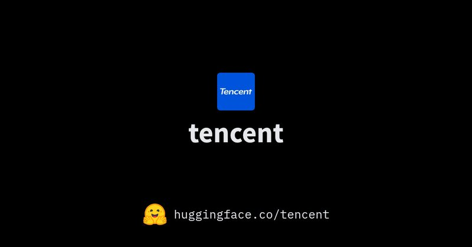

# 🐦 @_akhaliq

## 📅 November 04, 2026

> 5 post(s) archived.

---

### 🕐 14:40 UTC · @_akhaliq

> 🚀 Introducing HYPER3D Rigging. Rigging, now prompt-editable. Auto-rig humans, animals &amp; fantasy creatures, down to individual fingers☝🏻. 💬&quot;Add tail bones.&quot; Just ask. 250+ motion presets + animation controls. Rig. Refine. Animate. All in one place. Try it out⬇️ #3D #CG Media

🔗 [View original post](https://x.com/DeemosTech/status/2117990348198949375)

---

### 🕐 13:59 UTC · @_akhaliq

> We decoupled memory from the model. Living Brain is one persistent brain for ChatGPT, Claude, Cursor, Codex and your own agents. Write in one, retrieve in any. 92.2% on LoCoMo. 464ms median retrieval. Up to 22.6x fewer tokens per question. LLMs have parameters. Living Brain has plasticity. Media

🔗 [View original post](https://x.com/ladyxtel/status/2117980022250316282)

---

### 🕐 12:10 UTC · @_akhaliq

> MoviEdit makes long-form multi-shot video editing easy Edit a video with text or a single frame, and it re-renders every shot consistently. From Adobe Research &amp; KAIST. Media

🔗 [View original post](https://x.com/HuggingPapers/status/2117952698683171136)

---

### 🕐 11:39 UTC · @_akhaliq

> Weights coming soon👇 https://huggingface.co/tencent 👋Hy4 is here, new with vision. Firmly among the leading open models. More productive everywhere: finance, frontend, game, officework, research… Built responsibly, with cyber/biosecurity in mind. Try it out and let us know! 🔗：https://hy.tencent.ai/research/hy4?langVersion=en

🔗 [View original post](https://x.com/AdinaYakup/status/2117944942920155577)

---

### 🕐 00:16 UTC · @_akhaliq

> This is literally why we released the Pika H3 Flex weights. Less than 24 hours after we launched, @_akhaliq built a Turbo LoRA with 2-step draft generation. His release includes 4-step fast and 8-step HD variants, compatible with ComfyUI and Diffusers—and now lives under Pika-Labs on Hugging Face. We’re so proud to build alongside a community that keeps pushing what these models can do. Can’t wait to see what you make next. 🤗 https://huggingface.co/Pika-Labs/Pika-H3-Flex-Turbo-LoRA Meet Pika H3 Flex, debuting today as the #1 open weight model on DesignArena’s t2v board. It’s built for professional iteration, with exportable audio stems, resolutions up to 4k, and faster-than-realtime generation. It can produce a 15-second clip with soundtrack in as little a…

🔗 [View original post](https://x.com/pika_labs/status/2117772839642386856)

---
