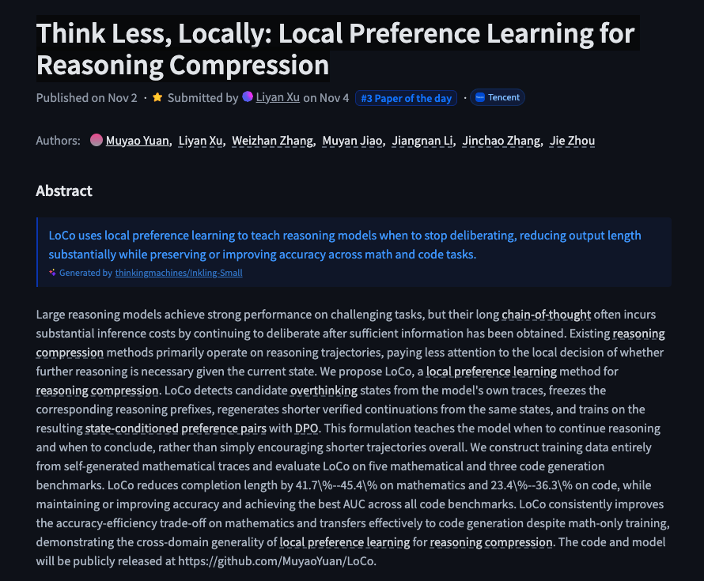
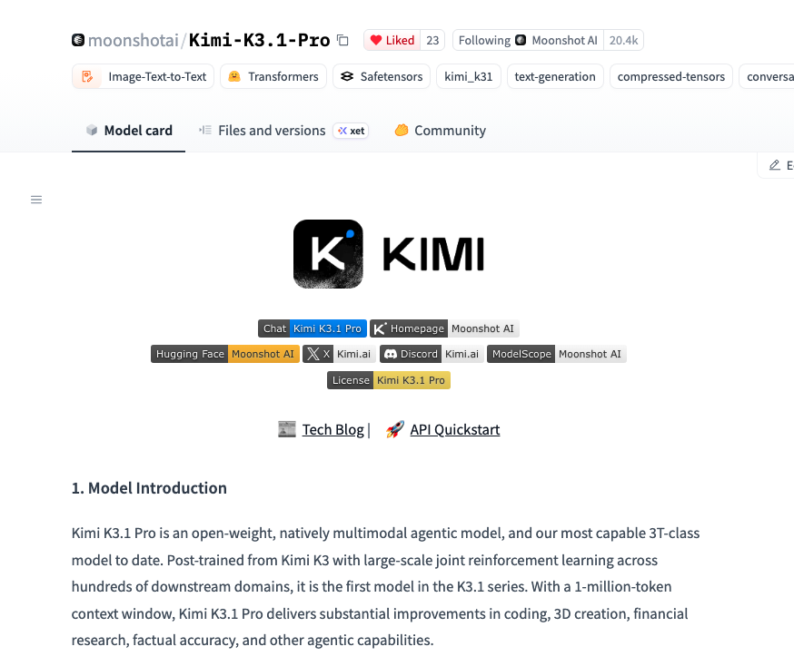
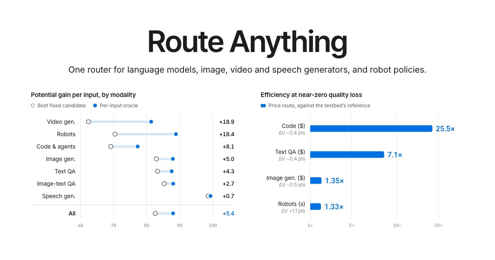

# 🐦 @_akhaliq

## 📅 November 04, 2026

> 11 post(s) archived.

---

### 🕐 20:32 UTC · @_akhaliq

> Think Less, Locally Local Preference Learning for Reasoning Compression paper: https://huggingface.co/papers/2611.04814

🔗 [View original post](https://x.com/_akhaliq/status/2118079011159195882)

---

### 🕐 19:16 UTC · @_akhaliq

> kimi k3.1 pro 3D worlds https://huggingface.co/spaces/akhaliq/kimi-3d-worlds Media

🔗 [View original post](https://x.com/_akhaliq/status/2118059786944369107)

---

### 🕐 16:30 UTC · @_akhaliq

> After Google acquired my AR startup, I started thinking about the next interface, this time for AI. Text and voice work fine, just like DOS did before the Mac. But nothing’s more intuitive than face to face. After two years of research, today we’re launching Atmee v2: a real-time avatar model that makes live video agents feel truly life-like. • Any character from 1 image + 10s of audio • Contextual expressions, gestures, even interacting with the environment • Live video calls, voice only, or video generation At its core, Atmee v2 is a video foundation model, it can render anything, but it’s built to excel at characters, which is what video models like Seedance 2.5 and Wan 3.0 are mostly used for. In comparison: Atmee v2 • Up to 50x faster • 10-100x cheaper Build tutors, sales coaches, support agents, companions, game characters, even whole living worlds. The interface after text and voice starts today. Media

🔗 [View original post](https://x.com/yuchenping/status/2118017931519078609)

---

### 🕐 15:41 UTC · @_akhaliq

> Kimi-K3.1-Pro just dropped on Hugging Face!! 🌝🚨 https://huggingface.co/moonshotai/Kimi-K3.1-Pro

🔗 [View original post](https://x.com/calebfahlgren/status/2118005728967332093)

---

### 🕐 15:10 UTC · @_akhaliq

> Microsoft released a new 4B model called Mage-VL-Cowork that sets a new SOTA for on-device computer use 🔥 I built a demo that lets you submit a task like &quot;Go to Wikipedia and find out when the Eiffel Tower was completed.&quot; Watch it click, type, scroll, and use a terminal on a real Linux desktop. The whole thing runs on @huggingface: the model in a Space, the desktop in an HF Sandbox. No VMs to manage. 🧵 Media

🔗 [View original post](https://x.com/NielsRogge/status/2117998047372202401)

---

### 🕐 14:40 UTC · @_akhaliq

> 🚀 Introducing HYPER3D Rigging. Rigging, now prompt-editable. Auto-rig humans, animals &amp; fantasy creatures, down to individual fingers☝🏻. 💬&quot;Add tail bones.&quot; Just ask. 250+ motion presets + animation controls. Rig. Refine. Animate. All in one place. Try it out⬇️ #3D #CG Media

🔗 [View original post](https://x.com/DeemosTech/status/2117990348198949375)

---

### 🕐 13:59 UTC · @_akhaliq

> We decoupled memory from the model. Living Brain is one persistent brain for ChatGPT, Claude, Cursor, Codex and your own agents. Write in one, retrieve in any. 92.2% on LoCoMo. 464ms median retrieval. Up to 22.6x fewer tokens per question. LLMs have parameters. Living Brain has plasticity. Media

🔗 [View original post](https://x.com/ladyxtel/status/2117980022250316282)

---

### 🕐 12:10 UTC · @_akhaliq

> MoviEdit makes long-form multi-shot video editing easy Edit a video with text or a single frame, and it re-renders every shot consistently. From Adobe Research &amp; KAIST. Media

🔗 [View original post](https://x.com/HuggingPapers/status/2117952698683171136)

---

### 🕐 11:39 UTC · @_akhaliq

> Weights coming soon👇 https://huggingface.co/tencent 👋Hy4 is here, new with vision. Firmly among the leading open models. More productive everywhere: finance, frontend, game, officework, research… Built responsibly, with cyber/biosecurity in mind. Try it out and let us know! 🔗：https://hy.tencent.ai/research/hy4?langVersion=en

🔗 [View original post](https://x.com/AdinaYakup/status/2117944942920155577)

---

### 🕐 08:09 UTC · @_akhaliq

> Route Anything One router for language models, image/video/speech generators, coding agents and robot policies: 374,401 scored runs across 25 benchmarks, and 8.82× average efficiency gain over a reference model.

🔗 [View original post](https://x.com/HuggingPapers/status/2117891957657829884)

---

### 🕐 00:16 UTC · @_akhaliq

> This is literally why we released the Pika H3 Flex weights. Less than 24 hours after we launched, @_akhaliq built a Turbo LoRA with 2-step draft generation. His release includes 4-step fast and 8-step HD variants, compatible with ComfyUI and Diffusers—and now lives under Pika-Labs on Hugging Face. We’re so proud to build alongside a community that keeps pushing what these models can do. Can’t wait to see what you make next. 🤗 https://huggingface.co/Pika-Labs/Pika-H3-Flex-Turbo-LoRA Meet Pika H3 Flex, debuting today as the #1 open weight model on DesignArena’s t2v board. It’s built for professional iteration, with exportable audio stems, resolutions up to 4k, and faster-than-realtime generation. It can produce a 15-second clip with soundtrack in as little a…

🔗 [View original post](https://x.com/pika_labs/status/2117772839642386856)

---
