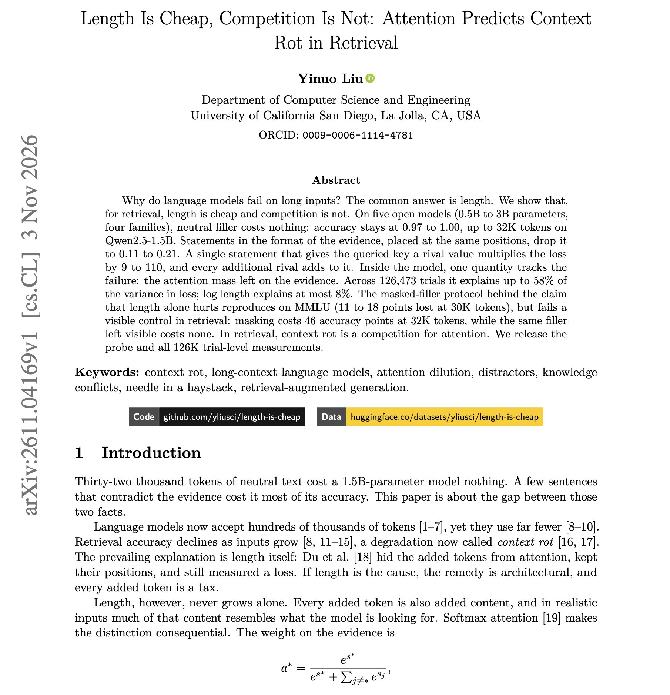
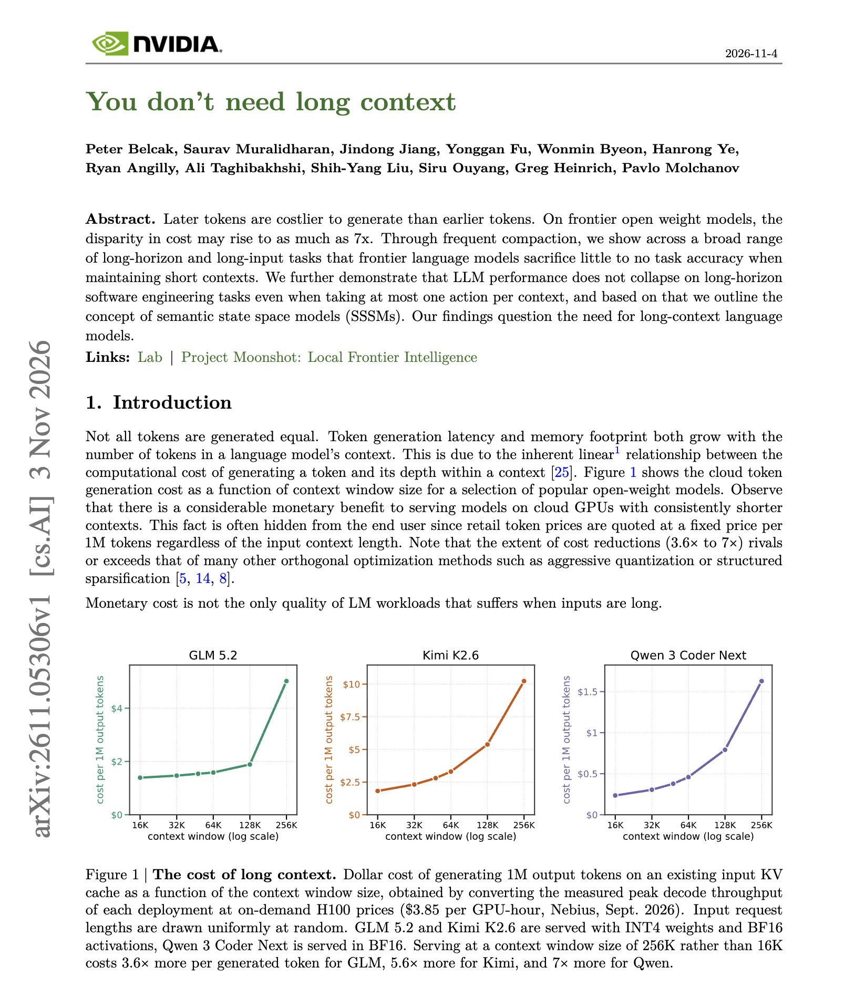

# 🐦 @dair_ai

## 📅 November 04, 2026

> 3 post(s) archived.

---

### 🕐 12:35 UTC · @dair_ai

> Great paper from UC San Diego on why long-context retrieval fails. (bookmark it) It also offers an interesting discussion of why context rot happens in LLMs. When a model fails on a long input, people usually blame the length. This paper finds that length alone does very little. Adding 32K tokens of unrelated text left accuracy at 97%-100% on Qwen2.5-1.5B. What hurts is text that looks like the answer. When the context also holds similar statements with wrong values, accuracy falls to between 16% and 33%. A single statement that gives a different value for the same question is enough to cause a large drop. The model fails when those statements pull its attention away from the correct passage. Across 126,473 trials, the amount of attention left on the correct passage explains up to 58% of the variation in errors. Input length explains at most 8%. For RAG and agent memory, dedupe and resolve conflicting statements before they reach the model. That matters more than trimming tokens. https://arxiv.org/abs/2611.04169 Chat with Paper: https://academy.dair.ai/papers/length-is-cheap-competition-is-not-attention-predicts-context-rot-in-retrieval-2611.04169

🔗 [View original post](https://x.com/dair_ai/status/2117958798841434118)

---

### 🕐 12:25 UTC · @dair_ai

> Highly recommended paper from NVIDIA. (bookmark it) There is a lot of debate about whether to use context compaction aggressively. They show that with frequent compaction, frontier language models lose little to no accuracy on a broad range of long-horizon and long-input tasks while keeping their context short. With one action per context, Claude Opus 4.5 scores 70.2 on SWE-bench Verified against 70.0 with the full history. Median peak context drops from 32K to 8K tokens. The agent carries a short summary of its state between steps instead of the whole transcript. Simple compaction at the end of a conversation often does better than the full history, and Opus goes from 70.0 to 74.8 with it. This also matters for cost. Later tokens cost more to generate than earlier ones, up to 7x on frontier open-weight models. The pattern holds on Terminal-Bench, FRAMES, BFCLv3 and multilingual SWE-bench, with modest losses in some settings. Before paying for million-token agent runs, it&apos;s worth testing aggressive compaction on your own tasks. https://arxiv.org/abs/2611.05306 Chat with Paper: https://academy.dair.ai/papers/you-dont-need-long-context-2611.05306

🔗 [View original post](https://x.com/omarsar0/status/2117956281910829083)

---

### 🕐 02:40 UTC · @dair_ai

> 🤯Another mind-blowing example (this time from the CTO of Legora) on Fable hand-writing weights of a model. This weight-space programming stuff is seriously some of the most exciting research I have seen in a long time. Got fable to hand-write weights of a 100k param model to recognize real versus fake legal citations. Basically one-shotted a full NN that’s better than training it

🔗 [View original post](https://x.com/omarsar0/status/2117809097474986382)

---
