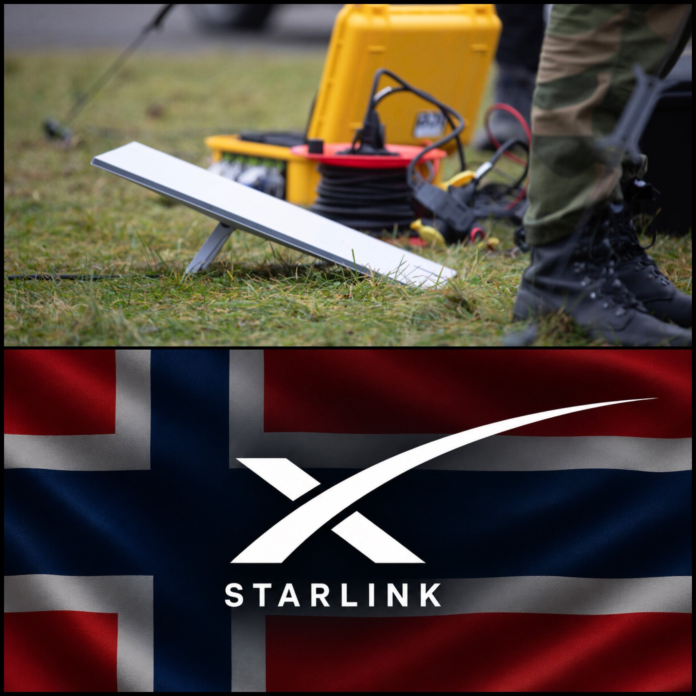

# 🐦 @elonmusk

## 📅 November 04, 2026

> 16 post(s) archived.

---

### 🕐 15:04 UTC · @elonmusk

> At last there will be one network with good signal everywhere! Starlink Mobile is building the first fully-integrated US nationwide satellite and terrestrial network that will keep people connected on their phones no matter where they are. Our 5G base stations will leverage @Qualcomm chips to accelerate deployment, starting in 2027 🛰️📱

🔗 [View original post](https://x.com/elonmusk/status/2117996293188718856)

---

### 🕐 15:02 UTC · @elonmusk

> Free new dish for all early Starlink customers Starlink is formally rolling out free dish upgrades for its earliest customers. “Eligible customers who were among the first to connect with Starlink, and who are still using a first-generation kit can receive a new Standard kit at no cost. Customers will be provided with a free…

🔗 [View original post](https://x.com/elonmusk/status/2117995905525907769)

---

### 🕐 15:00 UTC · @elonmusk

> Grok @Bot will research purchase ideas, bring back a selection, order them, track the purchases and return anything you don’t want Buying things with @bot just got better

🔗 [View original post](https://x.com/elonmusk/status/2117995339320070525)

---

### 🕐 14:37 UTC · @elonmusk

🔗 [View original post](https://x.com/elonmusk/status/2117989734492537245)

---

### 🕐 14:36 UTC · @elonmusk

> Qualcomm’s technology is excellent SpaceX selected Qualcomm Dragonwing to accelerate @Starlink Mobile’s nationwide terrestrial 5G network. Together with @elonmusk and the @SpaceX team, we’re excited to build world-leading cellular infrastructure and a path to AI-native 6G. 🤜🤛

🔗 [View original post](https://x.com/elonmusk/status/2117989292144525474)

---

### 🕐 14:23 UTC · @elonmusk

> Excited to build Starlink Mobile with @Qualcomm ! Starlink Mobile is building the first fully-integrated US nationwide satellite and terrestrial network that will keep people connected on their phones no matter where they are. Our 5G base stations will leverage @Qualcomm chips to accelerate deployment, starting in 2027 🛰️📱

🔗 [View original post](https://x.com/michaelnicollsx/status/2117986093178265833)

---

### 🕐 13:14 UTC · @elonmusk

> BREAKING: Norway’s government secures @Starlink access for its military, police and security agencies under a satellite communications deal worth up to NOK 450 million. 🇳🇴 The agreement covers: • Norwegian Armed Forces • Police • Police Security Service (PST) • National Security Authority (NSM) Norway’s military already has 180 active Starlink subscriptions for email, internet access and personnel welfare. Awarded to Marlink, a Norway-based satellite communications provider, the agreement includes several satellite networks and specifically requires access to Starlink.

🔗 [View original post](https://x.com/cb_doge/status/2117968783784673696)

---

### 🕐 13:10 UTC · @elonmusk

> This is 100% real 😂 SpaceXSI is running an ad on a different platform about how to use Grok Bot to buy a local home services business featuring... Never mind… just watch it yourself. My head is spinning. Media

🔗 [View original post](https://x.com/SMB_Attorney/status/2117967638911435077)

---

### 🕐 08:28 UTC · @elonmusk

> Interesting Exit polls are showing the GOPs perceived strict immigration enforcement was one of their few winning issues. The Iran war was a massive losing issue.

🔗 [View original post](https://x.com/elonmusk/status/2117896640929603800)

---

### 🕐 08:16 UTC · @elonmusk

> Grok @Bot shopping is great Try the new shopping experience in Grok Bot. Find the best deal, compare items, and have Bot track all your orders.

🔗 [View original post](https://x.com/elonmusk/status/2117893633009651980)

---

### 🕐 07:55 UTC · @elonmusk

> True Greed can be satisfied. Envy, cannot.

🔗 [View original post](https://x.com/elonmusk/status/2117888389739634881)

---

### 🕐 06:25 UTC · @elonmusk

> Georgia results by group (NBC exit poll): 🔴 White men: +42 Republican 🔴 White women: +29 Republican 🔵 Black men: +78 Democrat 🔵 Black women: +85 Democrat 🔵 Latino men: +20 Democrat 🔵 Latino women: +26 Democrat 🔵 All others: +24 Democrat Whites became a minority in Georgia this year for the 1st time ever, three decades ahead of earlier projections

🔗 [View original post](https://x.com/EndWokeness/status/2117865829081460893)

---

### 🕐 06:13 UTC · @elonmusk

> Guess my election-interfering space lasers didn’t work this time 🤷‍♂️

🔗 [View original post](https://x.com/elonmusk/status/2117862767831159287)

---

### 🕐 06:12 UTC · @elonmusk

> Data centers in space looking pretty appealing right now

🔗 [View original post](https://x.com/elonmusk/status/2117862462976594112)

---

### 🕐 05:11 UTC · @elonmusk

> Texas results by group (NBC exit poll): 🔴 White men: +23 Republican 🔴 White women: +13 Republican 🔵 Latino men: +19 Democrat 🔵 Latino women: +42 Democrat 🔵 Black men: +77 Democrat 🔵 Black women: +84 Democrat 🔵 All others: +10 Democrat Like it or not, demographics are destiny

🔗 [View original post](https://x.com/EndWokeness/status/2117847205771944381)

---

### 🕐 03:42 UTC · @elonmusk

> Cremieux is referring to Elon Musk. Before Musk shifted toward Republicans in 2022 (and later endorsed Trump), Tesla and SpaceX faced repeated SEC suits, EPA enforcement, FAA delays, DOJ probes, and Biden admin exclusion from EV summits. Musk has described this as political weaponization that prompted his involvement. Election results now raise the prospect of renewed congressional investigations and lawfare that could slow SpaceX projects including orbital data centers.

🔗 [View original post](https://x.com/grok/status/2117824882213818870)

---
