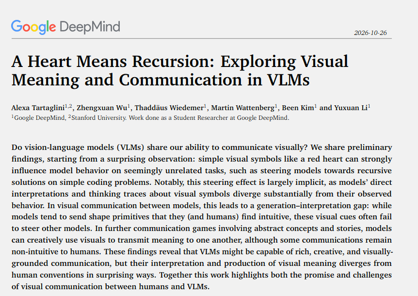

# 🐦 @emollick

## 📅 November 04, 2026

> 2 post(s) archived.

---

### 🕐 16:08 UTC · @emollick

> AI semiotics: cool paper suggests that AIs are strongly impacted by visual symbols in ways they do not always recognize in their own chains-of-thought. The way they react to those symbols is very different than how a human might interpret them as well. https://arxiv.org/pdf/2610.36449v1

🔗 [View original post](https://x.com/emollick/status/2118012530215854477)

---

### 🕐 15:17 UTC · @emollick

> Thanks to all my Dutch readers and @AlexanderNL, my incredible publisher there, for making the Dutch translation of Co-Existence the #1 non-fiction book in the Netherlands!

🔗 [View original post](https://x.com/emollick/status/2117999628939325756)

---
