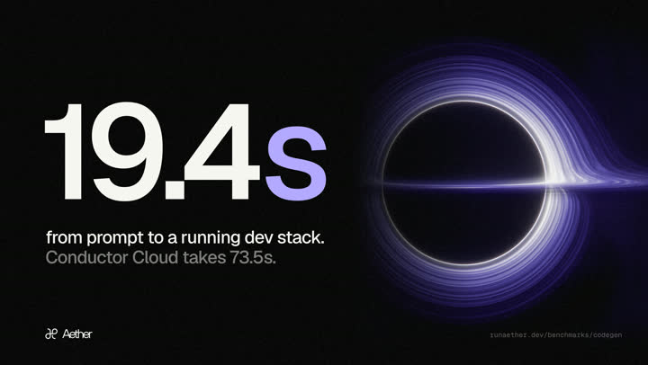

# 🐦 @omarsar0

## 📅 November 04, 2026

> 6 post(s) archived.

---

### 🕐 18:31 UTC · @omarsar0

> We just made a 5x cheaper Higgsfield. Voyager gives you AI video models like Seedance 2.5 at half Higgsfield’s price. More importantly, it cuts wasted generations. Users get final outputs in 2–3x fewer API calls. Half the price per generation. A fraction of the generations. Media

🔗 [View original post](https://x.com/anvisha/status/2118048598957109303)

---

### 🕐 18:28 UTC · @omarsar0

> Impressive work from @pranavctl on cloud coding agents. It&apos;s the fastest cloud coding agent: 19.4s from prompt to a running stack, and the benchmark is public. It runs Claude Code, Codex, and OpenCode on isolated cloud machines you watch and steer live, on the Claude or ChatGPT plan you already have. I build a lot with coding agents. Being able to watch a run live and drop into the same machine over SSH is what I&apos;d actually use. Today we’re introducing Aether @aetherruntime. The fastest cloud coding agents in the world that you can use with your existing subscription Give it a task and just 20 seconds later your build is running on its own cloud machine. You can pick up from your phone, watch every line…

🔗 [View original post](https://x.com/omarsar0/status/2118047813611233661)

---

### 🕐 17:22 UTC · @omarsar0

> Huge release for AI and math! Many people assume AI-generated code at scale means low quality. Axiom&apos;s new Stacks Project formalization in Lean says otherwise. The Stacks Project is a massive, deeply interconnected foundation for modern algebraic geometry. They turned it into machine-checkable code and kept that structure intact. AI agents now have a reusable foundation to build new math on. Most think vibecoding at scale is slop. Here’s a counterexample. Today we release a 16M-line formalization of the entire Stacks Project, critical infra underlying modern math, with optimized code quality and its highly interconnected structure preserved. A mathematical city 🌆

🔗 [View original post](https://x.com/omarsar0/status/2118031199255879758)

---

### 🕐 16:48 UTC · @omarsar0

> Huge market about to unlock here! Atmee v2 is a real-time avatar model for live video agents. It creates any character from one image and 10 seconds of audio. They report that it runs up to 50x faster than video models like Seedance 2.5 and Wan 3.0. Text and voice work well today. Talking to an agent face-to-face feels a lot more natural, especially for tutors, coaches, and support agents. After Google acquired my AR startup, I started thinking about the next interface, this time for AI. Text and voice work fine, just like DOS did before the Mac. But nothing’s more intuitive than face to face. After two years of research, today we’re launching Atmee v2: a real-tim…

🔗 [View original post](https://x.com/omarsar0/status/2118022631987220959)

---

### 🕐 15:56 UTC · @omarsar0

> Since most harnesses today use some form of context compaction, I would like to see more measurement around it. It&apos;s become even more important with longer-running tasks and multi-agent systems. I really don&apos;t trust the built-in auto-compaction mechanisms. I have built my own auto-compaction, optimized heavily for my tasks and frequently assessed.

🔗 [View original post](https://x.com/omarsar0/status/2118009615434535037)

---

### 🕐 14:15 UTC · @omarsar0

> An effective memory system lets a harness leverage agents&apos; persistent capabilities. So decoupling memory from the model is smart. Living Brain gives ChatGPT, Claude, Cursor, Codex, and your own agents one shared persistent memory. They report 92.2% on LoCoMo, with a 464ms median retrieval time. It also uses up to 22.6x fewer tokens per question. We decoupled memory from the model. Living Brain is one persistent brain for ChatGPT, Claude, Cursor, Codex and your own agents. Write in one, retrieve in any. 92.2% on LoCoMo. 464ms median retrieval. Up to 22.6x fewer tokens per question. LLMs have parameters. Living Brain has …

🔗 [View original post](https://x.com/omarsar0/status/2117983990099452018)

---
