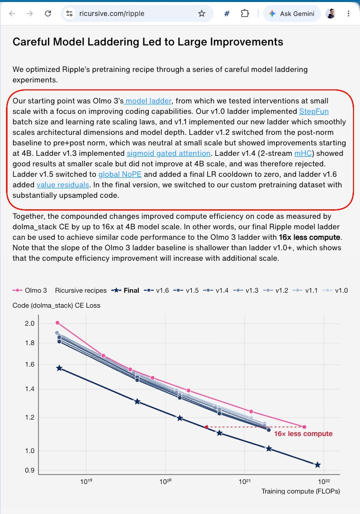
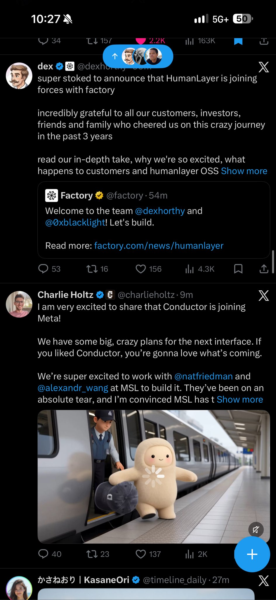
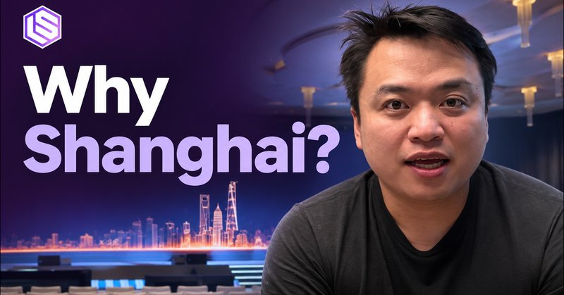

# 🐦 @swyx

## 📅 November 04, 2026

> 7 post(s) archived.

---

### 🕐 21:59 UTC · @swyx

> ran into theo last night at @FireworksAI_HQ forge and yea he&apos;s not kidding its both dumb and a banger 50b783df7d2c335500f1b6206d52649c69fb51931a0d616bfa2e299778588511a2ea894496cff26ba08ca8c7a81f64796f30d0efd9d914b32d3a5c639fd45125 About to vaguepost harder than I ever have vagueposted in my life. I&apos;m so sorry. I promise this will make sense in a few weeks. &quot;Bellwether&quot;

🔗 [View original post](https://x.com/swyx/status/2118100752732418268)

---

### 🕐 20:11 UTC · @swyx

> &gt; we developed and trained Ripple-65B Preview for only $32M, which is one-tenth the cost of the previous open-weight SOTA on agentic coding¹ this is like the avengers of open model SOTA ¹ &quot;Note that $32M is our full R&amp;D cost starting from scratch, including pretraining ladder development, data mixing, evals, debugging, synthetic data generation, posttraining recipe development, and the final hero pretraining and posttraining run.&quot; Today we release Ripple-65B Preview, our 65B dense LLM we pretrained from scratch. Ripple sets a new state-of-the-art for U.S. open-weight models in agentic coding tasks, surpassing significantly larger models including Muse Spark Open-816B, Beam-501B, Inkling-975B, and Nemotron…

🔗 [View original post](https://x.com/swyx/status/2118073650356384239)

---

### 🕐 20:00 UTC · @swyx

> every fucking time https://x.com/goodalexander/status/2118070067829014835?a=J_dML5HTjH5zSBm2OII&amp;s=20 @swyx @samlambert mcrib wasn&apos;t priced in btw

🔗 [View original post](https://x.com/swyx/status/2118070993747059066)

---

### 🕐 19:42 UTC · @swyx

> and yes my dms are a complete trash fire but i have hooked up high level people before and enjoy doing it for free, make sure u are actually category leader tho, market is very asymmetric

🔗 [View original post](https://x.com/swyx/status/2118066424996651505)

---

### 🕐 18:30 UTC · @swyx

> you thought i was kidding btw if you can build a category leader open source project in ai engineering right now the market acquihire rate is ~$10-$100m per ai engineer. you do not need to figure out a business model, you do not need GTM, you do not need funding. just build things clankers want.

🔗 [View original post](https://x.com/swyx/status/2118048180168483229)

---

### 🕐 10:49 UTC · @swyx

> ⚡ Behind Latent Space: from AI Substack to the first @aiDotEngineer in China 🇨🇳 https://www.youtube.com/watch?v=QmDLDy3ZSNE This time @Ninggao88 of Linkloud turns the mic around: asking @swyx how LS started, why “AI Engineering&quot; needed a name, and what’s different about the builder community in China. We also get into Kill My SaaS: agents could pass the entry checks, but choosing software we’d actually use took judgment about the organizer’s workflow. That gap between generating software and making a good product runs through the conversation, from conference tools to Legora and Thinking Machines. A special one for longtime listeners, with the original essays, demos and Chinese community posts on screen. Chapters on YouTube: 0:00 AIEi Shanghai 2:31 Cold open 3:28 The conversation with Galen 8:01 Learn in Public 10:54 How Latent Space started 13:05 The idea for AI Engineer 25:10 The conference as a dataset 29:57 Kill My SaaS 39:31 What the contest judge measured 46:45 Jev and System One models 52:49 Writing and founder stories 1:02:13 Legora and product taste 1:03:29 OpenClaw adoption in China 1:07:35 Thinking Machines and interaction models 1:10:02 Reading and listening recommendations

🔗 [View original post](https://x.com/latentspacepod/status/2117932116021588031)

---

### 🕐 00:01 UTC · @swyx

> excited to be heading back to SF next week for the @aiDotEngineer Code Summit. it only feels right after starting the year with @swyx and team @ AIE Europe in London to run it back for the first Code Summit in SF. hope to see lots of you there! oh and you&apos;ll see lots of the @GoogleDeepMind @GoogleAIStudio @antigravity crew at fun side events all week 👇

🔗 [View original post](https://x.com/vadiamit/status/2117769196469690765)

---
