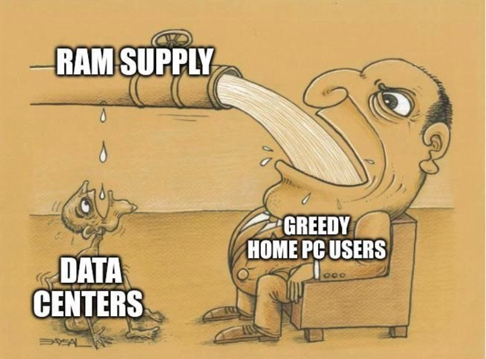

# 🐦 @tunguz

## 📅 November 04, 2026

> 6 post(s) archived.

---

### 🕐 20:39 UTC · @tunguz

> I hope the trials will be televised.

🔗 [View original post](https://x.com/tunguz/status/2118080733914829127)

---

### 🕐 20:18 UTC · @tunguz

🔗 [View original post](https://x.com/tunguz/status/2118075316736495856)

---

### 🕐 18:42 UTC · @tunguz

> Those greedy local AI fanatics. 🤬😡

🔗 [View original post](https://x.com/tunguz/status/2118051184779076026)

---

### 🕐 17:58 UTC · @tunguz

> 🤝

🔗 [View original post](https://x.com/tunguz/status/2118040241101754681)

---

### 🕐 17:51 UTC · @tunguz

> Three of my favorite things: 1. XGBoost 2. Gary, Indiana 3. Yes

🔗 [View original post](https://x.com/tunguz/status/2118038489828929808)

---

### 🕐 13:43 UTC · @tunguz

> Here is a project that I am *REALLY* excited about: xgboost-metal - Apple GPU accelerated XGBoost. Building on the original project and in collaboration with @bingxu_ and @int21_ai, we have ported XGBoost to Metal so that it can fully benefit from Apple Silicon, and Apple GPUs in particular. Go check it out, and let me know what you think! Introducing xgboost-metal 🚀 GPU-accelerated gradient boosting for Apple silicon, using the familiar XGBoost Python API. Train, predict, evaluate models, and compute feature contributions on your Mac’s GPU. 1/6

🔗 [View original post](https://x.com/tunguz/status/2117975982183272704)

---
