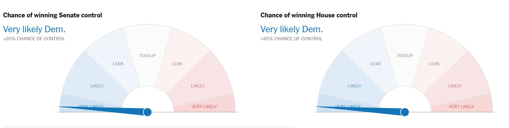

# 🐦 @ylecun

## 📅 November 04, 2026

> 2 post(s) archived.

---

### 🕐 02:51 UTC · @ylecun

> This is the current NY Times forecast. Incredible!

🔗 [View original post](https://x.com/KenRoth/status/2117811890437189826)

---

### 🕐 01:33 UTC · @ylecun

> @ylecun is certainly one of the few true thinkers and innovators in today’s overhyped AI landscape. He is brave to say something unpopular, but at the same time this is not without reason; all his thoughts come from math and physics, and he is one of the few researchers I have seen who can derive everything from basic formulas. He is now beginning the next chapter with @amilabs, a bold move, and I’m happy he can come to Singapore to inspire NTU students. I’m also always grateful for the chance to join him @amilabs on his journey toward the next level of intelligence. I&apos;ve just attended a talk by Yann LeCun! Basically he explored jepa from many angles, from the math behind it to its applications in robotic

🔗 [View original post](https://x.com/Brian_Bo_Li/status/2117792254693925001)

---
