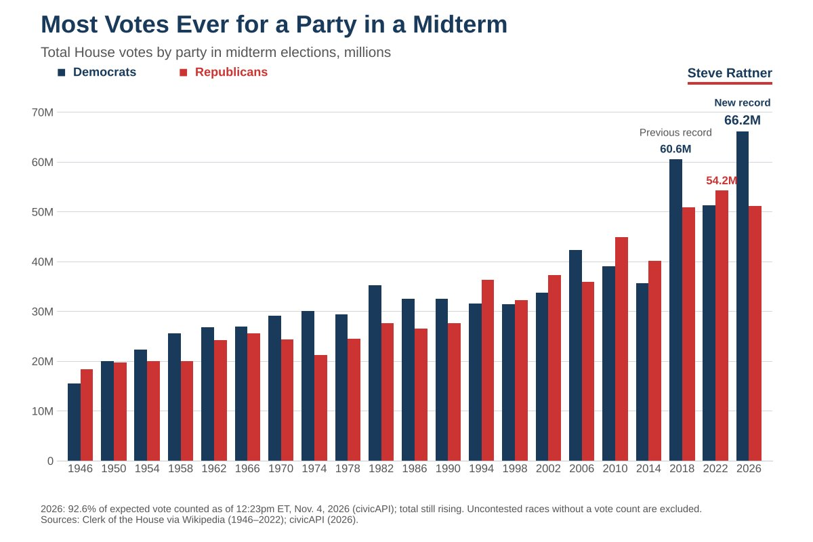
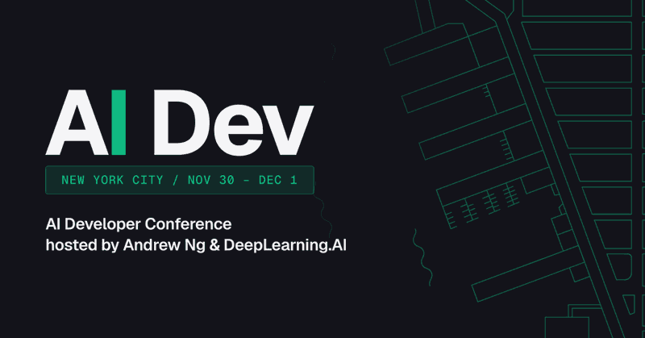
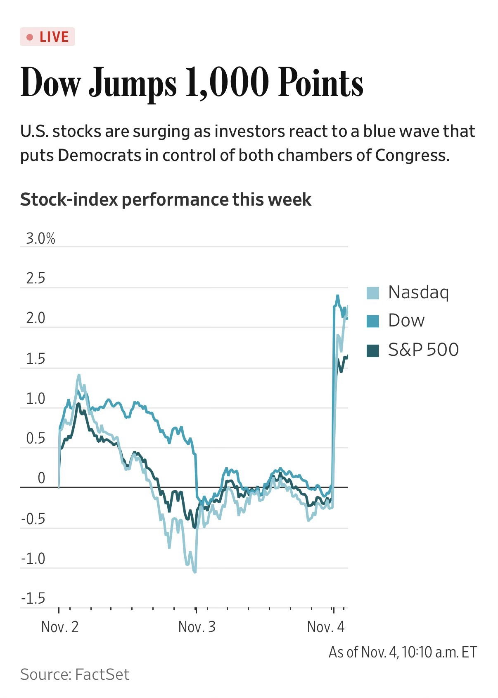
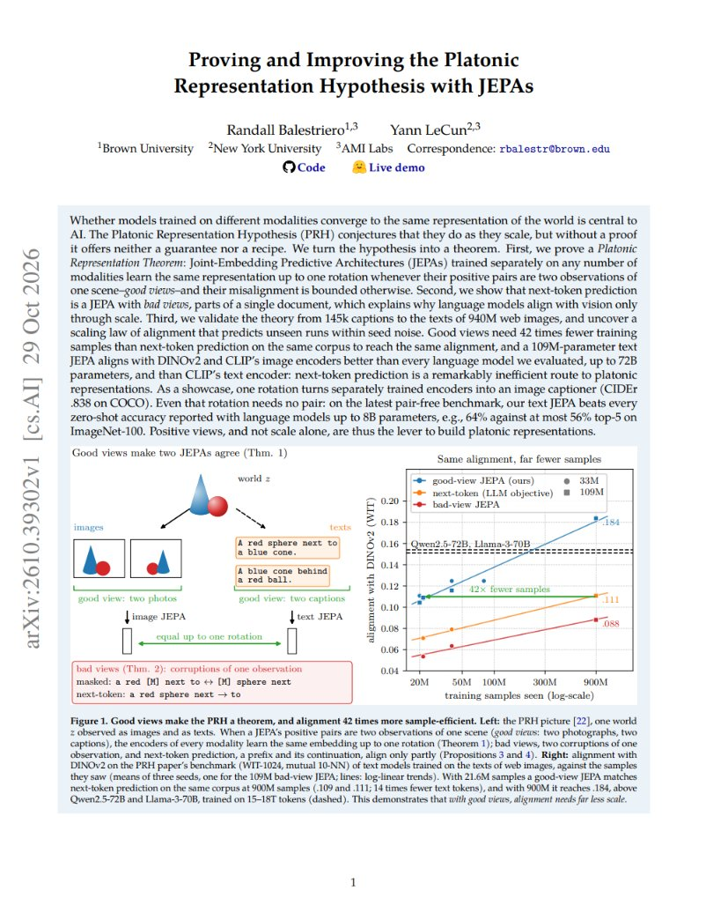
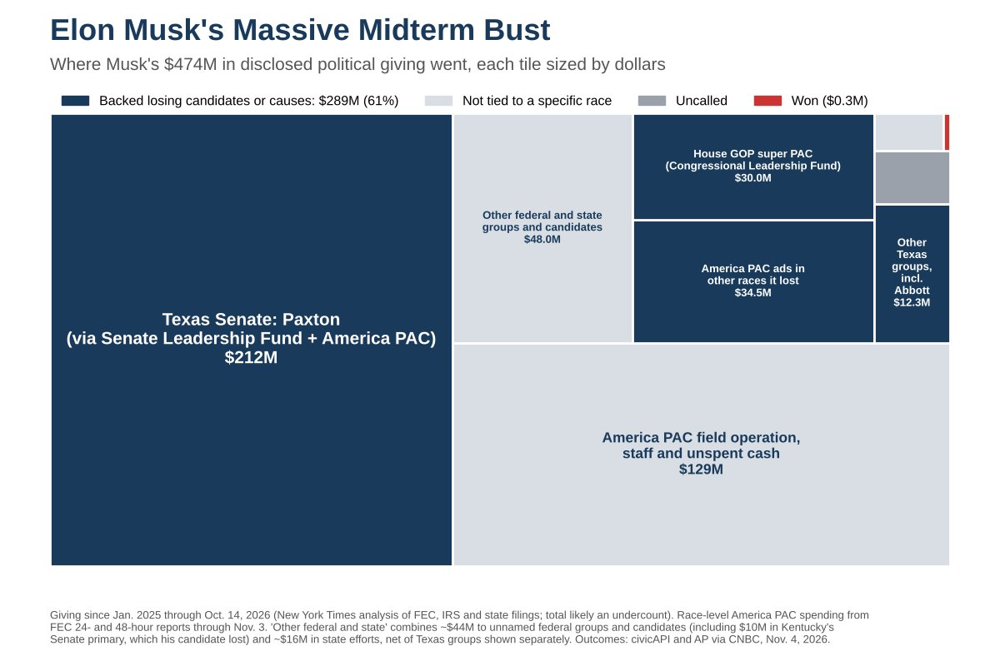

# 🐦 @ylecun

## 📅 November 04, 2026

> 11 post(s) archived.

---

### 🕐 22:45 UTC · @ylecun

> Introducing ID-WM: a hierarchical world model that decouples &quot;where to go&quot; from &quot;how to get there.&quot; Finally, we can plan over hundreds to thousands of steps with WMs. It beats the strongest baseline by 38.5%, single-level WMs by 135%. #NeurIPS2026 🧵 https://id-wm.github.io Media

🔗 [View original post](https://x.com/GaoyueZhou/status/2118112548205793551)

---

### 🕐 20:56 UTC · @ylecun

> Democrats have won more votes than any party in midterm history: 66 million and counting.

🔗 [View original post](https://x.com/SteveRattner/status/2118084892441669839)

---

### 🕐 19:56 UTC · @ylecun

> Join me and 2000 other AI engineers and builders at AI Dev in New York City, Nov 30-Dec 1! A LinkedIn study found that over July-September, the job title AI Engineer has been one of the 10 fastest-growing occupations in seven major economies. AI engineering has become a core skill for all software work, and AI Dev is designed to help you develop it. Our sessions give you hands-on practice with: - Coding agents and harness design: Harness tuning, repository context, autonomous coding - Agent memory and knowledge graphs: GraphRAG, vector search, persistent memory, hybrid retrieval - Agents in production: Evals, observability, simulated testing, browser and voice agents @ylecun and I will also talk about what’s next in world models and physical AI. I hope to see you there! Tickets: https://ai-dev.deeplearning.ai/

🔗 [View original post](https://x.com/AndrewYNg/status/2118069849142558737)

---

### 🕐 18:33 UTC · @ylecun

> Narrative violation?

🔗 [View original post](https://x.com/reidhoffman/status/2118048887110070387)

---

### 🕐 18:29 UTC · @ylecun

> 1/ A 109M text model trained with good views matched next-token prediction with 42x fewer samples on WIT-1024 (.109 at 21.6M samples vs .111 at 900M). Scaled up, it reached .184 mutual 10-NN with DINOv2, outscoring Qwen2.5-72B (.154) and Llama-3-70B (.151). 🧵

🔗 [View original post](https://x.com/che_shr_cat/status/2118048031396561384)

---

### 🕐 17:24 UTC · @ylecun

> Now we&apos;ll finally learn what&apos;s in the Epstein files. Mike Johnson is no longer in a position to shut down the House in order to prevent votes on measures to force their release. It&apos;s time. It&apos;s past time.

🔗 [View original post](https://x.com/paulg/status/2118031557470626292)

---

### 🕐 16:09 UTC · @ylecun

> Elon Musk dropped nearly half a billion dollars on the midterms. 98% of the money he spent on specific candidates went to losers.

🔗 [View original post](https://x.com/SteveRattner/status/2118012791592218928)

---

### 🕐 13:30 UTC · @ylecun

> Remember one thing when you read JEPA vs LLMs in the context of the platonic representation hypothesis. Hidden state of an LLM does not represent the full representation of the LLM, it carries only what is needed for the next token. It&apos;s not an encoder.

🔗 [View original post](https://x.com/antirez/status/2117972868952989767)

---

### 🕐 03:23 UTC · @ylecun

> Plot twist: I was Vapnik&apos;s Department Head between 1996 and 2002, and made sure he had the space, resources, and collaborators to do his best work. To people who think I&apos;m dogmatic: I famously disagreed with Vapnik about the best way forward in ML, but did what I could to promote his work, because research is about exploration and science is about results.

🔗 [View original post](https://x.com/ylecun/status/2117819936525721844)

---

### 🕐 02:51 UTC · @ylecun

> This is the current NY Times forecast. Incredible!

🔗 [View original post](https://x.com/KenRoth/status/2117811890437189826)

---

### 🕐 01:33 UTC · @ylecun

> @ylecun is certainly one of the few true thinkers and innovators in today’s overhyped AI landscape. He is brave to say something unpopular, but at the same time this is not without reason; all his thoughts come from math and physics, and he is one of the few researchers I have seen who can derive everything from basic formulas. He is now beginning the next chapter with @amilabs, a bold move, and I’m happy he can come to Singapore to inspire NTU students. I’m also always grateful for the chance to join him @amilabs on his journey toward the next level of intelligence. I&apos;ve just attended a talk by Yann LeCun! Basically he explored jepa from many angles, from the math behind it to its applications in robotic

🔗 [View original post](https://x.com/Brian_Bo_Li/status/2117792254693925001)

---
