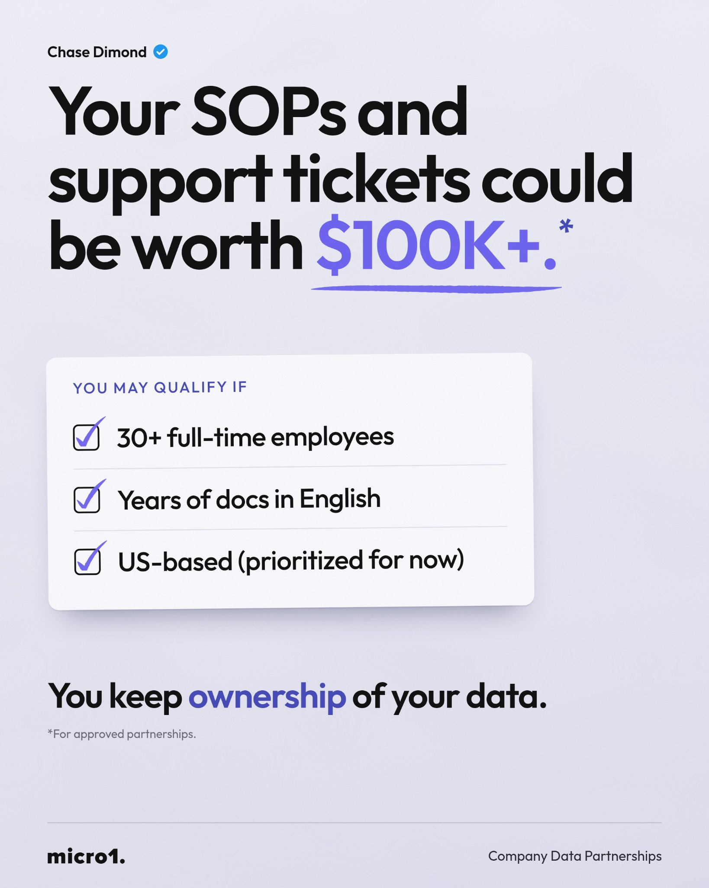
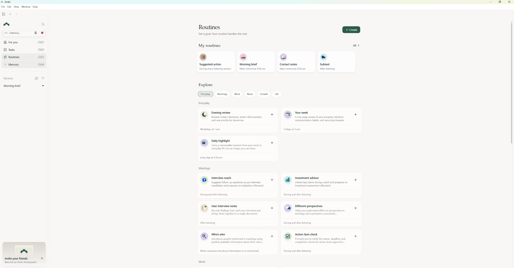

# 🐦 @AiEvolutio58513

## 📅 November 05, 2026

> 10 post(s) archived.

---

### 🕐 16:28 UTC · @AiEvolutio58513

> Sam Altman says the heaviest AI user on Earth six and a half years ago used about what the average person uses today: &quot;Six and a half years ago, the world token leader was an OpenAI employee using about 100,000 tokens a month.&quot; &quot;Now, the worldwide average of tokens per month, which I think tokens are the dumbest metric, but it&apos;s what we have. It&apos;s like 100,000.&quot; &quot;And the token leader at OpenAI uses something in the hundreds of billions.&quot; &quot;If that happens again, which I think it probably will, then in another six and a half years, the average person uses, let&apos;s say, 500 billion tokens a month.&quot; That is a five-million-fold jump in everyday AI use in under seven years. Interested in AI? Follow @AiEvolutio58513 and never fall behind. I track ChatGPT, Claude, and every tool quietly changing how we work and create, then hand you the tested signals. Media

🔗 [View original post](https://x.com/AiEvolutio58513/status/2118379844832817462)

---

### 🕐 16:12 UTC · @AiEvolutio58513

> Your company&apos;s SOPs, support tickets, and internal docs could be worth six figures. If your business has 30+ full-time employees, you may already have something valuable to AI companies. Think about all the situations your team has documented over the years: - How to train new hires - When to approve an exception - How to resolve complicated customer issues - What to do when a process breaks Those answers are sitting in SOPs, CRM records, support tickets, project histories, and internal knowledge bases. What&apos;s valuable is the decision-making behind them. These records show how people handle real situations, including the ones that don&apos;t follow the usual playbook. And that&apos;s useful for training AI agents to handle actual business tasks. That&apos;s the idea behind @micro1_ai&apos;s Company Data Partnerships program. micro1 pays qualifying businesses to license operational data they already have. For approved partnerships, payments start at $100K+ and can go higher depending on the amount, quality, and uniqueness of the data. Companies keep ownership of their underlying data. And micro1 says personal and identifying information is removed or transformed before the data is shared with third parties. They&apos;re looking across industries for established businesses with substantial English-language documentation. If that sounds like your company, it&apos;s worth seeing if you qualify: https://company.micro1.ai/register/?referralCode=72108c0b-3efa-456b-8b70-4a75fcc3565b&amp;utm_source=referral&amp;utm_medium=share&amp;utm_campaign=job_referral

🔗 [View original post](https://x.com/ecomchasedimond/status/2118375953072308653)

---

### 🕐 15:33 UTC · @AiEvolutio58513

> What surprised me most about emailing Viktor: he replies only to people already on the thread and never sends cold emails. I can cc him without worrying. Just email viktor@viktor.com @viktor_com Paid Partnership Starting today, anyone with an email address can have their own AI employee. Free to start. @viktor_com started in Slack. Now Viktor has an email address, so billions of people can reach it. Just email viktor@viktor.com to get started. Put Viktor on cc to book a meeting. Or forw…

🔗 [View original post](https://x.com/ecomchasedimond/status/2118366136433811612)

---

### 🕐 15:22 UTC · @AiEvolutio58513

> If you save useful research and rarely revisit it, Recall is worth exploring. Ambi is opening access in stages. Use my invitation link below to request access. Once you have access, you can start a 7-day free trial. Its first hardware is planned for early 2027. Try it: https://ambi.ai/i/USZYTU?utm_source=linkedin&amp;utm_medium=kol&amp;utm_campaign=launch_1012&amp;utm_content=AIEvolution_thread #ad #ambi #AmbiLaunch

🔗 [View original post](https://x.com/AiEvolutio58513/status/2118363398169903610)

---

### 🕐 15:22 UTC · @AiEvolutio58513

> Say I&apos;m working on a newsletter about AI agents. If I&apos;d shared a launch breakdown with Ambi last week, Recall could bring it back with a note explaining why it fits today&apos;s topic. That&apos;s when I&apos;d actually want to see it again.

🔗 [View original post](https://x.com/AiEvolutio58513/status/2118363396601163900)

---

### 🕐 15:22 UTC · @AiEvolutio58513

> I save AI articles, launches, and threads throughout the week. When it&apos;s time to write my newsletter, too many are buried in bookmarks. @hello_ambi has a Routine called Recall that can resurface links you share with it when they&apos;re relevant.

🔗 [View original post](https://x.com/AiEvolutio58513/status/2118363390460735940)

---

### 🕐 14:58 UTC · @AiEvolutio58513

> Elon Musk reveals he flew to Moscow to buy real nuclear missiles before SpaceX existed: &quot;I went to Russia in like 2001 and 2002 to buy ICBMs, which is an adventure. You go and meet with Russian high command and say, I&apos;d like to buy some ICBMs.&quot; The plan wasn&apos;t what it sounds like: &quot;Not to nuke anyone, but as a result of arms reduction talks, they had to destroy a bunch of their big nuclear missiles. So I was like, well, how about we take two of those, minus the nuke, add an additional upper stage for Mars.&quot; The Russians had other ideas: &quot;It was kind of trippy, being in Moscow in 2001, negotiating with the Russian military to buy ICBMs. And they kept raising the price on me, which is the opposite of what a negotiation should do.&quot; He came home without the missiles and started SpaceX to build the rockets himself. Interested in AI? Follow @AiEvolutio58513 and never fall behind. I track ChatGPT, Claude, and every tool quietly changing how we work and create, then hand you the tested signals. Media

🔗 [View original post](https://x.com/AiEvolutio58513/status/2118357242714128444)

---

### 🕐 13:01 UTC · @AiEvolutio58513

> Chamath says Anthropic needs at least $200 billion just to survive the next correction: &quot;They need, in my estimate, at least $200 billion. If you want to be super safe, a quarter-trillion gets the job done.&quot; &quot;$150 billion at $1.5 trillion is not enough. $200 billion barely gets them a few gigawatts. That is the bottom-line math if Anthropic is going to go through and survive an eventual correction.&quot; Interested in AI? Follow @AiEvolutio58513 and never fall behind. I track ChatGPT, Claude, and every tool quietly changing how we work and create, then hand you the tested signals. Media

🔗 [View original post](https://x.com/AiEvolutio58513/status/2118327799606034727)

---

### 🕐 11:03 UTC · @AiEvolutio58513

> Elon Musk explains why he thinks phones, apps and operating systems will be gone within 5-6 years: &quot;We&apos;re not going to have a phone in the traditional sense. What we call a phone will really be an edge node for AI inference, for AI video inference&quot; &quot;There won&apos;t be operating systems. There won&apos;t be apps in the future. It&apos;ll just be a device that is there for the screen and audio&quot; &quot;You&apos;ll get everything through AI. Whatever you can think of, or really whatever the AI can anticipate you might want, it&apos;ll show you&quot; &quot;Most of what people consume in 5 or 6 years, maybe sooner than that, will be AI-generated content. Music, videos&quot; &quot;The phone will just display the pixels and make the sounds that it anticipates you would most like to receive&quot; Interested in AI? Follow @AiEvolutio58513 and never fall behind. I track ChatGPT, Claude, and every tool quietly changing how we work and create, then hand you the tested signals. Media

🔗 [View original post](https://x.com/AiEvolutio58513/status/2118298112527888641)

---

### 🕐 07:56 UTC · @AiEvolutio58513

> Joe Rogan thought it had to be a conspiracy theory: AI companies quietly buying millions of books, scanning them, and throwing the originals away. Then Jamie looked it up. ROGAN: &quot;Oh my god, it&apos;s true.&quot; Anthropic had a code name for it: &quot;Project Panama.&quot; The internal memo: &quot;Project Panama is our effort to destructively scan all the books in the world.&quot; &quot;We don&apos;t want it to be known that we are working on this.&quot; Rogan&apos;s reaction: &quot;The training data is other people&apos;s work. It&apos;s books. That&apos;s what&apos;s insane.&quot; How it played out: Anthropic bought millions of books, cut off the spines, scanned every page and discarded them. Authors sued in Bartz v. Anthropic. The judge ruled the scanning of purchased books was fair use. The pirated books were another story. Anthropic had also downloaded millions from pirate sites, and that part cost it $1.5 billion, the largest copyright settlement in US history. About $3,000 per pirated book. Interested in AI? Follow @AiEvolutio58513 and never fall behind. I track ChatGPT, Claude, and every tool quietly changing how we work and create, then hand you the tested signals. Media

🔗 [View original post](https://x.com/AiEvolutio58513/status/2118251064617324839)

---
