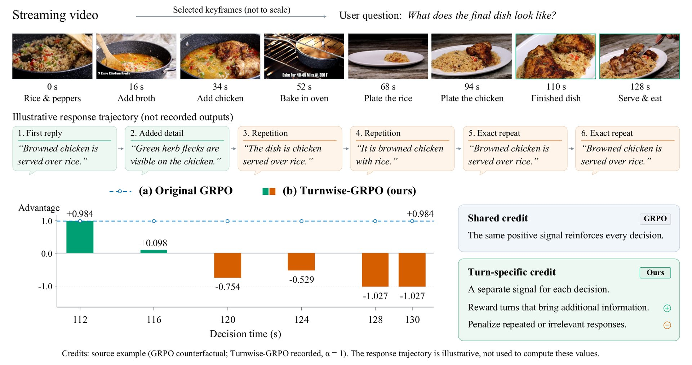
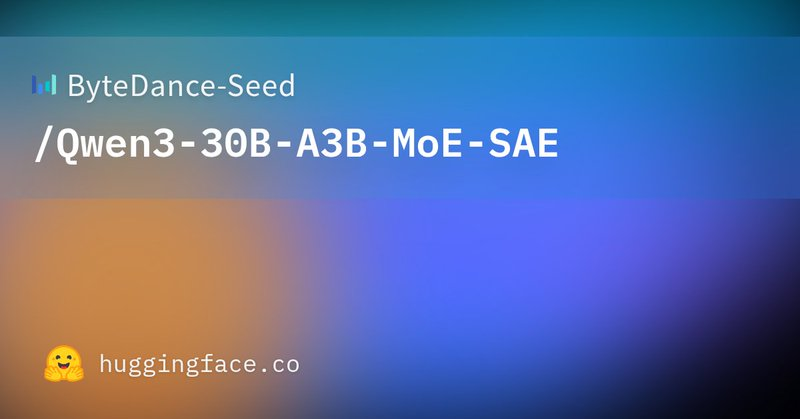

# 🐦 @_akhaliq

## 📅 November 05, 2026

> 6 post(s) archived.

---

### 🕐 19:47 UTC · @_akhaliq

> YOUR data deserves YOUR own, private model. Now, let @HuggingFace&apos;s ML Intern build it for you. Connect your data, files, mcps. And call it from Slack. Media

🔗 [View original post](https://x.com/abidlabs/status/2118429900134871418)

---

### 🕐 17:51 UTC · @_akhaliq

> From Pixels to Actions Towards Native Vision-Language-Action Policies paper: https://huggingface.co/papers/2611.06918 Media

🔗 [View original post](https://x.com/_akhaliq/status/2118400919637508576)

---

### 🕐 17:36 UTC · @_akhaliq

> Starting today, every engineer who joins Serval begins with a weeklong, $10,000 paid vacation. We’re building the next generational company. We need generational talent to see it through. Our mission has always been to empower people across every team to turn their understanding of a problem into working, trustworthy automations. Making that function inside the largest enterprises takes world-class engineering. That’s what you’d be joining us to do. There are foundational decisions still to make, and the engineers making them will shape the future of how big we can build this company. We want you to arrive rested and ready to do the best work of your life. So your first week is a chance to get away. And if a @getserval employee refers you, both you and that employee receive $30,000, on top of the vacation. Come build with us: https://www.serval.com/careers Media https://x.com/i/article/2118375976992227328

🔗 [View original post](https://x.com/AlexAtServal/status/2118396934566097349)

---

### 🕐 16:14 UTC · @_akhaliq

> Turns Matter for Streaming Video RL TurnWise is a new turn-level GRPO framework that gives each decision in a streaming conversation its own credit, improving when to answer vs. keep watching. It outperforms prior RL methods on three streaming benchmarks.

🔗 [View original post](https://x.com/HuggingPapers/status/2118376431721799824)

---

### 🕐 15:00 UTC · @_akhaliq

> What I&apos;m seeing across the industry right now is that the biggest bottleneck to AI adoption isn&apos;t model capabilities. It&apos;s data infrastructure. Today, we&apos;re expanding the Eon Data Foundation with the launch of Eon Yukon, a new serverless data engine purposely built to change that. AI agents need fresh, contextualized data to act. Specialized models need a continuous feed of data and feedback to improve. Both are still served by a stack, an architecture, and methods built for dashboards: -Spark and Flink clusters sized for peak, plus compaction jobs to keep tables usable. -A pipeline and a copy for every consumer, staged bronze to silver to gold. -Hand-written jobs, wired together by an orchestrator and kept alive by specialists. The result: shipping data is complicated, risky, and expensive. While coding agents ship apps in hours, they rarely build or run data pipelines. The data is too volatile, and a mistake costs too much. With Yukon, data moves from ingestion to processing to serving in one continuous flow, without the infrastructure and pipelines traditionally required to connect them. Events become compacted, sorted, deduplicated Iceberg tables within seconds. Real-time aggregations run inline, with fully managed state. Agents and applications can access fresh data with sub-millisecond latency through a Redis-compatible API or through our SQL and spark compatible query engine. Beyond moving and serving data, Yukon makes it continuously understandable - Live column-level statistics, accessible through MCP, give agents visibility into the data. Built-in monitoring, sampling, and data minimization help teams maintain control. At 1M events/sec and equal freshness, Yukon used 4x less compute than Spark and 7x less than Flink. The benchmark is public: run it yourself with Eon’s ingest-bench. This is another major step toward our vision of an Autonomous Data Foundation for the AI era, built to both protect enterprise data and unlock its full potential. Media

🔗 [View original post](https://x.com/OfirEhrlich/status/2118357800648659127)

---

### 🕐 14:06 UTC · @_akhaliq

> ByteDance just released sparse autoencoders for Qwen3-30B on Hugging Face These SAEs reveal that mixture-of-experts have fine-grained, interpretable specializations. https://huggingface.co/ByteDance-Seed/Qwen3-30B-A3B-MoE-SAE

🔗 [View original post](https://x.com/HuggingPapers/status/2118344119978451150)

---
