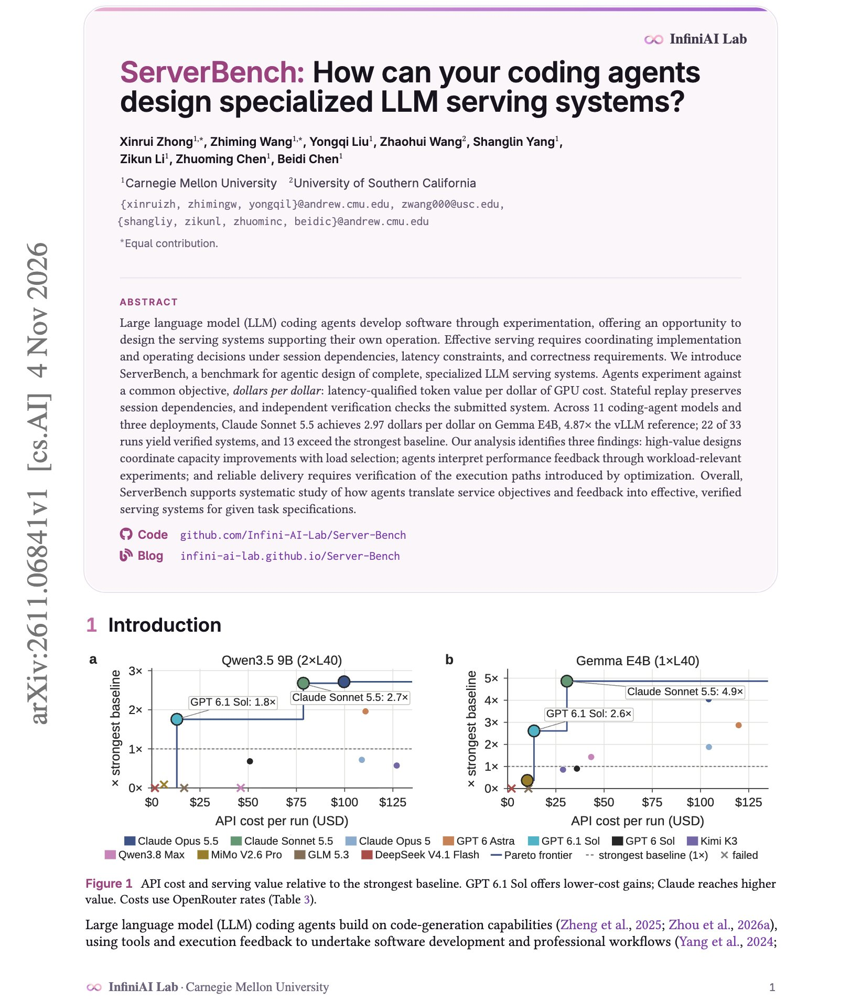
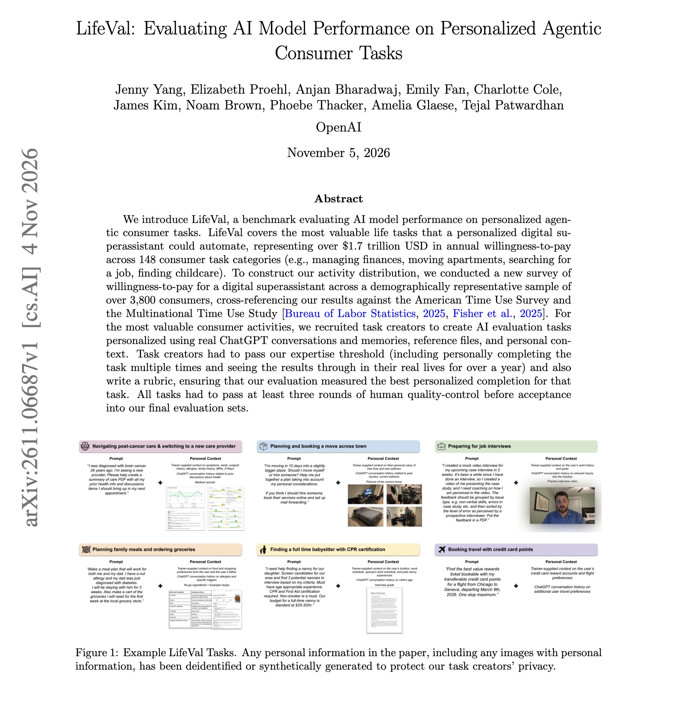

# 🐦 @dair_ai

## 📅 November 05, 2026

> 2 post(s) archived.

---

### 🕐 13:48 UTC · @dair_ai

> Impressive paper from CMU. Soon, we will have coding agents that can tune the entire stack, from prompts to token serving. This work experiments with coding agents to tune an LLM serving stack. They get Claude Sonnet 5.5 to build a serving system for Gemma E4B that delivers 4.87x the value per GPU dollar of the vLLM reference. ServerBench asks coding agents to design a complete, specialized serving system and decide how many concurrent sessions to run. The score is latency-qualified token value per dollar of GPU cost, measured by replaying real coding sessions with their dependencies intact. An independent check verifies the system works. Across 11 coding-agent models and three deployments, 22 of 33 runs produced a verified system and 13 beat the strongest baseline. The best designs raised capacity and chose the load to match it. Failed runs often shipped optimizations whose new code paths were never tested. https://arxiv.org/abs/2611.06841 Chat with Paper: https://academy.dair.ai/papers/serverbench-how-can-your-coding-agents-design-specialized-llm-serving-systems-2611.06841

🔗 [View original post](https://x.com/omarsar0/status/2118339557154504969)

---

### 🕐 13:41 UTC · @dair_ai

> Recommended benchmark from OpenAI on agents for everyday life tasks. They surveyed 3,837 US consumers to rank 148 life tasks by what people would pay an assistant to handle. Together, those tasks are worth over $1.7 trillion a year. LifeVal turns the most valuable of them into 169 agent tasks. Each one is written by someone who has done the task many times in real life, using their own ChatGPT conversations, memories, and files. The tasks include managing finances, moving apartments, searching for a job, and finding childcare. Every task comes with a rubric, a working environment and an offline copy of the web, and passes three rounds of human review. Scores rise steadily from GPT-5.2 to GPT-6 Astra. The most common failure for every model is a wrong answer or recommendation, often because the model missed a fact sitting in the user&apos;s past chats. On criteria tied only to past conversations, the win rate was 33%, compared with 48% for saved memories. If you build assistants with memory, test whether the agent actually finds what the user told it weeks ago. https://arxiv.org/abs/2611.06687 Chat with Paper: https://academy.dair.ai/papers/lifeval-evaluating-ai-model-performance-on-personalized-agentic-consumer-tasks-2611.06687

🔗 [View original post](https://x.com/dair_ai/status/2118337806120718495)

---
