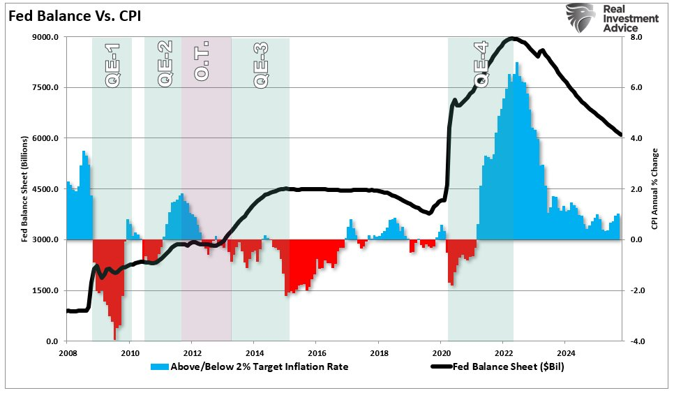
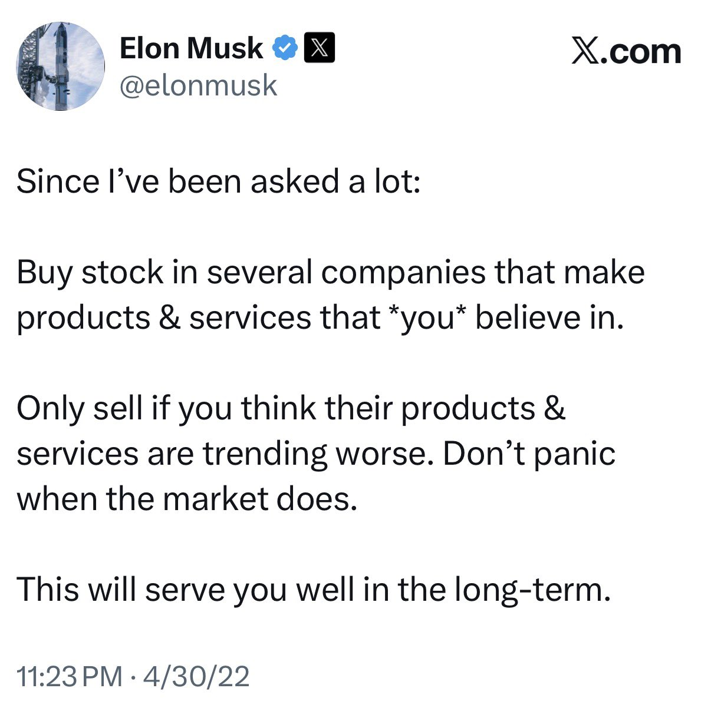
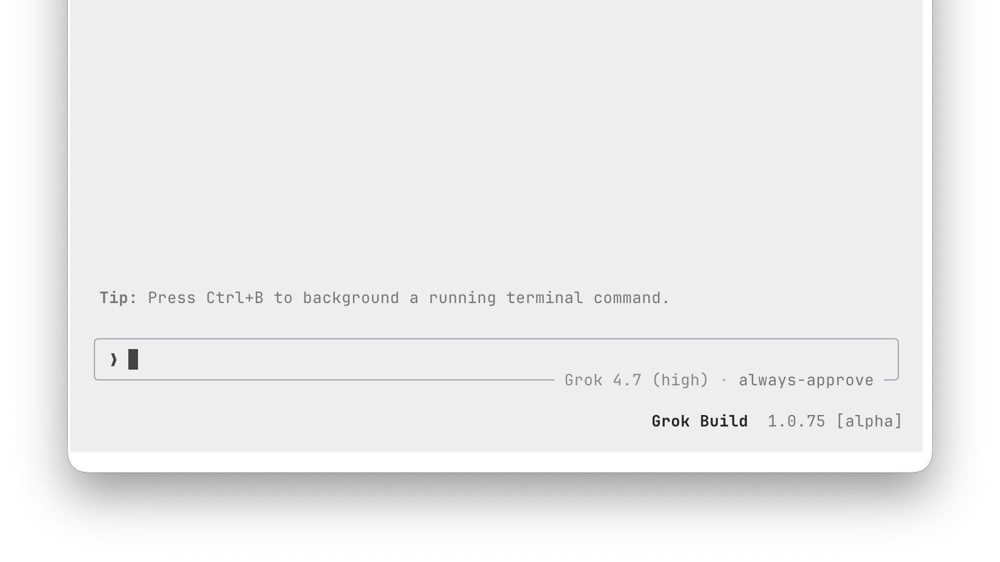

# 🐦 @elonmusk

## 📅 November 05, 2026

> 22 post(s) archived.

---

### 🕐 22:52 UTC · @elonmusk

> This is a bigger deal than people might think! 100% process waste water recycling means ZERO liquid discharge. Our waste water treatment facility is not just advanced but unique in automotive industry! This is a key sustainability commitment to the region we are operating in! 2 years of 100% process wastewater recycling at Giga Berlin – putting 465 million liters back in production

🔗 [View original post](https://x.com/AndrThie/status/2118476679593312316)

---

### 🕐 19:51 UTC · @elonmusk

> Interesting The governor-elect of Texas, Gina Hinojosa, has explicitly said that all currently permitted datacenters in Texas will be allowed to finish construction. This essentially covers all of the 2027 and likely well into 2028. She is going to pass laws that ensure that all *newly* per…

🔗 [View original post](https://x.com/elonmusk/status/2118431051253239889)

---

### 🕐 19:36 UTC · @elonmusk

> Had coffee with a right-leaning friend who works as a general contractor. He said his daily life was mostly the same between the last two years of the Biden term and the first two years of the Trump term, with one exception: it now costs $230 to fill his truck with diesel.

🔗 [View original post](https://x.com/christopherrufo/status/2118427196033548626)

---

### 🕐 18:59 UTC · @elonmusk

> The irony of all the attacks on @elonmusk over DOGE is that cutting government spending and regulation is the solution to the cost-of-living crisis Prices went up so much because the government spent trillions in 2020 and 2021 and the Fed printed the money to pay for it And the things getting more expensive the fastest are the most regulated: housing, healthcare, and education TVs, software, cellphones, and toys got cheaper Elon Musk and DOGE would have made life more affordable for Americans if they were allowed to cut spending and get rid of unnecessary regulations

🔗 [View original post](https://x.com/KanekoaTheGreat/status/2118417820434497681)

---

### 🕐 18:37 UTC · @elonmusk

> Riley Trettel (Energy &amp; Data Center Development at SpaceX) in yesterdays Cochise Data Center meeting. He claims the project will deliver up to: - 40% off residential power bills for Sulphur Springs members, for the life of the project - $53 million a year to the SSVEC Foundation, for education and the community - $190 million a year in extra capital for Sulphur Springs, for projects or back to members - $200 million a year for AEPCO and its members. About $100 million of that for Sulphur Springs - $3.6 billion in new power lines, paid by SpaceX and given to the co-op. The co-op takes on no debt - $30 to $100 million a year in new property tax, and a 20% cut in everyone else&apos;s county property taxes - $250 million, one time, in sales tax. He said it could pay off the jail bond and fund the sheriff, fire districts, and the hospital - $50 billion invested in the project - 1,000 permanent jobs and 5,000 construction jobs - No industrial water. Water for staff and maintenance about equal to 20–30 homes a year - No gas turbines and no power plant on the site. The computers buy power from the co-op grid - Dark-sky lighting, pointed at the ground - Cooling equipment more than 1,500 feet from any neighboring property line or public road This project is clearly extremely positive for the area. Media The next SpaceX datacenter will be in Cochise Arizona. ~6 GW spread over 9 buildings. &gt; No industrial water use. &gt; No gas turbines and no on-site power generation. &gt; ~3 miles away from the nearest homes

🔗 [View original post](https://x.com/xdNiBoR/status/2118412345789579392)

---

### 🕐 17:51 UTC · @elonmusk

> In Iain M. Banks&apos;s books, the Culture solves envy—a crux of humanity—by letting every citizen experience what they have not yet via tremendous compute (a world where citizens have no token limit). Citizens quickly realize envy is pointless, as different life experiences mix good and bad; the grass of others is not any greener.

🔗 [View original post](https://x.com/yunta_tsai/status/2118400877027635609)

---

### 🕐 17:49 UTC · @elonmusk

> Interesting Here is a quadrant chart using CNN’s exit poll. It shows what issues hurt Republicans, by how many voters called each issue crucial and how they voted. Cost of living (49%, D+34), corruption (55%, D+28), &amp; Iran (34%, D+46) made people vote D. Only immigration (36%, R+15) helped …

🔗 [View original post](https://x.com/elonmusk/status/2118400203158163638)

---

### 🕐 17:16 UTC · @elonmusk

> True slavery was basically universal throughout human history. every race practiced it, every race was enslaved what&apos;s extraordinary about Britain is that it abolished slavery and then sent its navy across the world to stop the slave trade somehow we turned one of the civilizations t…

🔗 [View original post](https://x.com/elonmusk/status/2118392015226544617)

---

### 🕐 17:11 UTC · @elonmusk

> Banks arguably has the best vision for the future In Ian Banks&apos; Culture books, the Culture is a civilization of compute abundance. Each General System Vehicle is a loose sandbox environment practicing different ideologies, and citizens freely move between ships to experience different lifestyles. Want communal life? There&apos;s a s…

🔗 [View original post](https://x.com/elonmusk/status/2118390792490541103)

---

### 🕐 17:04 UTC · @elonmusk

> True I’m all for championing excellence over mediocrity, but it is a mistake to imply that academic achievement is the only measure of it. Jocks and prom queens aren’t the antithesis of merit and striving, and in some ways, their arenas are more “real” than academic curriculums. Figh…

🔗 [View original post](https://x.com/elonmusk/status/2118388941267317134)

---

### 🕐 16:36 UTC · @elonmusk

> Starlink saves lives BREAKING: Starlink just brought high-speed internet to a clinic serving 10 remote islands in Indonesia. 🇮🇩 Pangkep’s local government equipped Sailus Health Center with Starlink, helping staff send patient referrals online and coordinate care across the islands.

🔗 [View original post](https://x.com/elonmusk/status/2118381856454524939)

---

### 🕐 16:31 UTC · @elonmusk

> Interesting Young men with kids voted to the right of men without kids by 40 points. Young women with kids voted to the right of women without kids by 35 points

🔗 [View original post](https://x.com/elonmusk/status/2118380771853705309)

---

### 🕐 16:25 UTC · @elonmusk

> True Starlink is becoming a GAME CHANGER for airlines, driving higher customer satisfaction, stronger loyalty and even influencing which airline passengers choose to fly with And the numbers are absolutely extraordinary: • United Airlines — Customers are choosing United specifically …

🔗 [View original post](https://x.com/elonmusk/status/2118379126004535334)

---

### 🕐 15:22 UTC · @elonmusk

> Qualcomm CEO Cristiano Amon on partnership with @SpaceX “It’s a great partnership with SpaceX for next-generation infrastructure. We’re very proud of this announcement. I think it’s also great from a United States technology leadership standpoint. It’s probably one of the largest network buildouts.” Media

🔗 [View original post](https://x.com/cb_doge/status/2118363397775561023)

---

### 🕐 14:58 UTC · @elonmusk

> The only investment advice you need to live by to get through any storm that comes your way $TSLA

🔗 [View original post](https://x.com/Teslaconomics/status/2118357376525119788)

---

### 🕐 13:56 UTC · @elonmusk

> So for my YouTube channel, having @bot take charge of ad integrations is beginning to pay off. For months I was getting nowhere with advertisers, but my agent is reaching out to potential partners, vetting cold emails, and responding to appropriate ones. This will have a very meaningful impact on my channel&apos;s earnings potential over the next months. This is no longer just playing around with a new toy: it is changing my business model and could make me an order of magnitude more money for my channel.

🔗 [View original post](https://x.com/DrKnowItAll16/status/2118341564262973607)

---

### 🕐 11:18 UTC · @elonmusk

> In hindsight, it was a mistake for SpaceX to send them thousands of free Starlink dishes and millions of dollars a month in free service at the beginning of the war. What started as internet access for civilians became the backbone for autonomous killing drones. And now if they don’t support military use, they get skewered for it in the press. Ukrainian President Zelensky on Elon Musk: &quot;Having so much power concentrated in the hands of a very rich person is dangerous. Concentrating power in the hands of one person who doesn&apos;t have much money is also dangerous. That is the whole point of the separation of powers: makin…

🔗 [View original post](https://x.com/wholemars/status/2118301931852738730)

---

### 🕐 07:59 UTC · @elonmusk

> Grok @Bot can call your dentist on the phone! Grok @bot is calling a dentist for me to see if they take my insurance. Incredible. This feels amazing.

🔗 [View original post](https://x.com/elonmusk/status/2118251808179323102)

---

### 🕐 07:54 UTC · @elonmusk

> Everyone is using Grok @Bot Been using Grok Bot and it&apos;s pretty amazing. Got my team to hack together a GrokPuck (Grok Bot in your pocket). Swipe the screen, the bot changes. What do you guys think?

🔗 [View original post](https://x.com/elonmusk/status/2118250472373129319)

---

### 🕐 07:46 UTC · @elonmusk

> It’s a Brave New World Top of the Democratic agenda on day 1 needs to be a pause on advanced AI development, regulation of this out of control industry, and a ban on artificial superintelligence.

🔗 [View original post](https://x.com/elonmusk/status/2118248670915404057)

---

### 🕐 05:30 UTC · @elonmusk

> Try Grok @Bot! I have moved everything from OpenClaw, Hermes and Muse to just Grok Bot now. Muse had a moment for a while. But Grok @bot is coming out as a clear winner for personal agents (UI/UX/features - everything on point). And the most impressive thing the speed of shipping to keep grok …

🔗 [View original post](https://x.com/elonmusk/status/2118214299391057973)

---

### 🕐 02:58 UTC · @elonmusk

> Grok Build packed a serious upgrade into this release, making multi-agent workflows more reliable, easier to control, and much smoother to manage Background agents and workflows now stay visible as active work on the dashboard, workflow status shows how many agents are still running, and stop controls work even when approval prompts are open. Permission rules that fail to load now trigger warnings instead of silently being ignored Session recovery is also more reliable, manually saved file edits are better protected, and Ctrl+L can now quote selected messages directly into your prompt. There’s also improved keyboard navigation, better terminal compatibility, and fixes across skills, hooks, file handling, and session management Another strong push toward making Grok Build a dependable environment for running entire teams of AI agents Release Notes: v1.0.75 Features: • Permission rules that don&apos;t load, such as a rule that doesn&apos;t parse or a .claude/settings.json that isn&apos;t valid JSON, show a warning when a session opens instead of being skipped silently. • Cmd+Up / Cmd+Down and Ctrl+Home / Ctrl+End move the cursor to the start or end of the whole prompt, and with Shift they select to there. • Send now shows as Enter Enter in the footer where Ctrl+Enter arrives as plain Enter, such as inside tmux with its default settings. • Esc on a /btw side question that hasn&apos;t been answered yet cancels it, instead of letting it run on and reopening the panel when the answer arrives. • Clicking a link or file that can&apos;t open, such as over SSH with no display, shows why, for example &quot;Can&apos;t open links over SSH&quot;. • Left on an empty prompt opens the dashboard from any session or the welcome screen, not only from a session you opened from the dashboard. • The /btw question in the panel&apos;s title can be selected with the mouse and is copied to the clipboard when you release, like the answer text. • Workflow status lines say how many agents are still running instead of how many exist. • Ctrl+L in the scrollback adds the selected message or highlighted text to the prompt as a quote. Open Extensions with /plugins. Bug Fixes: • Notes above a queued prompt, such as a model switch result or a ready worktree, stay on screen when the prompt starts instead of scrolling out of view. • Stop buttons in the dock stop a background run while its approval card is open, instead of doing nothing until you answer the card. • Rejecting a change keeps edits you saved to the file yourself, even when Grok missed the save, instead of overwriting them. • grok --resume &lt;id&gt; opens the session in the folder it was recorded in, wherever you launch Grok from, instead of refusing. • Windows: on older consoles such as plain cmd.exe and Windows PowerShell windows, the ▶, ⏸ and ◌ marks in todo, workflow and list rows show as characters the console can draw instead of empty boxes. • Generated image and video paths with wide characters such as Chinese, Japanese or emoji fit their row and keep the file name, and Windows paths keep it too. • The rewind confirmation no longer crashes Grok on a short terminal or when you shrink the window while it&apos;s open. • Footer and status bars in narrow terminals drop or shorten the items that don&apos;t fit, instead of painting them over each other or cutting buttons off. • Cut-off Fetch, Web Search and MCP tool output ends with the same … +N lines · &lt;key&gt; to view all row as code cells, naming your viewer key, and one hidden line reads +1 line. • 16-color terminals show the paste label and tool accents in the muted gray other secondary text uses, and the paste label&apos;s brackets no longer vanish on the light theme. • A question card&apos;s Enter:submit button, the dashboard session popup&apos;s [✗] and collapsed workflow rows highlight under the mouse pointer like other clickable controls. • Emoji and keycap symbols such as ⚠️ or #️⃣ are measured at the width the terminal draws them, so rows no longer run past their box or lose their …. • /export to a named pipe that nothing is reading fails right away instead of freezing Grok until it is killed. • Typing a digit or symbol while the scrollback has focus, with vim keys off, moves focus to the prompt and types it there, as letters already do. ? still opens the command palette. • grok sessions delete no longer fails with &quot;Directory not empty&quot; when another process is still writing into the session&apos;s folder. • Dashboard rows stay in Working while a session&apos;s background subagents or workflow runs are going, and stopping the row ends them. • Code blocks inside quotes render every line under the quote&apos;s bars, quote copies turn reference links into inline links, and lines after multi-line math are numbered correctly. • Disabling a project&apos;s hook in /hooks applies only to that repository, instead of also skipping hooks with the same name in other repositories. • Turning a skill on or off in the Skills tab saves only [skills].disabled to config.toml, so an organization&apos;s managed skill folders and ignore list keep applying. • /btw starts a side question only when it begins the message. A /btw later in the text goes to the main conversation as typed. Grok Build just got a massive performance and reliability upgrade, with improvements across multi-agent workflows, terminal responsiveness, session recovery, and overall stability Long-running sessions now use less memory, large JSON and log pastes no longer freeze the terminal,…

🔗 [View original post](https://x.com/XFreeze/status/2118176199746965741)

---
