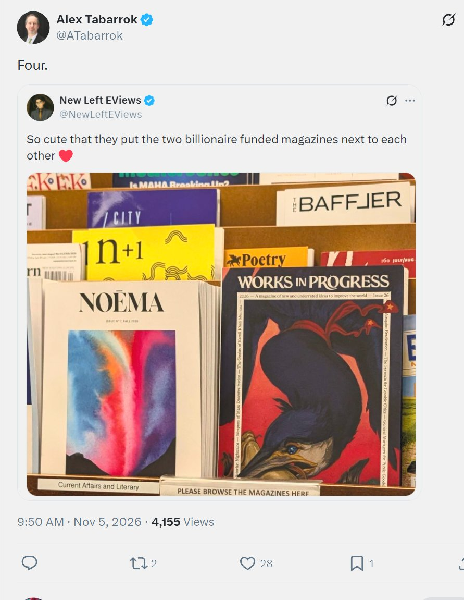

# 🐦 @emollick

## 📅 November 05, 2026

> 6 post(s) archived.

---

### 🕐 22:11 UTC · @emollick

> I think its technically five billionaire-funded magazines, though I believe all have editorial independence: the City Journal (Paul Singer&apos;s Foundation), Baffler (Soros Open Society), Poetry (Ruth Lily Endowment), Noema (Berggruen Institute) and Works in Progress (Stripe).

🔗 [View original post](https://x.com/emollick/status/2118466236094759237)

---

### 🕐 22:01 UTC · @emollick

> Erik is one of the economists who has been watching the impact of AI on the economy most closely, even before generative AI... Evidence is growing that we’re turning the corner on productivity. US productivity grew at a 3.6% annual rate this past quarter. That’s more than double the 1.5% average from 2007-2019. The new numbers put me further ahead for my bet with Bob Gordon about productivity growth in …

🔗 [View original post](https://x.com/emollick/status/2118463680295944665)

---

### 🕐 18:39 UTC · @emollick

> &quot;Can you actually Rickroll me? Don&apos;t explain what a Rickroll is and don&apos;t just describe how someone could do one. Try to pull it off in your response here.&quot; Never change, Claude. (The GPT-6 Pro version included an attention test interrupted by an animated singer - cute)

🔗 [View original post](https://x.com/emollick/status/2118412828373840294)

---

### 🕐 16:02 UTC · @emollick

> I am so sorry about the comments, everyone.

🔗 [View original post](https://x.com/emollick/status/2118373441590137144)

---

### 🕐 15:55 UTC · @emollick

> Inside every firm adopting AI are two forces that both say they are &quot;working on AI transformation:&quot; a set of people who are AI-pilled who see AI as an existential threat/opportunity &amp; a set who desperately want everyone to view AI as a regular technology so nothing has to change.

🔗 [View original post](https://x.com/emollick/status/2118371656939053117)

---

### 🕐 02:21 UTC · @emollick

> Whatever role AI played as an issue in this election, I suspect it will play a larger role in every election to come, at least for the foreseeable future.

🔗 [View original post](https://x.com/emollick/status/2118166747215954028)

---
