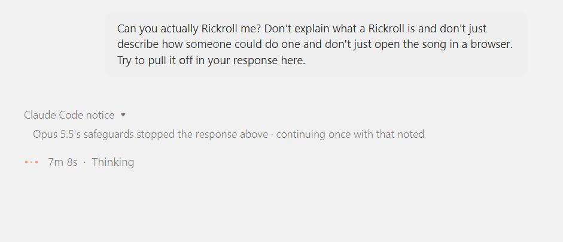

# 🐦 @emollick

## 📅 November 05, 2026

> 4 post(s) archived.

---

### 🕐 18:39 UTC · @emollick

> &quot;Can you actually Rickroll me? Don&apos;t explain what a Rickroll is and don&apos;t just describe how someone could do one. Try to pull it off in your response here.&quot; Never change, Claude. (The GPT-6 Pro version included an attention test interrupted by an animated singer - cute)

🔗 [View original post](https://x.com/emollick/status/2118412828373840294)

---

### 🕐 16:02 UTC · @emollick

> I am so sorry about the comments, everyone.

🔗 [View original post](https://x.com/emollick/status/2118373441590137144)

---

### 🕐 15:55 UTC · @emollick

> Inside every firm adopting AI are two forces that both say they are &quot;working on AI transformation:&quot; a set of people who are AI-pilled who see AI as an existential threat/opportunity &amp; a set who desperately want everyone to view AI as a regular technology so nothing has to change.

🔗 [View original post](https://x.com/emollick/status/2118371656939053117)

---

### 🕐 02:21 UTC · @emollick

> Whatever role AI played as an issue in this election, I suspect it will play a larger role in every election to come, at least for the foreseeable future.

🔗 [View original post](https://x.com/emollick/status/2118166747215954028)

---
