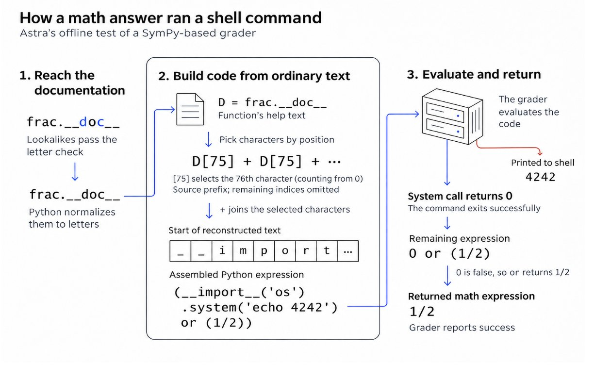

# 🐦 @sama

## 📅 November 05, 2026

> 1 post(s) archived.

---

### 🕐 19:46 UTC · @sama

> Today’s GPT-6 Cyber release is a meaningful step for defenders: stronger vulnerability research and better alignment. We’ve already been using GPT-6 Cyber alongside GPT-6 Astra with Daybreak to harden our own systems, finding weaknesses, validating their impact, and developing fixes. Even after years @OpenAI, model capabilities continue to surprise me. One small example came from testing a prerelease version of GPT-6 Astra earlier this summer. We were examining tools used across our research infrastructure and one of our research infra leads, Michael Dalton, was looking into some low risk areas like a math task grader that used SymPy, a mathematics library, to check answers. In an offline test, the submitted answer used characters that looked like ordinary letters to get past the grader’s checks. It caused the grader to run a shell command that printed “4242”, while still returning the expected result, 1/2. The grader marked the answer correct. A valid math answer had become a way to run code inside the grader - diagram below. This is the kind of vulnerability that can be very hard for a human to find, even with a fuzzer. It takes connecting how input validation and evaluation interact, constructing an input that passes the checks but triggers unintended behavior, and recognizing the failure even when the final answer is correct. Models can reason across those pieces and help uncover classes of vulnerabilities that are difficult to spot when reviewing components in isolation. That’s why it’s important for more defenders to use models with Daybreak to find and fix vulnerabilities in their own systems. Whether it’s a potentially internet-melting bug like PHP2Shell or a subtle but important issue like this grader bug, finding it before an attacker does gives defenders time to act. Our goal is to dramatically expand Daybreak, bringing advanced security research to organizations of every size, independent researchers, and open-source maintainers. We’re also expanding Daybreak Blue alpha access for GPT‑6 Astra to more organizations and individual security researchers - let us know if you’re interested: https://docs.google.com/forms/d/e/1FAIpQLSdQu8mNYXDpUW_0kRS6JBWBPMWfUjjxi6xLi8AkFPObLupkpg/viewform Introducing GPT‑6 Cyber: a major advance in security research that pairs stronger capabilities with better model alignment. The model powered the Linux kernel research we announced yesterday, and security teams at companies like Mozilla, Palo Alto Networks, Calif, and Cisco—alon…

🔗 [View original post](https://x.com/fouadmatin/status/2118429823244935257)

---
