# 🐦 @swyx

## 📅 November 05, 2026

> 30 post(s) archived.

---

### 🕐 18:30 UTC · @swyx

> My chat with @swyx on software factories is live. We walk through the full factory stack: https://www.youtube.com/watch?v=LL0YmIyBKSU

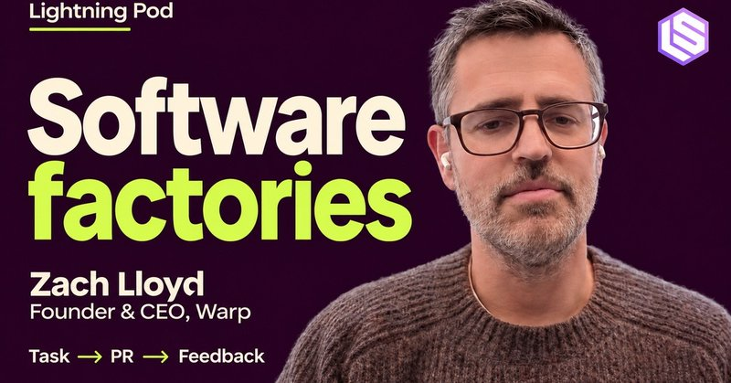

🔗 [View original post](https://x.com/zachlloydtweets/status/2118410609234772114)

---

### 🕐 17:54 UTC · @swyx

> https://x.com/YijinBao73718/status/2118195151151808614 AIE @ Shanghai! Happy to attend an event at Shanghai with @aiDotEngineer . This always night quality conference is as great as promised and can’t wait to talk to speakers at Expo 😜

🔗 [View original post](https://x.com/swyx/status/2118401472660701475)

---

### 🕐 17:53 UTC · @swyx

> https://x.com/Ni_luvya/status/2118177969000825152 在AIE上领到自家物料了， 喜欢@ryolu_ 的分享：当我们什么都能做时，还知道自己想要什么吗？ 让创意回归感受和生活

🔗 [View original post](https://x.com/swyx/status/2118401431338446927)

---

### 🕐 17:51 UTC · @swyx

> we&apos;re recording an AAv5 pod with @_micah_h and @grmcameron today and this reminds me why you basically need @ArtificialAnlys AA-* rebuilds of every single eval because you -CANNOT- trust labs not to intentionally or accidentally benchmaxx, you need a few trusted third parties to basically redo the entire eval in spirit but not in letter, to have a quick sniff test that model claims hold up under minor perturbations (eg starting from &quot;randomizing order in multiple choice questions&quot; to coming up with completely new problems that superficially look different but actually test the same underlying logic and reasoning steps). not enough people are reading bench traces like this 👇 and the systematic way to catch this benchmaxxing is basically to have altbenches for everything Kimi K3.1 recalls instructions it was never given on Terminal Bench. They match the hidden tests. K3.1 while solving: &quot;Instructions likely distilled pitfalls from previous agents.&quot; 🤯 When we edit a task to contradict them, K3.1 refuses the new instructions and fails. Other mode…

🔗 [View original post](https://x.com/swyx/status/2118400768957202439)

---

### 🕐 15:53 UTC · @swyx

> very important talk from today‘s AIE shanghai. thank you for the live translation and subtitles. So here it is — @ryolu_ &apos;s talk at @aiDotEngineer 2026 Shanghai. I shot it handheld on a Xiaomi 15 Ultra, so there&apos;s some shake; I fixed as much of it as I could in CapCut. Handheld footage just isn&apos;t going to be sharp or steady. Still, it&apos;s the best talk I saw on day 1 of AIE —…

🔗 [View original post](https://x.com/helloiamleonie/status/2118371223809982492)

---

### 🕐 15:00 UTC · @swyx

> So here it is — @ryolu_ &apos;s talk at @aiDotEngineer 2026 Shanghai. I shot it handheld on a Xiaomi 15 Ultra, so there&apos;s some shake; I fixed as much of it as I could in CapCut. Handheld footage just isn&apos;t going to be sharp or steady. Still, it&apos;s the best talk I saw on day 1 of AIE — which is why I&apos;m not posting a text summary. Watch for yourself. I missed the first minute or so. Ryo opens with the excitement of what AI makes possible, and how seeing what others are building can quickly turn that excitement into anxiety about falling behind. Media

🔗 [View original post](https://x.com/ZinkLu2/status/2118357855782965560)

---

### 🕐 13:43 UTC · @swyx

> manus firsthand club01 期 和朋友们的久违聚会，披萨啤酒闲聊，看 AI host 翻车 o(^▽^)o （迟到了最好吃的披萨）

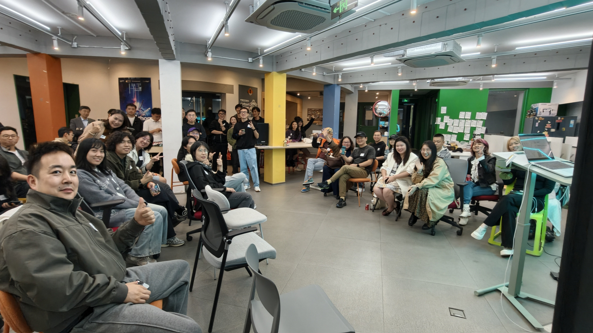

🔗 [View original post](https://x.com/ameliax111/status/2118338475271528762)

---

### 🕐 13:11 UTC · @swyx

> For a long time I’ve talked about Agent Experience. Many think AX is the new DX, but that misses the bigger picture. We’re moving to an agent-first world, where agents are the primary users of all software. AX isn’t just the new DX. It’s the new UX. https://www.innovationendeavors.com/insights/ax-is-not-the-new-dx-its-the-new-ux

🔗 [View original post](https://x.com/auchenberg/status/2118330248135582163)

---

### 🕐 12:30 UTC · @swyx

> @swyx you must wonder how you looked like in front of hull house of AI engineers in China! Great opening from Mengying @StandupPartners, golden words from @ryolu_ and such an amazing gaming demos from @MinakoOikawa Day 1 @aiDotEngineer

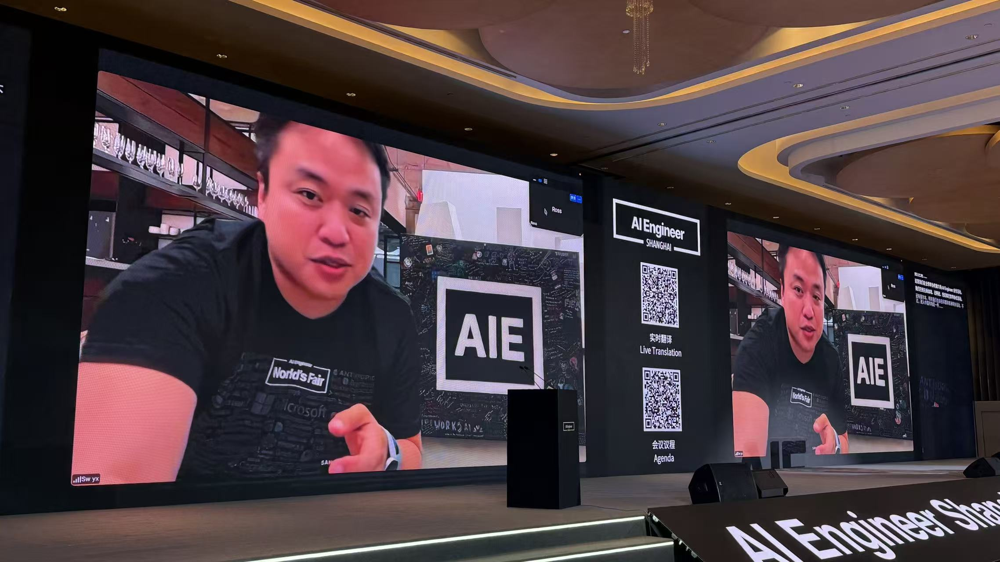

🔗 [View original post](https://x.com/Ninggao88/status/2118320016366133433)

---

### 🕐 08:52 UTC · @swyx

> 在 aie 上演“解救”大斌行动，哈哈哈[破涕为笑]

![在 aie 上演“解救”大斌行动，哈哈哈[破涕为笑]](../../../../assets/images/2026/11/05/2118265218283589925-1.jpg)

🔗 [View original post](https://x.com/ameliax111/status/2118265218283589925)

---

### 🕐 08:19 UTC · @swyx

> AIE Shanghai is amazing

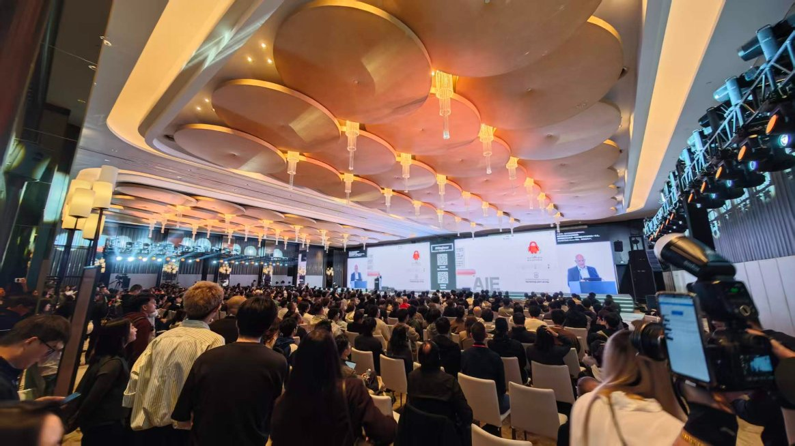

🔗 [View original post](https://x.com/Xianbao_QIAN/status/2118256882578075723)

---

### 🕐 07:58 UTC · @swyx

> https://x.com/lily_gpupoor/status/2118223980398276867?s=46 AIE Shanghai @swyx is happening now, Nov 5-6! Spicy take: AIE &gt;&gt;&gt; OpenAI Dev Day for me, cuz it has the best and most fun AI builder community. Make sure to check out @ryolu_’s talk. His keynote at Cursor Compile was my all-time favorite!

🔗 [View original post](https://x.com/swyx/status/2118251501214896570)

---

### 🕐 07:46 UTC · @swyx

> I’m humbled by my product and my team 🫶. Major keynote and 100% built on @openclaw with voice notes on a train from Hangzhou to Shanghai. Never touched Google Drive. Claw had full access to my X, past talks etc. Even the self roasting pablo meme it generated i never asked 👌

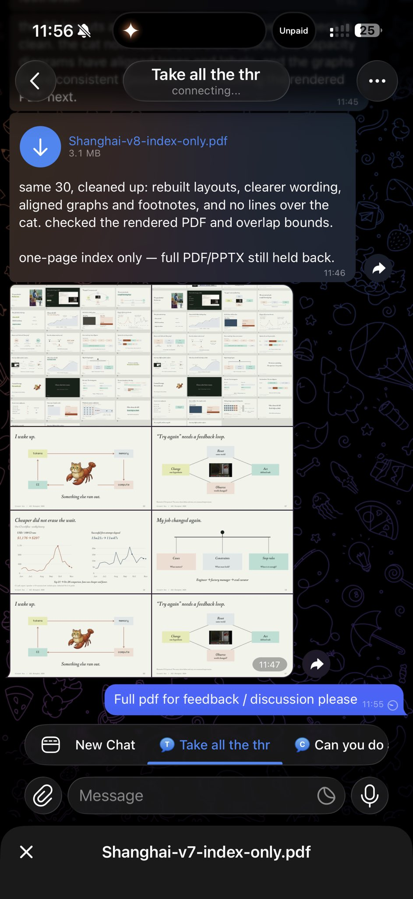

🔗 [View original post](https://x.com/vincent_koc/status/2118248452568285608)

---

### 🕐 07:39 UTC · @swyx

> absolutely tearing up seeing AIE Shanghai kick off and SUCH INCREDIBLE EXECUTION from @StandupPartners. the first AIE in China is actually happening!!! and its a packed room and a hot schedule featuring @ryolu_ , @Microsoft, @MiniMax_AI , @theworldlabs, @HeyGen , @ExaAILabs , @openclaw , @StepFun_ai , @liquidai , @youdotcom , @DynaRobotics , @baseten, @Meta , @OptiverGlobal , @ManusAI and more. not livestreamed because Reasons but you can bet we&apos;ll be posting up some videos and takes Look at this turnout at @aiDotEngineer Shanghai Day 1! Featuring the one the only @ryolu_ 當我們什麼都能做，還知道自己想做什麼嗎？🥹 好真誠的分享

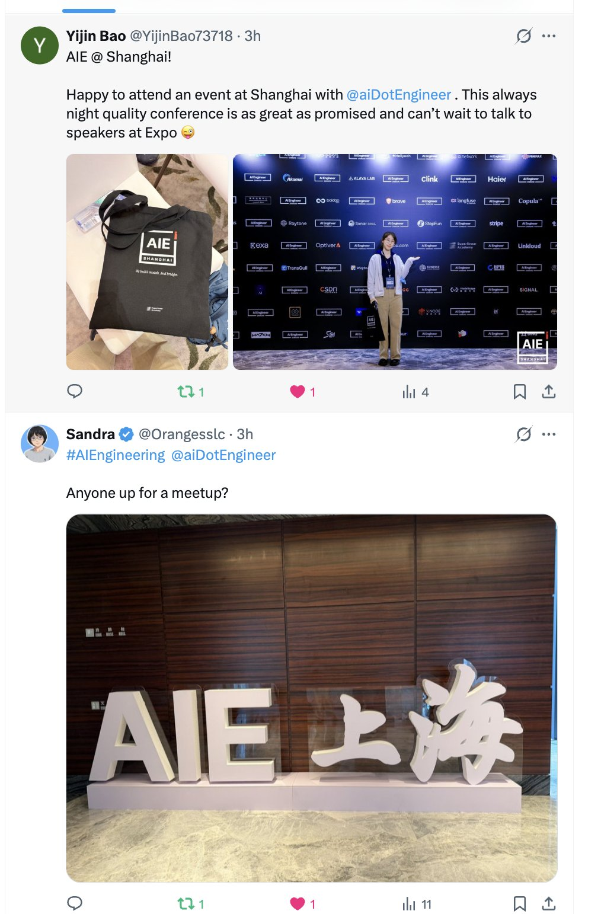

🔗 [View original post](https://x.com/swyx/status/2118246851136909731)

---

### 🕐 07:39 UTC · @swyx

> I went to Shanghai to attend AI Engineer Shanghai 2026 hosted by @swyx, I really like @ryolu_ ‘s talk about what he thought and care about in the age of AI. Some of the words he said really resonated with me, ”when AI can almost do anything for us, do we still know want we to do?” Many of his principles are similar to what I feel about life and research, where everything comes down to simplicity and freedom. Although I don’t know anything about real design, the spirit is the same, whether it is to write a math proof, design a research experiments to get to a conclusion or designing a system(@GenAI_is_real probably have much to say about that). Those who still have standard for quality and beauty rather than chasing the AI speed and AI quantify (that most people are chasing) is our last fort that distinguishes us with AI.

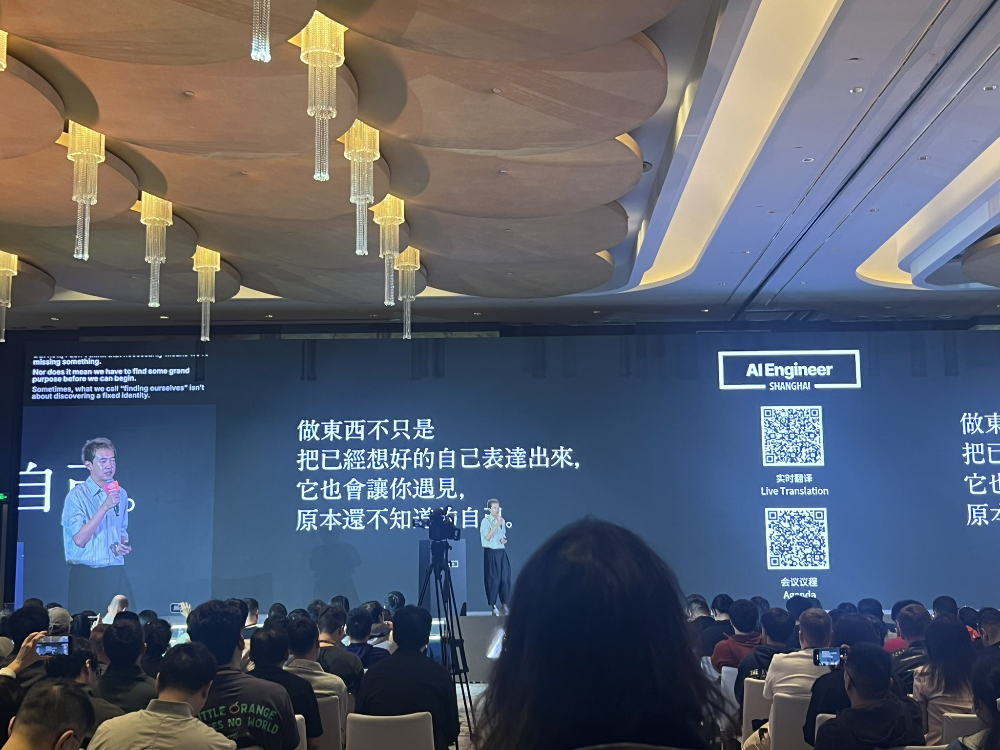

🔗 [View original post](https://x.com/SuJinyan6/status/2118246809957277730)

---

### 🕐 06:08 UTC · @swyx

> AIE Shanghai @swyx is happening now, Nov 5-6! Spicy take: AIE &gt;&gt;&gt; OpenAI Dev Day for me, cuz it has the best and most fun AI builder community. Make sure to check out @ryolu_’s talk. His keynote at Cursor Compile was my all-time favorite! ⚡ Behind Latent Space: from AI Substack to the first @aiDotEngineer in China 🇨🇳 https://www.youtube.com/watch?v=QmDLDy3ZSNE This time @Ninggao88 of Linkloud turns the mic around: asking @swyx how LS started, why “AI Engineering&quot; needed a name, and what’s different about the bu…

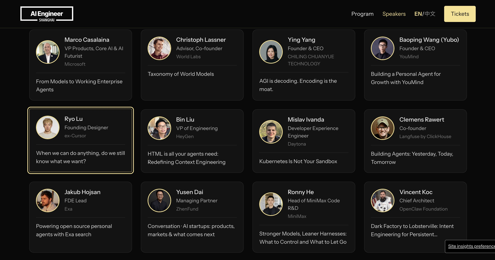

🔗 [View original post](https://x.com/lily_gpupoor/status/2118223980398276867)

---

### 🕐 05:56 UTC · @swyx

> The fustration when I wake up and its all gone to shit… again! 🙈 At @aiDotEngineer Shanghai today to talk about how we @openclaw went from building a dark factory to building the city “Lobsterville”.

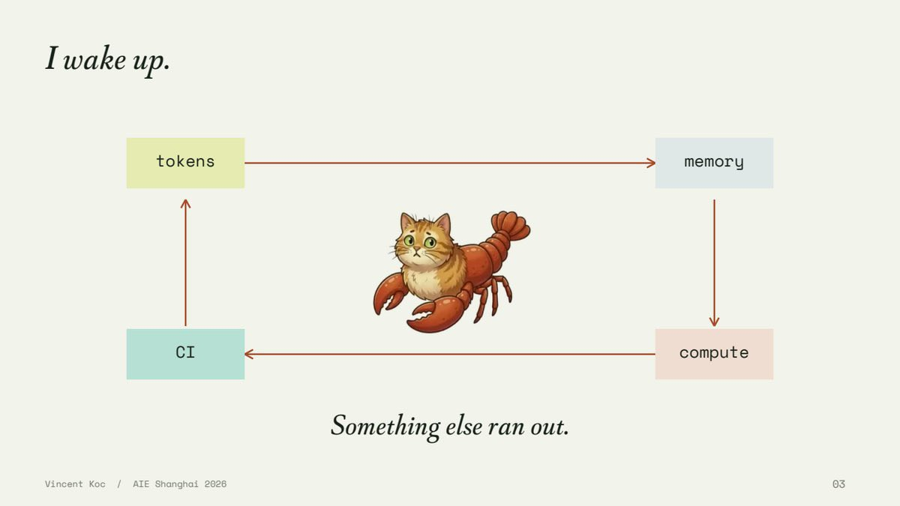

🔗 [View original post](https://x.com/vincent_koc/status/2118220970037268747)

---

### 🕐 05:10 UTC · @swyx

> “没必要招一个比你更弱的人。大部分团队 2–3 人就够了。”这是今天 AI Engineer 大会上，一位 OnlyFans 顾问跟我说的。他早期是滴滴的 AI 负责人，后来去了美国 Roblox，他非常不建议现在创业团队招人。 我们聊到社交，他说美国做 AI 线上社交已经很卷了，现在美国反而在转做线下社交，见面、互动、一起吃饭这些。在他们看来，Telegram 不是一个好的社交渠道。而且不建议我去旧金山，因为甲方和客户都不在那。 谈到现在AI创业的人，他说现在只能做非常垂直的赛道 整个展区摊位，有一些做量化的（Optiver）、做培训的、做 Agent 评估（Evaluation）的，还有 http://You.com 这类给 Agent 用的搜索工具。 前 Cursor 的 Ryo Lu，@ryolu_ 从旧金山搬回台北了，他觉得旧金山到处都是KPI，什么都要被优化，受不了那种硅谷的氛围。 他今天的演讲题目是：当我们什么都能做的时候，我们要做什么？ 其实是现在大家经常讨论的话题，当工具越来越强，开始替你做所有判断，甚至直接给你一个很好、很完整的结果。比如，你让它做一个日记 App，它会帮你设好提醒、心情指数。这当然没什么不对，但这真的是你想要的吗？很可能只是AI大量参考了其他人的结果。 而你在被动接受一个完整的结果，但你并没有参与其中。 他自己从旧金山搬到台北，也是在实践这件事。要保留人 做不同选择的自由。 包括我再次见到的这个朋友在内，很多人都讲到，Agent 性价比更高、算力更强、更强的英伟达…，但到头来还是要去解决服务人的需求、要人和人去见面。还有人聊到了宠物医疗。 大家都在说 Agent 经济、Agent 卖东西，但现场真正反复出现的问题是：Agent 怎么服务于人的需求。 人 要参与到 AI 生成的过程里，从 Prefill 到 Decode

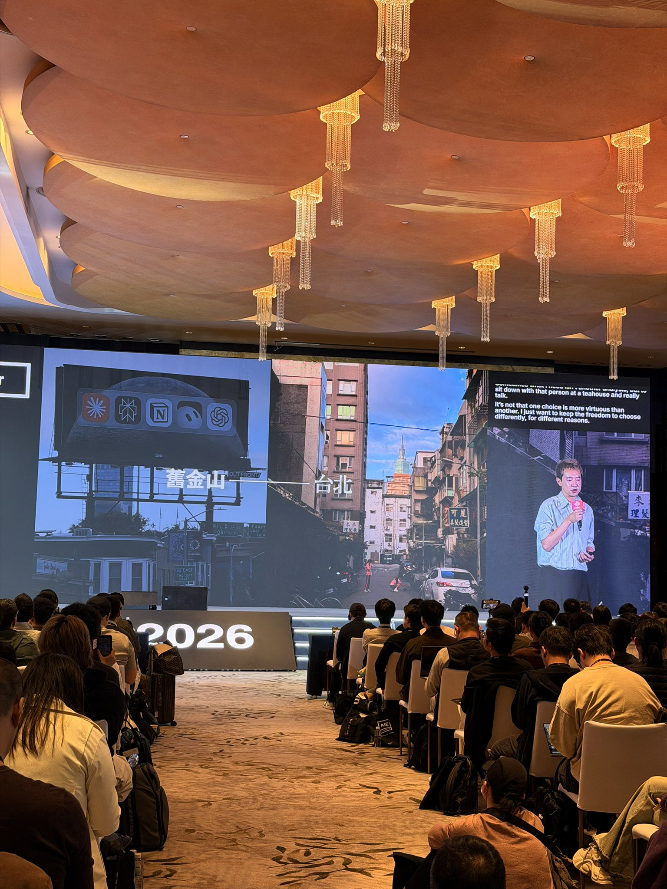

🔗 [View original post](https://x.com/Yuki27__/status/2118209195627676078)

---

### 🕐 05:08 UTC · @swyx

> uhhh what, 3x faster 5x cheaper but evals SAME ON FRONTIERCODE 2 this is distillation without tradeoffs. i think @thinkymachines inkling is one of the most underrated base models in the world. expect to see a TON more of these esp on US pretrained models Introducing SWE-2 Flash, our new fast &amp; efficient coding model. On leading evals, it outperforms all American open-weight models, even ones 3x larger. To balance transparency and cyber risks, we are building a program to securely share the weights with partners &amp; researchers.

🔗 [View original post](https://x.com/swyx/status/2118208851506036989)

---

### 🕐 05:05 UTC · @swyx

> gave a talk at @aiDotEngineer shanghai about about a question i keep coming back to: when we can make anything, do we still know what we want? i want tools that help us find our own answers, not skip the process of forming them. not just more output, but more room to think, care, and make together. will share more soon! @ryolu_ 在 AIE 的分享真的是一股清流啊，真的是广告里面播了一集电视剧的感觉。 反正我已经录下来了回头传上来让大家品品。

🔗 [View original post](https://x.com/ryolu_/status/2118207967728451760)

---

### 🕐 04:22 UTC · @swyx

> @ryolu_ 在 AIE 的分享真的是一股清流啊，真的是广告里面播了一集电视剧的感觉。 反正我已经录下来了回头传上来让大家品品。

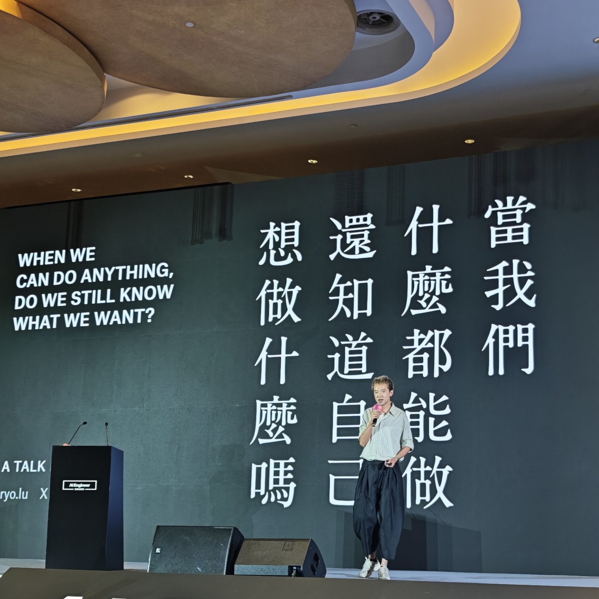

🔗 [View original post](https://x.com/ZinkLu2/status/2118197358601379910)

---

### 🕐 04:21 UTC · @swyx

> 有幸来听到 Ryo 的讲座，短短不到半小时却受益匪浅，

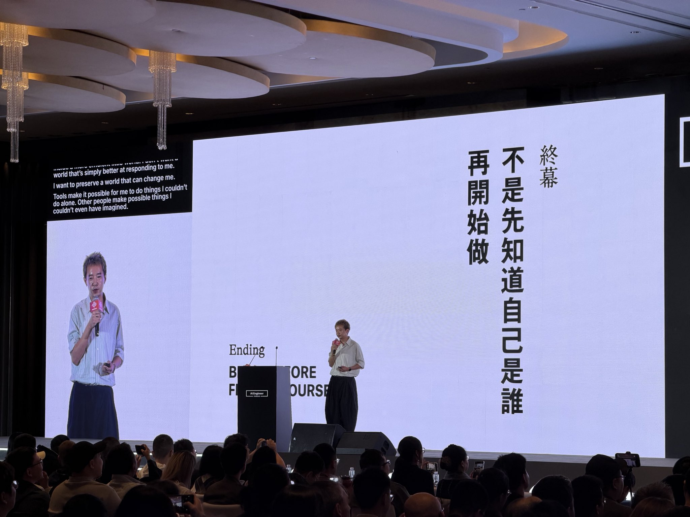

🔗 [View original post](https://x.com/vanillaCitron/status/2118197075343216656)

---

### 🕐 04:14 UTC · @swyx

> AIE @ Shanghai! Happy to attend an event at Shanghai with @aiDotEngineer . This always night quality conference is as great as promised and can’t wait to talk to speakers at Expo 😜

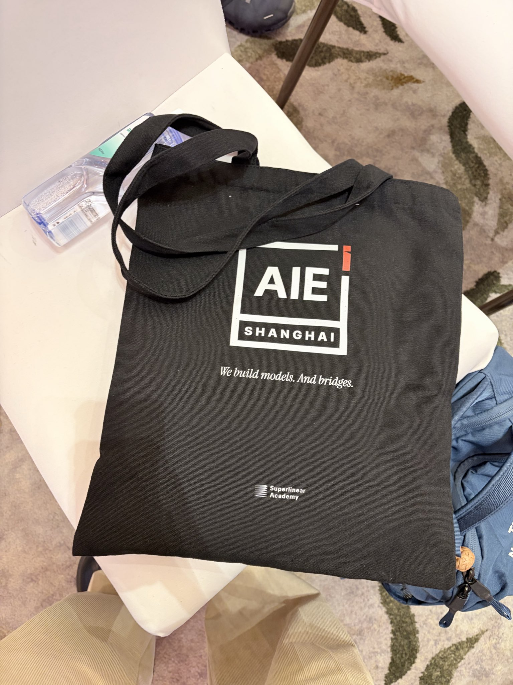

🔗 [View original post](https://x.com/YijinBao73718/status/2118195151151808614)

---

### 🕐 03:13 UTC · @swyx

> ✅

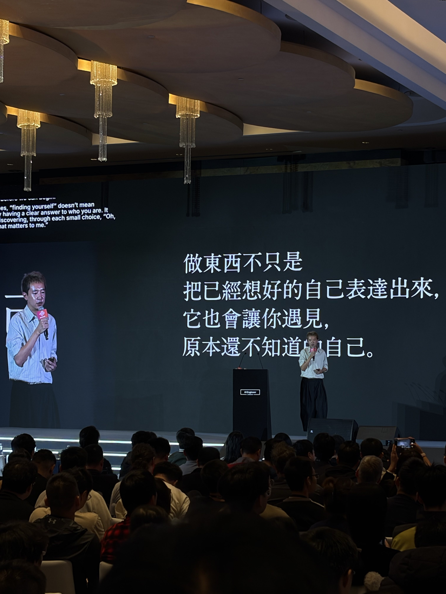

🔗 [View original post](https://x.com/zanweiguo/status/2118179977019662815)

---

### 🕐 03:05 UTC · @swyx

> 在AIE上领到自家物料了， 喜欢@ryolu_ 的分享：当我们什么都能做时，还知道自己想要什么吗？ 让创意回归感受和生活

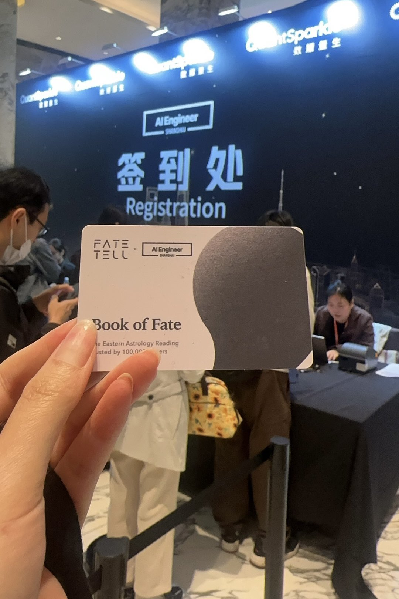

🔗 [View original post](https://x.com/Ni_luvya/status/2118177969000825152)

---

### 🕐 02:33 UTC · @swyx

> announced on aie channel. so hyped https://x.com/aiDotEngineer/status/2118048131052933313 Three days at AIE CODE: Nov 10: Fighting Slop in Software Factories. Talks + workshops. Nov 11: System One models making smart software. Nov 12: Raising Ambition, including Grand Rewrites. San Francisco. Nov 10 requires the workshop add-on. Schedule: https://ai.engineer/code/202…

🔗 [View original post](https://x.com/swyx/status/2118169736563589350)

---

### 🕐 01:31 UTC · @swyx

> First AIE in China. Live tweets today.

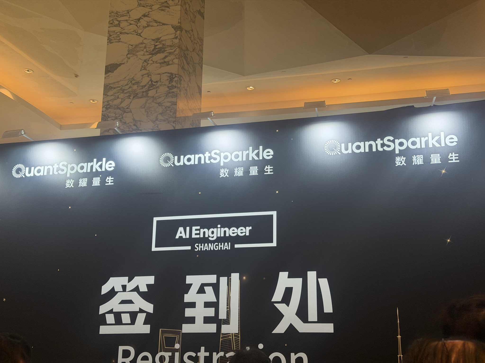

🔗 [View original post](https://x.com/Gracemzshao/status/2118154102194786455)

---

### 🕐 01:25 UTC · @swyx

> i&apos;m still processing. what an insane run. $0 to $100B ARR in 2.5 years. hey @TBPN you dropped this but we gotchu

🔗 [View original post](https://x.com/swyx/status/2118152585911869634)

---

### 🕐 00:30 UTC · @swyx

> i actually respect breadth in an economy that only respects b2b saas competitor: we solved coding oai: here’s sora competitor: we solved alignment oai: here’s scarlett johannson’s voice competitor: we are giving tokens and vms away for free to recapture mainstream attention oai: heres dancing cats Images, upgraded—introducing ChatGPT Images 2.6. Now with GIFs and reference images. Plus, two new models are coming to the API with 50% faster image generation.

🔗 [View original post](https://x.com/swyx/status/2118138737419067758)

---

### 🕐 00:12 UTC · @swyx

> GPU, CPU, file system... I put BabyAGI in Qwen 👶 meet babyagi-inside: a bounded agent loop, compiled into the weights of Qwen3.5-2B. nothing runs outside the model the agent still sucks, but the loop works! built on and uses @thevixhal&apos;s qwenfs, shout out to @divagr1925&apos;s qwenputer more 👇 Media

🔗 [View original post](https://x.com/yoheinakajima/status/2118134446947971336)

---
