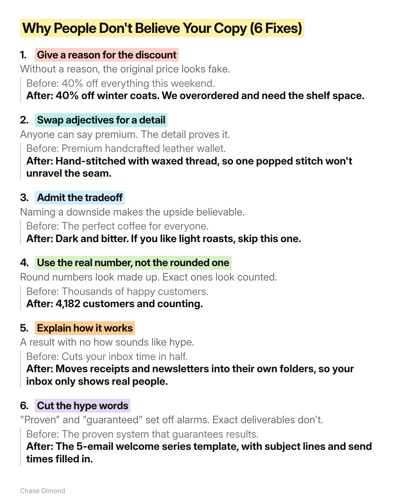
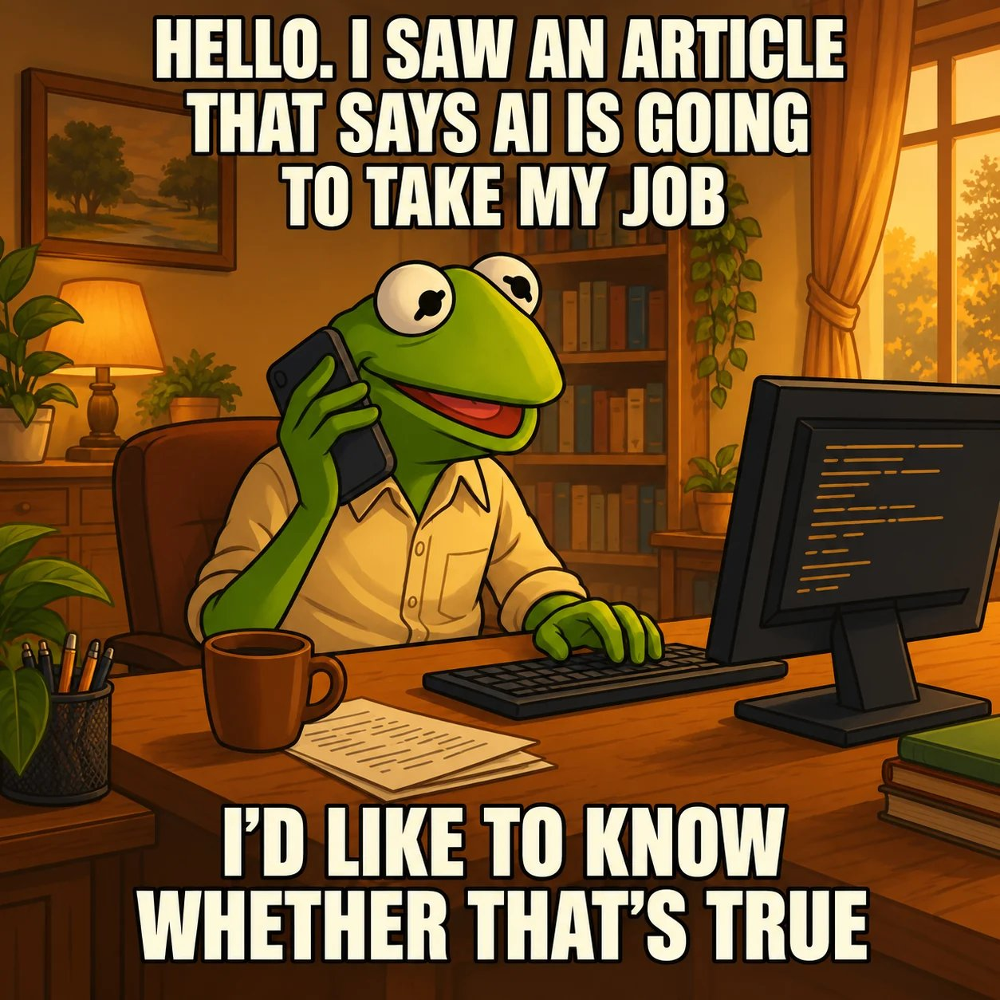

# 🐦 @AiEvolutio58513

## 📅 November 06, 2026

> 7 post(s) archived.

---

### 🕐 17:54 UTC · @AiEvolutio58513

> Why people don&apos;t believe your copy (6 fixes):

🔗 [View original post](https://x.com/ecomchasedimond/status/2118764044555628921)

---

### 🕐 16:32 UTC · @AiEvolutio58513

> Elon Musk stops in the middle of an interview about AI risk to check his phone. At the start, he&apos;d warned the reporters: &quot;I might occasionally just stop and check for any emergencies coming through.&quot; Then he looks down, goes quiet, and gets up. His only explanation: &quot;I have Bolero stuck in my head.&quot; Even mid-interview, he never fully stops watching what&apos;s happening at his companies. Interested in AI? Follow @AiEvolutio58513 and never fall behind. I track ChatGPT, Claude, and every tool quietly changing how we work and create, then hand you the tested signals. Media

🔗 [View original post](https://x.com/AiEvolutio58513/status/2118743250760778028)

---

### 🕐 16:15 UTC · @AiEvolutio58513

> “Is all this AI stuff coming for my job?” A retention manager asked me that over lunch a few weeks back, half-joking. She runs email for a couple of DTC brands. My honest answer surprised her a bit. Because most of her week is spent on production. Briefing the same email again, chasing the hero, checking links, moving a send because the product page slipped. The strategy part (the bit she’s actually paid for) gets whatever’s left on Friday afternoon. With something like @getallanai, that whole layer shrinks. You stock a library once, it assembles a different email per subscriber at send time, and it learns what lands with who. It’ll generate the creative too if you want it to. What’s left on her plate is the stuff only she can do. What the offer should be. Who’s worth talking to this month. What the brand is actually saying to people. She went quiet for a second and said: “So I’d just be doing the strategy.” Yeah… That’s the pitch. The part that disappears is the part nobody enjoyed anyway. It sits on top of Omnisend or Klaviyo, so nothing moves. Free for 30 days, and the trial includes the creative. Start free and start focusing on the part of your job that moves the needle. → https://getallan.com/

🔗 [View original post](https://x.com/ecomchasedimond/status/2118739168046317645)

---

### 🕐 15:04 UTC · @AiEvolutio58513

> Here&apos;s how Elon Musk fixed Starlink when it was failing: &quot;Starlink was a mess. It was 10X too expensive and they were building 1/10 of how many they needed.&quot; &quot;Elon&apos;s like I&apos;ve had it. This is now the bottleneck. I&apos;m fixing this.&quot; He flew a team of engineers he trusted to Seattle. &quot;They fire the entire Starlink leadership team.&quot; Then they sat in a war room and ran his algorithm on every part of the satellite: What are the first principles of satellite design? How simple can we make this thing? Why does this exist? Why do we need this much energy? Why do we need this manufacturing process? &quot;And over the course of a few months they make a two order of magnitude leap.&quot; &quot;These people had never encountered this design before, but just by applying the algorithm and working with maniacal urgency towards this extremely high design bar, they created this product that&apos;s now, if it was a standalone business, would be worth tens of billions of dollars or more.&quot; Interested in AI? Follow @AiEvolutio58513 and never fall behind. I track ChatGPT, Claude, and every tool quietly changing how we work and create, then hand you the tested signals. Media

🔗 [View original post](https://x.com/AiEvolutio58513/status/2118721109516492982)

---

### 🕐 13:01 UTC · @AiEvolutio58513

> Elon Musk puts a number on superintelligence: $30 trillion a year added to the world economy. &quot;Once you have a robot that can manipulate atoms, can shape objects, the value of the intelligence becomes exponentially greater because it can now do things.&quot; &quot;My guess is digital superintelligence probably improves the output of goods and services by 20 to 30%, something like that. It&apos;s like $30 trillion a year incremental.&quot; Interested in AI? Follow @AiEvolutio58513 and never fall behind. I track ChatGPT, Claude, and every tool quietly changing how we work and create, then hand you the tested signals. Media

🔗 [View original post](https://x.com/AiEvolutio58513/status/2118690146786927090)

---

### 🕐 10:58 UTC · @AiEvolutio58513

> Sam Altman just admitted the bug problem has outgrown the people fixing it: &quot;I don&apos;t even know a dramatic enough word to use… models can find bugs that are outside of the normal threat model of what we think a hacker can do… hardware-level, insane stuff… I no longer think we&apos;re gonna be able to just patch all the bugs.&quot; Interested in AI? Follow @AiEvolutio58513 and never fall behind. I track ChatGPT, Claude, and every tool quietly changing how we work and create, then hand you the tested signals. Media

🔗 [View original post](https://x.com/AiEvolutio58513/status/2118659232333721719)

---

### 🕐 08:03 UTC · @AiEvolutio58513

> Garry Tan says turning down Palantir for a promotion at Microsoft was a $2 to $4 billion mistake. Two of his Stanford fraternity brothers, Joe Lonsdale and Stephen Cohen, were interning at Peter Thiel&apos;s hedge fund: &quot;They said, &apos;Let&apos;s go get Garry. He&apos;s up in Seattle.&apos; They flew me down to have dinner with him, and Peter said, &apos;I&apos;m so sure this is the right thing for you. Here&apos;s a check for 70 grand.&apos; That was how much I made at Microsoft at the time.&quot; Tan&apos;s answer: &quot;I said, &apos;Thank you very much, Mr. Thiel, but I might get promoted to level 60 this year.&apos; Which I did. But that was a $2 to $4 billion mistake at this point.&quot; He got the promotion. Palantir is now one of the most valuable software companies in the world. Interested in AI? Follow @AiEvolutio58513 and never fall behind. I track ChatGPT, Claude, and every tool quietly changing how we work and create, then hand you the tested signals. Media

🔗 [View original post](https://x.com/AiEvolutio58513/status/2118615141633941661)

---
