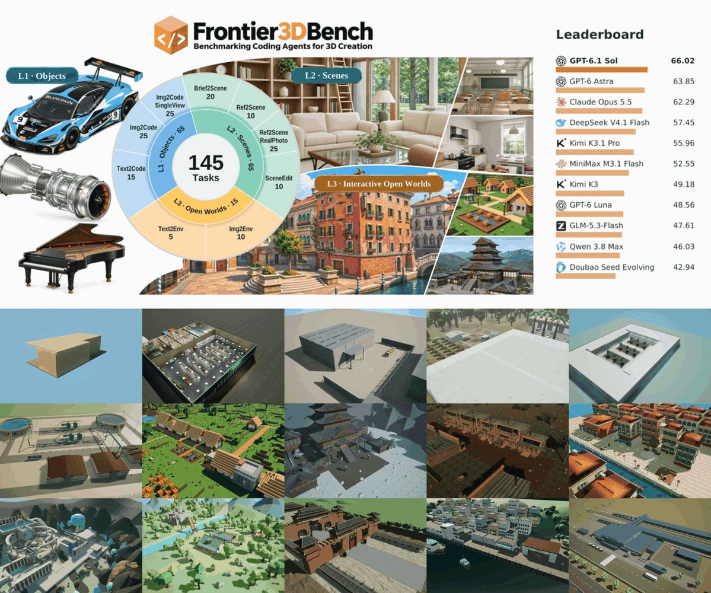
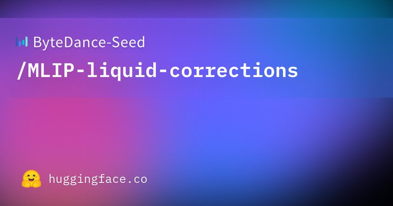
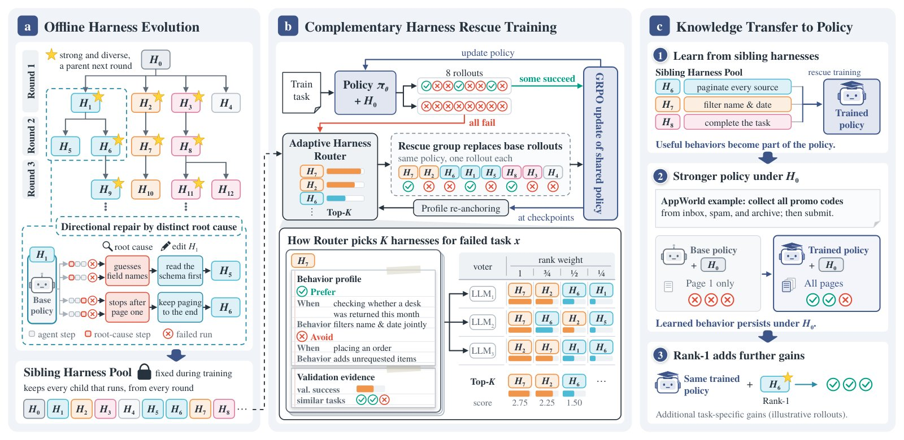

# 🐦 @_akhaliq

## 📅 November 06, 2026

> 5 post(s) archived.

---

### 🕐 14:45 UTC · @_akhaliq

> Can coding agents replace traditional 3D vision pipelines and build a entire interactive worlds from code? Introducing Einsia AI&apos;s Frontier3DBench — a unified benchmark evaluating coding agents across 3D Objects, Scenes, and Interactive Open Worlds. - 145 tasks across 9 categories (Blender &amp; UE5) - 11 frontier model-harness configurations - Joint evaluation: Appearance, Structure &amp; Behavior Project: https://lab.einsia.ai/frontier3dbench GitHub: https://github.com/Einsia/Frontier3D paper:https://lab.einsia.ai/frontier3dbench/Frontier3DBench.pdf 🧵 See key findings below 👇

🔗 [View original post](https://x.com/EinsiaAI/status/2118716282971599349)

---

### 🕐 13:04 UTC · @_akhaliq

> ByteDance Seed published a new dataset on Hugging Face: MLIP-liquid-corrections. It provides BSSE and ATM correction labels for 2M molecular configurations, derived from OMol25. This helps fine-tune ML interatomic potentials for accurate liquid simulations. https://huggingface.co/datasets/ByteDance-Seed/MLIP-liquid-corrections

🔗 [View original post](https://x.com/HuggingPapers/status/2118690909520875785)

---

### 🕐 12:10 UTC · @_akhaliq

> Harness-S: Learning from Sibling Harnesses A training method that uses complementary sibling harnesses to rescue failed agent rollouts and transfers those behaviors into a single policy that still works under the original harness.

🔗 [View original post](https://x.com/HuggingPapers/status/2118677343942459538)

---

### 🕐 09:26 UTC · @_akhaliq

> TailSteer Trajectory-Tail Steering for Drift-Resistant Multi-turn Image Editing paper: https://huggingface.co/papers/2611.06741 app: https://huggingface.co/spaces/akhaliq/endless-edit-tailsteer

🔗 [View original post](https://x.com/_akhaliq/status/2118636009311404525)

---

### 🕐 07:43 UTC · @_akhaliq

> Our Confucius4-R2T2（Real Real-Time Transcribe） paper is now on arXiv! 📄 https://arxiv.org/abs/2611.06043 R2T2 learns what to transcribe—and when to wait. 🎙️

🔗 [View original post](https://x.com/NetEaseYouDaoAI/status/2118610165146775594)

---
