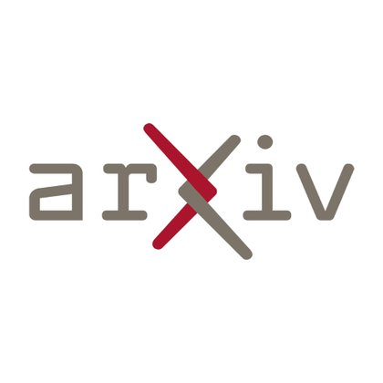

# 🐦 @_akhaliq

## 📅 November 06, 2026

> 2 post(s) archived.

---

### 🕐 09:26 UTC · @_akhaliq

> TailSteer Trajectory-Tail Steering for Drift-Resistant Multi-turn Image Editing paper: https://huggingface.co/papers/2611.06741 app: https://huggingface.co/spaces/akhaliq/endless-edit-tailsteer

🔗 [View original post](https://x.com/_akhaliq/status/2118636009311404525)

---

### 🕐 07:43 UTC · @_akhaliq

> Our Confucius4-R2T2（Real Real-Time Transcribe） paper is now on arXiv! 📄 https://arxiv.org/abs/2611.06043 R2T2 learns what to transcribe—and when to wait. 🎙️

🔗 [View original post](https://x.com/NetEaseYouDaoAI/status/2118610165146775594)

---
