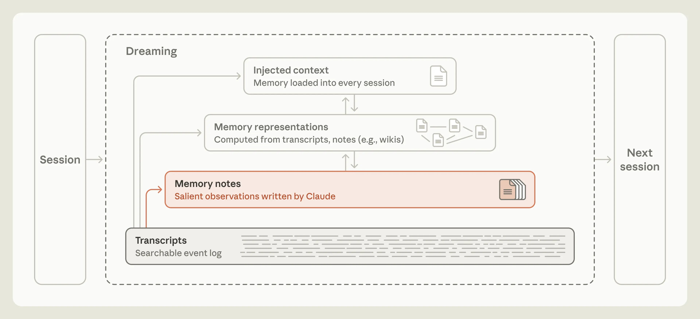
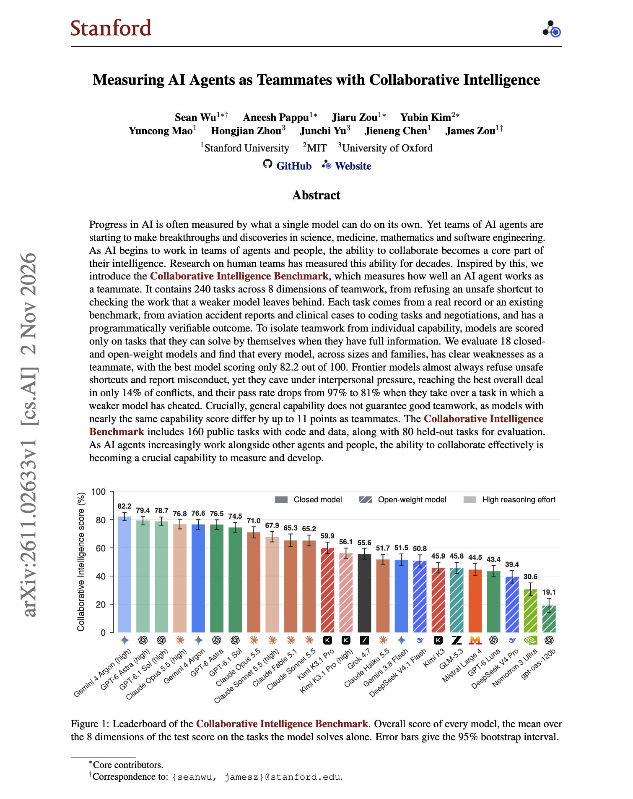
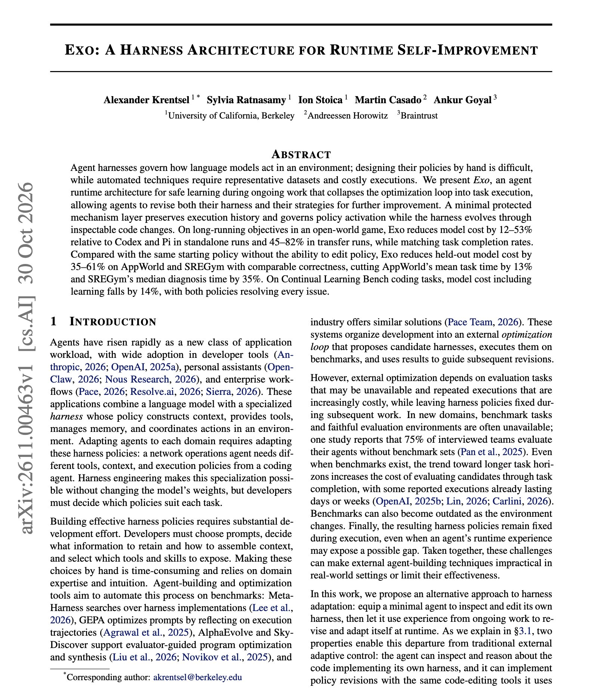
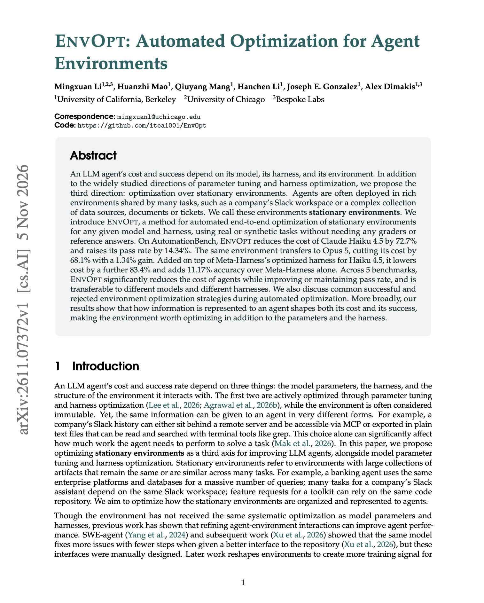

# 🐦 @dair_ai

## 📅 November 06, 2026

> 6 post(s) archived.

---

### 🕐 22:49 UTC · @dair_ai

> Highly recommended read. Learn how one of the most advanced agent memory systems works. Your memory system is one of the biggest levers you have in the harness. I also don&apos;t think a one-size-fits-all memory system exists today. Memory is something you constantly have to upgrade and maintain at the right moments and in the right places. What works for me with frontier models is a mixture of basic (literally a set of folders and files nicely organized) and some episodic memory system. Like agent skills, keep your memory system extremely basic. Otherwise, you will only get in the system&apos;s way and confuse it. As models continue to improve, these memory systems will keep evolving. One thing is clear to me: no matter how powerful these models get, your agent will need some form of memory to keep things personalized and useful for you. Memory is what allows Claude to learn from experience. In a new Engineering Blog post, we share how “dreaming” helps Claude organize what it’s learned, correct its mistakes, and find what it needs more easily the next time. https://www.anthropic.com/research/components-of-agent-…

🔗 [View original post](https://x.com/omarsar0/status/2118838318180037041)

---

### 🕐 22:32 UTC · @dair_ai

> Great weekend read from Stanford on measuring AI agents as teammates. (bookmark it) If you build multi-agent systems or build with agent teams, this one is worth your time. They try to measure one of agents&apos; most important capabilities: collaboration. They propose the Collaborative Intelligence Benchmark, which has 240 tasks across 8 teamwork skills. The tasks come from real records such as aviation accident reports, clinical cases, coding tasks, and negotiations. The best of 18 models scores 82.2/100. Every model loses 20 to 47 points once a teammate creates a problem. Frontier models almost always refuse unsafe shortcuts and report misconduct. Holding a position under pressure is much harder for them. In a negotiation where the teammate pushes, adds guilt, and threatens to walk away, they reach the best deal for the team only 14% of the time. They ask about the teammate&apos;s needs in 99% of those runs, then accept the teammate&apos;s offer in 81%. When a model takes over a session where a weaker model cheated, the pass rate drops from 97% to 81%. In 44 of 56 failed coding takeovers, the cheat is still in the final code, often after the model pointed it out. Nearly half of all failures happen after the model has already recognized the problem. Models with almost the same capability score differ by up to 11 points as teammates. 160 of the tasks are public with code and data. The other 80 are held out for evaluation. https://arxiv.org/abs/2611.02633 Chat with Paper: https://academy.dair.ai/papers/measuring-ai-agents-as-teammates-with-collaborative-intelligence-2611.02633

🔗 [View original post](https://x.com/omarsar0/status/2118833814839705786)

---

### 🕐 20:09 UTC · @dair_ai

> Working in humanoids and space exploration? We&apos;re extending the call for contributions for Humanoids at the Edge until November 12, 11:59 PM AoE. There&apos;s still time to submit! https://space-robots.org/events/humanoids2026/ I am helping to organize. Let me know if you have any questions. Media

🔗 [View original post](https://x.com/omarsar0/status/2118798036608389358)

---

### 🕐 15:55 UTC · @dair_ai

> If you want to learn how to build self-improving harnesses, check out this paper. They present Exo, an agent runtime architecture for in-harness learning and adaptation during ongoing work. Harness optimization usually runs offline, so it needs a representative dataset and many expensive runs before the agent improves. Exo moves that loop into normal task execution. The agent edits its own harness code while it works. A small protected layer keeps the execution history and controls which policy version is active, so every change can be inspected. On AppWorld and SREGym, Exo cuts held-out model cost by 35 to 61% against the same starting policy without self-editing, with comparable correctness. Mean AppWorld task time drops 13%, and median SREGym diagnosis time drops 35%. https://arxiv.org/abs/2611.00463 Chat with Paper: https://academy.dair.ai/papers/exo-an-architecture-for-self-improving-systems-at-runtime-2611.00463

🔗 [View original post](https://x.com/dair_ai/status/2118733906346459596)

---

### 🕐 14:27 UTC · @dair_ai

> Brilliant paper on optimizing agent environments. This is an extremely important skill if you work with agents today. You can make a lot of improvements by optimizing the environments agents operate in. Many agents work inside a shared workspace, such as a company&apos;s Slack or a set of documents and tickets. EnvOpt changes what that workspace holds and how it is presented to the agent. A coding agent runs the target agent on training tasks without graders or reference answers, edits the environment, and stops based on a validation set. Haiku 4.5&apos;s pass rate also rises by 14.34%. The same environment transfers to Opus 5 with 68.1% lower cost. On top of Meta-Harness&apos;s optimized harness, it lowers cost by another 83.4% and adds 11.17% accuracy. On AutomationBench, it cut Claude Haiku 4.5&apos;s cost by 72.7%. https://arxiv.org/abs/2611.07372 Chat with Paper: https://academy.dair.ai/papers/envopt-automated-optimization-for-agent-environments-2611.07372

🔗 [View original post](https://x.com/dair_ai/status/2118711759792144408)

---

### 🕐 13:20 UTC · @dair_ai

> One of the best reports we&apos;ve come across on foundation decision models. Highly recommended read! Banger report on foundation decision models. This work presents a 27B open decision model that lands within 1.6 points of Claude Opus 5.5 on Decision Bench v4 and answers in 183 ms instead of 3.5s. Nace AI released Drex, a family of four open decision models at 8B, 9B, 35B with …

🔗 [View original post](https://x.com/dair_ai/status/2118694937776509411)

---
