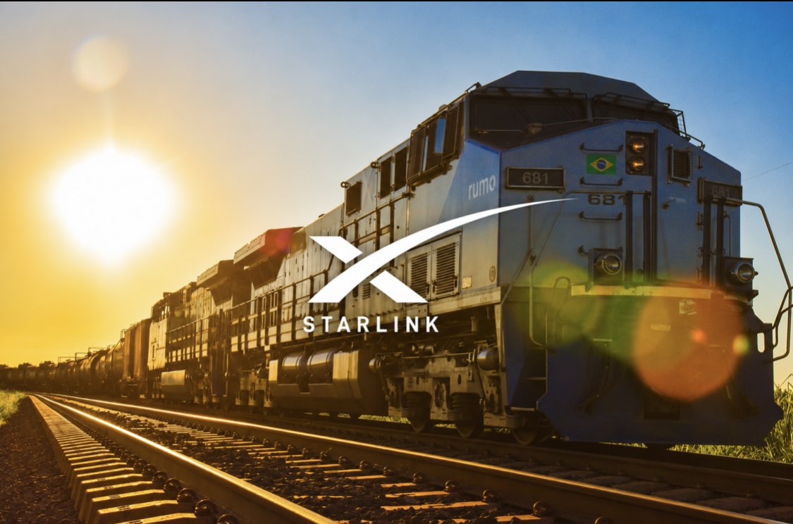
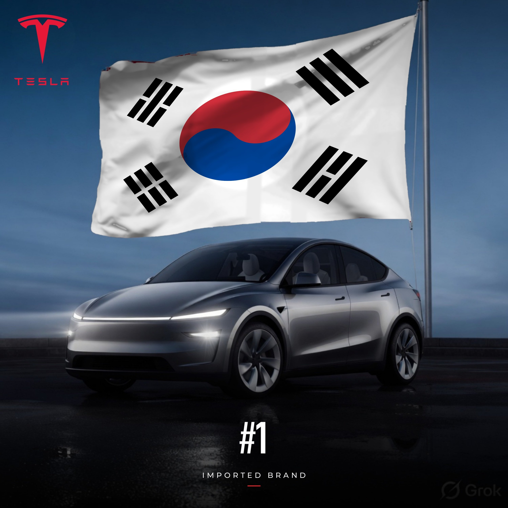
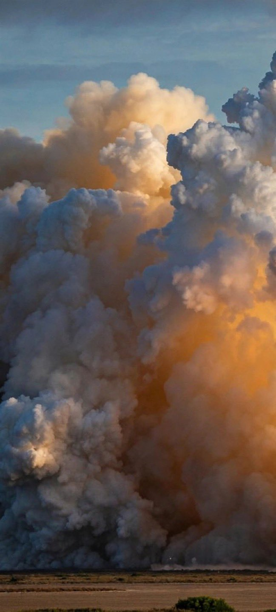
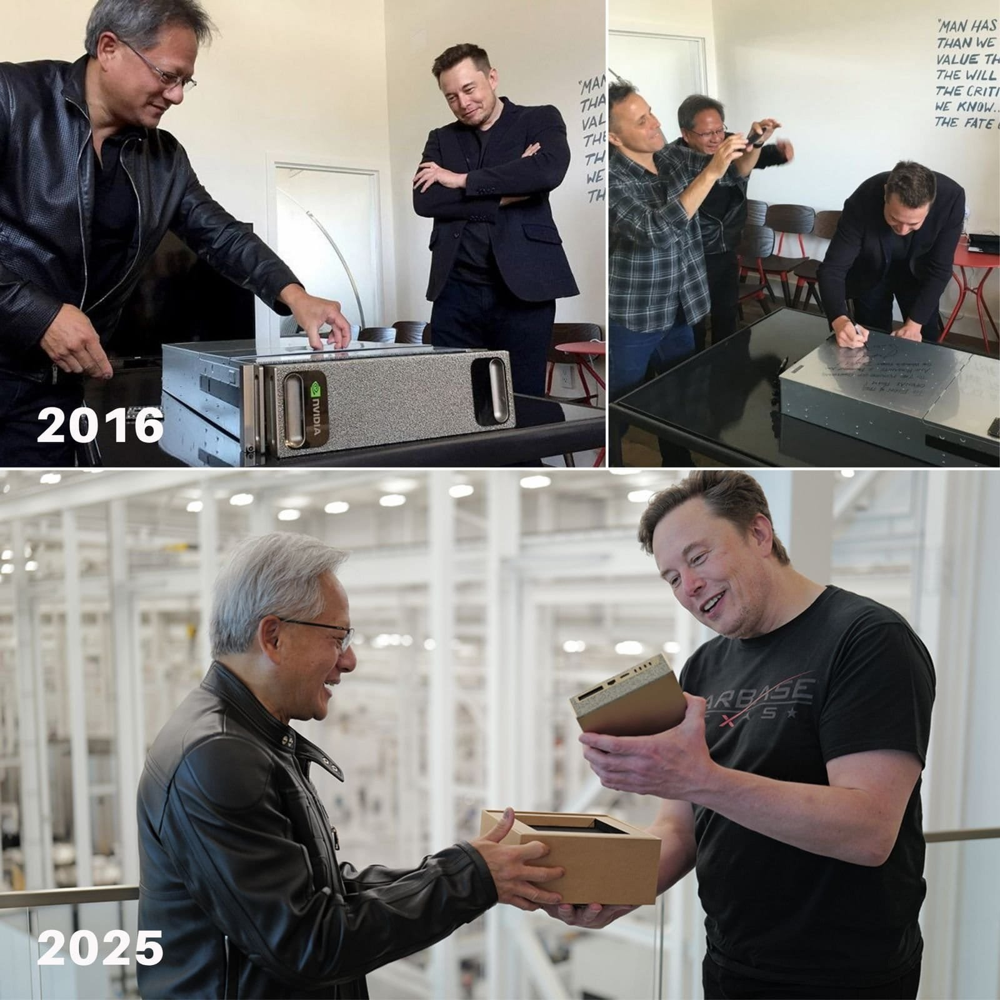
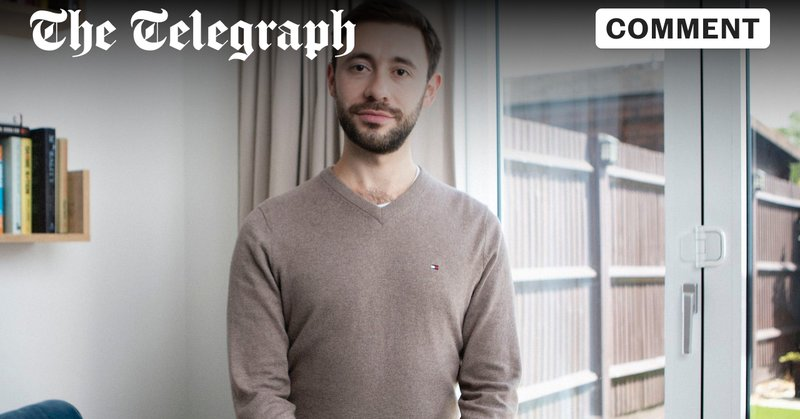

# 🐦 @elonmusk

## 📅 November 06, 2026

> 61 post(s) archived.

---

### 🕐 23:54 UTC · @elonmusk

> https://Terafab.ai

🔗 [View original post](https://x.com/elonmusk/status/2118854622907674904)

---

### 🕐 23:53 UTC · @elonmusk

> If you want to iterate fast with radically new chip designs, join the Terafab project! Elon Musk just revealed that Tesla is building a research chip fab at Gigafactory Texas that could reduce semiconductor development cycles from one year to just one month That&apos;s a potential 12 TIMES increase in the speed of chip development Tesla is building two semiconductor fa…

🔗 [View original post](https://x.com/elonmusk/status/2118854441063600539)

---

### 🕐 23:39 UTC · @elonmusk

> Good breakdown of the interview with Ron Baron Here’s the full interview of @elonmusk with Ron Baron 0:13 - Exciting times ahead 0:21 - First principles and TerraFab 2:18 - Chip fabs geopolitical risk 5:51 - Terawatt scale ambition 6:14 - Trillion dollar phased build 7:36 - Why others don’t improve 7:49 - Austin research fab…

🔗 [View original post](https://x.com/elonmusk/status/2118850719944212645)

---

### 🕐 22:04 UTC · @elonmusk

> Beautiful quote &quot;For all but a vanishingly brief instant near the dawn of history, the word &apos;ship&apos; will mean &apos;spaceship.&apos;&quot; –Arthur C. Clarke

🔗 [View original post](https://x.com/elonmusk/status/2118826964916298088)

---

### 🕐 21:46 UTC · @elonmusk

> BREAKING: Starlink now helps connect 500+ locomotives and railcars for Rumo, Brazil’s largest freight rail operator. 🇧🇷 Autotrac’s system switches between 4G and Starlink so trains can stay in touch with the control center in real time, even where there’s no cell signal.

🔗 [View original post](https://x.com/cb_doge/status/2118822261088190714)

---

### 🕐 21:27 UTC · @elonmusk

> It’s true Elon Musk says the lack of popularity for data centers is temporary because of the prosperity that is brought by them: &quot;The lack of popularity is where there aren&apos;t data centers and they think a data center will have a bad effect. Memphis is booming because of @SpaceX. The resta…

🔗 [View original post](https://x.com/elonmusk/status/2118817587203322349)

---

### 🕐 21:01 UTC · @elonmusk

> Roughly doubling revenue at scale for a large company used to be something special, but super intelligence makes that look slow! Elon Musk says Cloudflare is underestimating how much AI agents will take over the internet. MUSK: “Agentic internet traffic already exceeds human traffic... Cloudflare predicted that in five years, agentic AI traffic will be a thousand times more than human traffic. And if anyt…

🔗 [View original post](https://x.com/elonmusk/status/2118810958730862759)

---

### 🕐 20:32 UTC · @elonmusk

> Here’s the full interview of @elonmusk with Ron Baron 0:13 - Exciting times ahead 0:21 - First principles and TerraFab 2:18 - Chip fabs geopolitical risk 5:51 - Terawatt scale ambition 6:14 - Trillion dollar phased build 7:36 - Why others don’t improve 7:49 - Austin research fab iteration 10:49 - Culture of speed and ideas 13:48 - Walking the floor hands-on 15:39 - Data centers pitchforks 16:44 - OpenAI origins Anthropic 18:09 - Building data centers fast 20:01 - Revenue exploding Jose meme 23:16 - Model Y best in China 23:28 - China ownership exception 24:50 - ARR to five hundred billion 27:45 - Digital AI economy boost 28:21 - Robotics five times productivity 30:10 - Rent robots not sell 30:41 - Memphis community benefits 32:55 - Data centers in space 33:35 - StarMind and space power 36:26 - Cost to orbit history 36:52 - Falcon nine reusability limits 39:09 - Hourly launches Starship size 40:25 - Chopsticks and heat shield 44:30 - Starship unlocks Starlink 46:49 - Agentic traffic thousand times 48:09 - Starlink V3 bandwidth explosion 51:26 - Spectrum and telcos 52:43 - Satellite replacement cycle 53:17 - Laser links hundred times 53:55 - Competing with China power 55:37 - Space intelligence advantage 57:19 - Demand from superintelligence 58:02 - Universal high income future 1:00:43 - Legacy contribution Media

🔗 [View original post](https://x.com/cb_doge/status/2118803735573070329)

---

### 🕐 20:07 UTC · @elonmusk

> Elon Musk just revealed that digital superintelligence will increase the entire global economy by 20–30%, adding approximately $25 trillion in economic output And this transformation is going to happen incredibly fast Here&apos;s the scale of what&apos;s coming: • Global economy: ~$130 TRILLION • Digital superintelligence impact: +20–30% • Potential economic expansion: $25 trillion or more • Humanoid robotics: NOT EVEN INCLUDED in these projections And that&apos;s what makes this so extraordinary This is the impact of digital superintelligence alone, before accounting for the enormous productivity gains from humanoid robots operating across factories, businesses and entire industries The combination of digital superintelligence and physical robotics represents an economic transformation on a scale humanity has never experienced And this is only the beginning of what superintelligence will unlock for humanity Media

🔗 [View original post](https://x.com/XFreeze/status/2118797409950339534)

---

### 🕐 19:55 UTC · @elonmusk

> Elon Musk tells Ron Baron why SpaceX catches Starship with the launch tower’s “chopsticks” “It’s kind of like Mr. Miyagi in Karate Kid, you know, catching the fly, but just make it bigger.” “The rocket is placed on the launch pad by the tower and then is caught by those same tower arms and placed back on the launch pad when it returns from space.” “You really couldn’t get faster reusability than landing back where you took off.” “This, in principle, would allow us to refly the rocket, the giant booster, the Super Heavy booster, once an hour.” Most rockets are still thrown away after one flight. Starship is being built to fly like an airplane. Media

🔗 [View original post](https://x.com/KanekoaTheGreat/status/2118794459836268646)

---

### 🕐 19:45 UTC · @elonmusk

> We may succeed at this attempt, we may also fail, but the likelihood of success in the near term is high. Then we will optimize -&gt; accelerate. SpaceX will attempt to catch both the Super Heavy booster and Starship on the upcoming flight. If both are successful, it will mark the first time that all parts of an orbital rocket return to Earth intact. This is the critical breakthrough needed to make life multiplanetary.

🔗 [View original post](https://x.com/edwards345/status/2118791889633804493)

---

### 🕐 19:43 UTC · @elonmusk

> Elon Musk on the next Starship flight: “You’ll really want to watch this one. This one’s cool It’s the largest flying object ever made And it’s the highest thrust object ever made by humans of any kind whatsoever” Starship will weigh over 5,000 tons at liftoff, then the Super Heavy booster comes back from space just minutes later “Success is not always guaranteed, but excitement is” Media

🔗 [View original post](https://x.com/XFreeze/status/2118791290930532617)

---

### 🕐 19:37 UTC · @elonmusk

> Elon Musk just confirmed that SpaceX is preparing to attempt the FIRST-EVER tower catch of a Starship upper stage with Ship 42 in about ONE WEEK SpaceX has already achieved multiple precise, controlled soft landings of Starship in the ocean Elon revealed that these landings were so accurate that if a catch tower had been positioned at those locations, Starship would have been caught But bringing a massive spacecraft back to the actual launch tower requires an entirely different level of confidence SpaceX has been working to ensure the ship is reliable enough to return without damaging the tower or putting people at risk from falling debris And SpaceX reached that point Ship 42 is being prepared for the first attempt to catch a Starship upper stage with the launch tower And there&apos;s another interesting detail Elon highlighted that 42 is a special number, making Ship 42 a fitting vehicle for this historic attempt This is the breakthrough Starship needs to achieve FULL AND RAPID REUSABILITY For the first time ever, SpaceX is preparing to bring the entire Starship rocket back for recovery using its launch tower Media

🔗 [View original post](https://x.com/XFreeze/status/2118789834940784716)

---

### 🕐 19:34 UTC · @elonmusk

> Armies that win have the general at the front lines. Nobody wants to bleed for the prince in the palace. Ron Baron asked Elon Musk how many CEOs live on site in an Airstream and work hands-on with everyone. MUSK: “Airstreams are actually pretty nice... It’s parked right next to the power plant.” “We built this power plant that’s producing over a gigawatt... in about a year, as oppo…

🔗 [View original post](https://x.com/elonmusk/status/2118789067571954105)

---

### 🕐 19:32 UTC · @elonmusk

> ~100 lasers per satellite, each operating above 10 Tb/s, with over 100k satellites should be able to outcompete undersea cables. Speed of light in space is ~40% faster than cable and the path is direct, instead of following the outline of land masses. Elon just teased SpaceX&apos;s next-gen V4 @Starlink satellites: &quot;Starlink version 4 will have 10x the capability of V3 (which itself is 10x better than V2), especially with the long-distance laser links. Our next-gen laser links will be 10-terabits per second. 100x better. And we&apos;ll…

🔗 [View original post](https://x.com/elonmusk/status/2118788513365954734)

---

### 🕐 19:27 UTC · @elonmusk

> 🇦🇷 🇦🇷 Tesla Argentina!! 🇦🇷 🇦🇷 Llegamos a Argentina el 20 de Noviembre

🔗 [View original post](https://x.com/elonmusk/status/2118787365426893002)

---

### 🕐 19:23 UTC · @elonmusk

> Pulling massive power cables is a great workout and far more productive than lifting weights 🏋️‍♀️ Elon Musk in new interview on @SpaceXSI&apos;s data center site in Memphis: &quot;I insist on doing some of the work myself manually. I&apos;ve pulled power cables the size of an anaconda. I&apos;ve done the fiber optic cabling; I try to do at least a little bit of everything so I&apos;m not numb to the…

🔗 [View original post](https://x.com/elonmusk/status/2118786343958675697)

---

### 🕐 19:12 UTC · @elonmusk

> Elon Musk just revealed an absolutely insane revenue trajectory for SpaceX: on track to exceed $100 billion annualized in December, a best guess of over $500 billion by December next year, and a trillion is no longer out of the question &quot;I think, just to comment on a few of those things, so we are tracking to have an annual rate of revenue, that is in excess of $100 billion in December. Obviously, December&apos;s pretty close, so I have good insight into that, so unless there&apos;s some natural disaster or something, we will meet that target. And then based on the plans that we have next year, it seems quite likely that our annual recurring revenue in December of next year will exceed 500 billion. Now, this is not a promise, this is what I think will happen, this is my best guess. Just want to distinguish between this is a promise to do something versus what I think will occur. What I think will occur is an ARR in December of next year of 500 billion, and I simply said, a trillion is not out of the question, meaning it was previously out of the question and it is no longer out of the question, it&apos;s maybe 2% or something likelihood But it&apos;s interesting that it&apos;s not 0%, that&apos;s the interesting part. And the probability is increasing with time” Media

🔗 [View original post](https://x.com/XFreeze/status/2118783624325791849)

---

### 🕐 18:59 UTC · @elonmusk

> Elon today on @SpaceX&apos;s upcoming Starship Flight 15, which will attempt to catch both the Super Heavy Booster and Starship&apos;s upper stage: &quot;You really want to watch this one. This one&apos;s cool. It&apos;s the largest flying object ever made. And then the giant thing comes back. Excitement is guaranteed.&quot; Video below on what the ship catch will look like: Media Media

🔗 [View original post](https://x.com/SawyerMerritt/status/2118780450512527793)

---

### 🕐 18:34 UTC · @elonmusk

> Elon Musk today: &quot;The @Tesla Model Y is the best selling EV in China. This is difficult. Think about that for a second. And let me tell you, Chinese car companies are super good.&quot; (via 33rd Annual Baron Investment Conference today in NYC) Media

🔗 [View original post](https://x.com/SawyerMerritt/status/2118774106791293031)

---

### 🕐 18:19 UTC · @elonmusk

> Elon Musk in a new interview today on Terafab: &quot;There&apos;s three possible meanings to Terafab. One is terror. I think sometimes people ask, &apos;Why would you want a terror fab?&apos; Haha. Then there&apos;s Terra, which just means Earth, but it&apos;s actually Tera for terawatt. But arguably, all three apply.&quot; Media

🔗 [View original post](https://x.com/SawyerMerritt/status/2118770237625573489)

---

### 🕐 17:51 UTC · @elonmusk

> This project would be an incredible benefit to the people of my home state. The next SpaceX datacenter will be in Cochise Arizona. ~6 GW spread over 9 buildings. &gt; No industrial water use. &gt; No gas turbines and no on-site power generation. &gt; ~3 miles away from the nearest homes

🔗 [View original post](https://x.com/BurnhamDC/status/2118763171502772554)

---

### 🕐 17:46 UTC · @elonmusk

> SpaceX revenue this quarter alone will be substantially higher than NASA’s entire annual budget! Many people claim SpaceX is subsidized by NASA, but that is false. NASA provided ~5% of SpaceX revenue. SpaceX earned its contracts by offering the best product at the lowest price, &amp; it is the only astronaut transport option that meets NASA safety standards.

🔗 [View original post](https://x.com/elonmusk/status/2118761981037723848)

---

### 🕐 16:16 UTC · @elonmusk

> Tesla self-driving gives mobility to seniors Larry is 98 years old, and he bought a Tesla Model Y because of Full Self-Driving. His first car was a 1931 Ford Model A. After 80 years behind the wheel, he says driving with Tesla FSD feels more relaxing. He even took his Model Y on a road trip to Colorado and called the drive…

🔗 [View original post](https://x.com/elonmusk/status/2118739371939803498)

---

### 🕐 16:11 UTC · @elonmusk

> Tesla remains South Korea&apos;s #1 best-selling imported car brand for the NINTH consecutive month 🇰🇷 October 2026 registrations: • Tesla: 9,165 • Mercedes-Benz: 6,744 • BMW: 5,633 Tesla outsold Mercedes-Benz by 2,421 vehicles and BMW by 3,532 And the Model Y Premium dominated the imported-model rankings with 5,501 registrations on its own Tesla&apos;s October sales more than DOUBLED year-over-year, surging 110.7% Once, German luxury brands dominated South Korea&apos;s imported car market Now Tesla is leading it

🔗 [View original post](https://x.com/XFreeze/status/2118738155654513112)

---

### 🕐 16:10 UTC · @elonmusk

> Exactly 😂 Tesla has no government contracts and President Trump ended federal incentives for electric vehicles. SpaceX contracts with the government are BOTH the best product AND the lowest price! Moreover government revenue will be less than 10% of SpaceX revenue this quarter and less then 5% a year from now. Happy to cancel any that the government doesn’t want. Just say the word! Elon please send this January 1: Dear Senate &amp; House Democrats, Many of you criticize my companies receiving federal contracts. I hereby offer to cancel. Please publish a list of each contract to cancel with any required agency consent, and we will cancel promptly.

🔗 [View original post](https://x.com/elonmusk/status/2118737725964837353)

---

### 🕐 16:04 UTC · @elonmusk

> Starlink saves lives Starlink helped save six lives in the Atlantic. The Estonian yacht Cekritito was taking on water off Spain. Captain Madis Rallmann used Starlink to send a distress message to volunteer rescuers in Estonia. They passed it to maritime authorities, and a Spanish Coast Guard helicop…

🔗 [View original post](https://x.com/elonmusk/status/2118736224110444999)

---

### 🕐 15:59 UTC · @elonmusk

> We are living in SpaceX century If they successfully catch booster **and** ship in a week, we are officially in a different era as a species SpaceX will attempt to catch both the Super Heavy booster and Starship on the upcoming flight. If both are successful, it will mark the first time that all parts of an orbital rocket return to Earth intact. This is the critical breakthrough needed to make life multiplanetary.

🔗 [View original post](https://x.com/ArthurMacwaters/status/2118735000988418139)

---

### 🕐 15:50 UTC · @elonmusk

> Tesla Model Y is the best-selling car of any kind on Earth Tesla Model Y is Australia’s best-selling passenger vehicle so far this year, beating the Toyota RAV4. From January through October, Tesla sold 39,035 Model Ys versus 35,927 RAV4s. Sales of Tesla’s all-electric SUV jumped 117.2% compared with the same period last year.

🔗 [View original post](https://x.com/elonmusk/status/2118732812161519852)

---

### 🕐 15:50 UTC · @elonmusk

> Media

🔗 [View original post](https://x.com/elonmusk/status/2118732649426731409)

---

### 🕐 15:48 UTC · @elonmusk

> Ron Baron understands BREAKING: Ron Baron backs Elon Musk to put data centers in space. “We need more power and Elon’s doing that.” • Baron says America needs to build more chips at home and generate more electricity. “We need more power. Elon’s doing that.” • By Baron’s estimate, China has roughly 3…

🔗 [View original post](https://x.com/elonmusk/status/2118732296446673209)

---

### 🕐 15:02 UTC · @elonmusk

> Launching in Argentina later this month Llegamos a Argentina el 20 de Noviembre

🔗 [View original post](https://x.com/Tesla/status/2118720752379899907)

---

### 🕐 14:56 UTC · @elonmusk

> More than a dozen flight tests and years of development, with countless hours worked by SpaceX engineers and technicians, all come down to this: the first orbital Starship launch carrying advanced Starlink satellites bound for space. Watch “Go For Orbit” and experience the moments behind flying the most ambitious Starship mission yet Media

🔗 [View original post](https://x.com/SpaceX/status/2118719281038770389)

---

### 🕐 13:26 UTC · @elonmusk

> I&apos;m telling you Grok&apos;s speech-to-text literally the best there is I was literally talking to Grok with music blasting right next to my ears. It was so loud that the person next to me could barely hear me talking Yet Grok was transcribing everything incredibly accurately It&apos;s gotten so good that I trust it way too much now. I don&apos;t even bother checking the text after talking to Grok Bot anymore You can try it it&apos;s unbelievably good

🔗 [View original post](https://x.com/XFreeze/status/2118696586213756935)

---

### 🕐 12:52 UTC · @elonmusk

> The Godfathers of Superintelligence It all began right here, and now they&apos;re taking Superintelligence into orbit, to an entirely new level

🔗 [View original post](https://x.com/XFreeze/status/2118688066651214236)

---

### 🕐 12:32 UTC · @elonmusk

> BREAKING: Indian government sources say Starlink is welcome in India. 🇮🇳 “Customer is the king,” one official told ANI today. India welcomes competition in satellite internet, and customers will choose their provider based on price, value and quality. Yesterday brought good news for Starlink Direct to Cell too. TRAI proposed letting Indian mobile operators use their existing spectrum to connect phones directly to satellites. If adopted, the proposal could give Starlink a path to bring Direct to Cell to India through a local telecom partner, helping people stay connected where cell towers don’t reach. Media

🔗 [View original post](https://x.com/cb_doge/status/2118682924791050343)

---

### 🕐 09:34 UTC · @elonmusk

> Yes Elon Musk predicts space will become the lowest-cost place to run superintelligence within just 2–3 years “I think the case is a no-brainer for building solar-powered AI data centers in space” Solar panels facing the Sun and radiators pointed away from it can provide an incredib…

🔗 [View original post](https://x.com/elonmusk/status/2118638089677803638)

---

### 🕐 09:32 UTC · @elonmusk

> Starlink enables education in remote areas Starlink is bringing internet access to remote classrooms in Indonesia Katingan’s local government is distributing Starlink kits to preschools, elementary schools and junior high schools across areas where traditional internet remains weak or unavailable In 2026, Katingan receiv…

🔗 [View original post](https://x.com/elonmusk/status/2118637614068912548)

---

### 🕐 08:58 UTC · @elonmusk

> Seldon, Psychohistory Elon Musk on the life cycle of civilizations: “You do tend to see the same patterns… civilizations go through a life cycle like an organism Just like a human: zygote, fetus, baby, toddler, teenager… eventually it gets old and dies The civilizations go through a life cycle No civ…

🔗 [View original post](https://x.com/elonmusk/status/2118629153390158000)

---

### 🕐 08:55 UTC · @elonmusk

> “I was cancelled for criticising legislation that did not exist. Now, that very legislation is on course to become law. This time around, what I fear is not cancellation, but criminalisation.” My article for the Telegraph on the Conversion Practices Bill. https://www.telegraph.co.uk/news/2026/11/06/my-job-therapist-will-be-impossible-trans-madness/

🔗 [View original post](https://x.com/JamesEsses/status/2118628271164444909)

---

### 🕐 08:55 UTC · @elonmusk

> What is love? (Baby don’t hurt me)

🔗 [View original post](https://x.com/elonmusk/status/2118628232002158682)

---

### 🕐 08:39 UTC · @elonmusk

> Terafab is the largest building in human history Starship is the largest and most powerful flying object in human history Terafab is moving fast

🔗 [View original post](https://x.com/ArthurMacwaters/status/2118624369874448477)

---

### 🕐 08:25 UTC · @elonmusk

> Terafab is moving fast Tesla&apos;s chip effort is moving at Tesla speed, not semiconductor speed. Elon says TeraFab is going well, and @FutureAZA watched the related Fab Lab at Giga Texas go from bare ground to steel in days. Brian saw the site still lit and dusty at midnight, with work continuing around …

🔗 [View original post](https://x.com/elonmusk/status/2118620772268990966)

---

### 🕐 07:05 UTC · @elonmusk

> The most special product that ever got to exist. Changed my life in so many ways. I love you @cybertruck, forever. PS: chihiro is destined to meet her Haku

🔗 [View original post](https://x.com/battleangelviv/status/2118600603459002520)

---

### 🕐 06:58 UTC · @elonmusk

> Cybertruck was an incredible technology development platform and lives on through Cybercab. Thanks to everyone who contributed to making the future looking like the future As well to the community of owners whose adventures I&apos;ve enjoyed and will continue to follow ❤️ Tesla will be winding down production of the Cybertruck at Gigafactory Texas around the middle of next year to make room for increased Cybercab production

🔗 [View original post](https://x.com/wmorrill3/status/2118598887258644883)

---

### 🕐 06:52 UTC · @elonmusk

> Elon Musk on the set of Star Wars: The Mandalorian in 2019.

🔗 [View original post](https://x.com/cb_doge/status/2118597315229569169)

---

### 🕐 06:50 UTC · @elonmusk

> 😬 we are fucked

🔗 [View original post](https://x.com/elonmusk/status/2118596790958322075)

---

### 🕐 06:48 UTC · @elonmusk

> 14 years ago Media

🔗 [View original post](https://x.com/elonmusk/status/2118596405862478175)

---

### 🕐 06:45 UTC · @elonmusk

> Banger https://m.youtube.com/watch?v=Km91UtrSWx8&amp;pp=ugUEEgJlbtIHCQkpDAGHKiGM7w%3D%3D&amp;ra=m

🔗 [View original post](https://x.com/elonmusk/status/2118595675374109154)

---

### 🕐 06:44 UTC · @elonmusk

> @tetsuoai It troubles me greatly that we do not yet see any sign of aliens

🔗 [View original post](https://x.com/elonmusk/status/2118595407597203915)

---

### 🕐 06:33 UTC · @elonmusk

🔗 [View original post](https://x.com/elonmusk/status/2118592599363817491)

---

### 🕐 06:33 UTC · @elonmusk

> Starlink brings high-speed internet to more schools in Lesotho’s mountains. Computers delivered to Marakabei High School in 2017 finally went online with Starlink. The project is expanding to Thaba-Tseka Technical Institute with support from the U.S. Embassy in Maseru. ♥️ Media

🔗 [View original post](https://x.com/cb_doge/status/2118592577482129800)

---

### 🕐 06:30 UTC · @elonmusk

> Tesla will be winding down production of the Cybertruck at Gigafactory Texas around the middle of next year to make room for increased Cybercab production

🔗 [View original post](https://x.com/elonmusk/status/2118591788701421573)

---

### 🕐 06:28 UTC · @elonmusk

> Not bad 🚨 Tesla is outselling the next twelve EV makers combined in California… $TSLA @elonmusk

🔗 [View original post](https://x.com/elonmusk/status/2118591262890848688)

---

### 🕐 06:23 UTC · @elonmusk

> @tweetfollllower @MrMikeInvesting I just can’t help thinking of topiaries whenever someone mentions “hedge” fund 😂

🔗 [View original post](https://x.com/elonmusk/status/2118590026548461642)

---

### 🕐 06:20 UTC · @elonmusk

> Yup ELON MUSK: “The stock market is a very strange thing. It&apos;s kind of like Warren Buffett&apos;s sort of analogy, is the stock market&apos;s like having someone stand at the edge of your house and yell prices to buy or sell your house every day. And sometimes they take their meds and sometim…

🔗 [View original post](https://x.com/elonmusk/status/2118589343061491737)

---

### 🕐 06:15 UTC · @elonmusk

> 🇰🇷 Tesla Korea 🇰🇷 BREAKING: Tesla beats Mercedes-Benz and BMW to stay No. 1 in South Korea’s imported car market for the 9th straight month. 🇰🇷 October registrations surged 110.7% year over year to 9,165. Model Y Premium led all imports.🥇

🔗 [View original post](https://x.com/elonmusk/status/2118588019230056525)

---

### 🕐 06:09 UTC · @elonmusk

> This is exactly in line with how I&apos;ve always thought. In fact, I hate the em-dash (even before AI over-use), and I&apos;ve always used the single-dash with spaces instead of it. @yunta_tsai (The rules of English need to change to put spaces between the em dashes, as they presently too much resemble a hyphenated word, rather than a parenthetical phrase. Also, “—“ is an unpleasantly long a line. The en dash, “–“, is a better length.)

🔗 [View original post](https://x.com/yishan/status/2118586674867540293)

---

### 🕐 04:27 UTC · @elonmusk

> @yunta_tsai (The rules of English need to change to put spaces between the em dashes, as they presently too much resemble a hyphenated word, rather than a parenthetical phrase. Also, “—“ is an unpleasantly long a line. The en dash, “–“, is a better length.)

🔗 [View original post](https://x.com/elonmusk/status/2118560985678234094)

---

### 🕐 03:59 UTC · @elonmusk

> Truly amazing what having a real stake in the future does to people. https://x.com/Smirkley/status/2118356806720266556?a=Nwdsh1MQhhoeeDX_iag&amp;s=20 Young men with kids voted to the right of men without kids by 40 points. Young women with kids voted to the right of women without kids by 35 points

🔗 [View original post](https://x.com/xenocosmography/status/2118553775241843111)

---

### 🕐 01:37 UTC · @elonmusk

> Elon Musk on why Starship has to be fully reusable: &quot;Nobody&apos;s ever made a fully reusable orbital rocket.&quot; &quot;That&apos;s really the critical breakthrough necessary for life to become multiplanetary.&quot; &quot;For us to become a true spacefaring civilization, we have to achieve full and rapid reusability.&quot; &quot;I call it rapidly reusable reliable rockets.&quot; Full and rapid reuse is the whole point. @elonmusk Credit: Everyday Astronaut, First Look Inside SpaceX Starfactory (2024) Media

🔗 [View original post](https://x.com/teslaownersSV/status/2118518108721906039)

---
