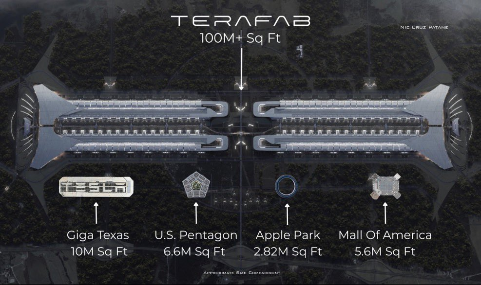
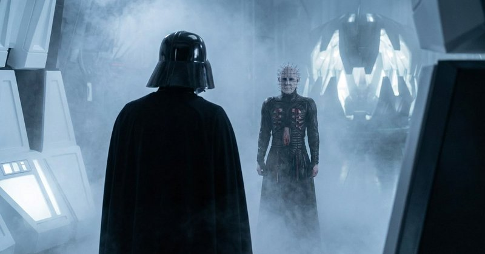
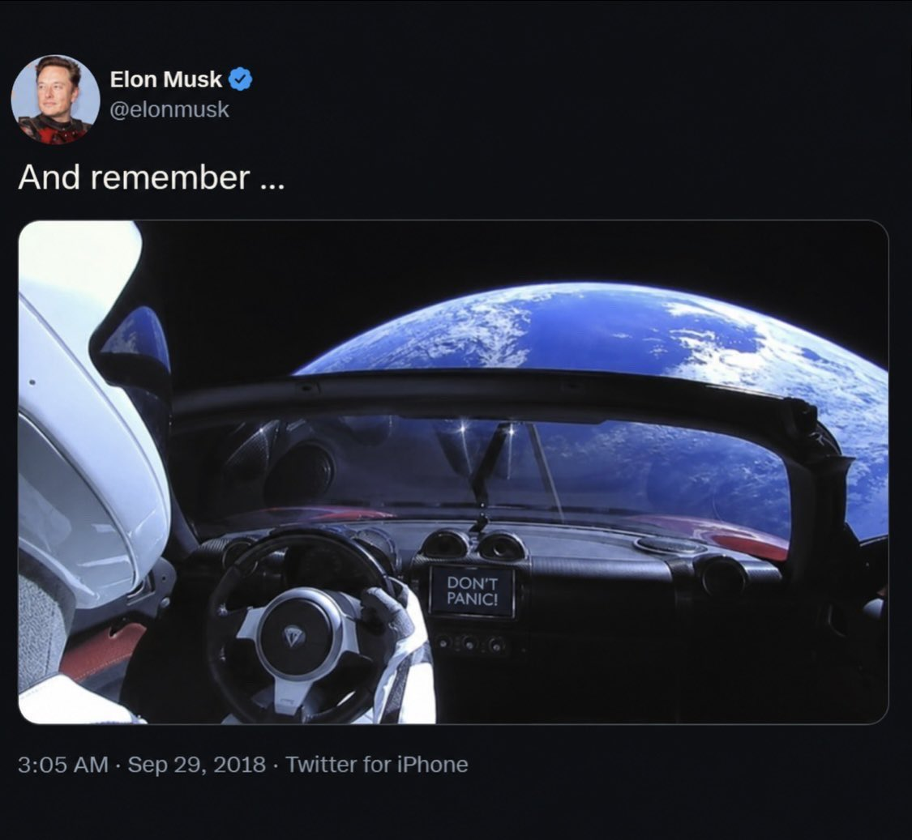

# 🐦 @elonmusk

## 📅 November 06, 2026

> 25 post(s) archived.

---

### 🕐 12:32 UTC · @elonmusk

> BREAKING: Indian government sources say Starlink is welcome in India. 🇮🇳 “Customer is the king,” one official told ANI today. India welcomes competition in satellite internet, and customers will choose their provider based on price, value and quality. Yesterday brought good news for Starlink Direct to Cell too. TRAI proposed letting Indian mobile operators use their existing spectrum to connect phones directly to satellites. If adopted, the proposal could give Starlink a path to bring Direct to Cell to India through a local telecom partner, helping people stay connected where cell towers don’t reach. Media

🔗 [View original post](https://x.com/cb_doge/status/2118682924791050343)

---

### 🕐 09:34 UTC · @elonmusk

> Yes Elon Musk predicts space will become the lowest-cost place to run superintelligence within just 2–3 years “I think the case is a no-brainer for building solar-powered AI data centers in space” Solar panels facing the Sun and radiators pointed away from it can provide an incredib…

🔗 [View original post](https://x.com/elonmusk/status/2118638089677803638)

---

### 🕐 09:32 UTC · @elonmusk

> Starlink enables education in remote areas Starlink is bringing internet access to remote classrooms in Indonesia Katingan’s local government is distributing Starlink kits to preschools, elementary schools and junior high schools across areas where traditional internet remains weak or unavailable In 2026, Katingan receiv…

🔗 [View original post](https://x.com/elonmusk/status/2118637614068912548)

---

### 🕐 08:58 UTC · @elonmusk

> Seldon, Psychohistory Elon Musk on the life cycle of civilizations: “You do tend to see the same patterns… civilizations go through a life cycle like an organism Just like a human: zygote, fetus, baby, toddler, teenager… eventually it gets old and dies The civilizations go through a life cycle No civ…

🔗 [View original post](https://x.com/elonmusk/status/2118629153390158000)

---

### 🕐 08:55 UTC · @elonmusk

> What is love? (Baby don’t hurt me)

🔗 [View original post](https://x.com/elonmusk/status/2118628232002158682)

---

### 🕐 08:39 UTC · @elonmusk

> Terafab is the largest building in human history Starship is the largest and most powerful flying object in human history Terafab is moving fast

🔗 [View original post](https://x.com/ArthurMacwaters/status/2118624369874448477)

---

### 🕐 08:25 UTC · @elonmusk

> Terafab is moving fast Tesla&apos;s chip effort is moving at Tesla speed, not semiconductor speed. Elon says TeraFab is going well, and @FutureAZA watched the related Fab Lab at Giga Texas go from bare ground to steel in days. Brian saw the site still lit and dusty at midnight, with work continuing around …

🔗 [View original post](https://x.com/elonmusk/status/2118620772268990966)

---

### 🕐 07:05 UTC · @elonmusk

> The most special product that ever got to exist. Changed my life in so many ways. I love you @cybertruck, forever. PS: chihiro is destined to meet her Haku

🔗 [View original post](https://x.com/battleangelviv/status/2118600603459002520)

---

### 🕐 06:58 UTC · @elonmusk

> Cybertruck was an incredible technology development platform and lives on through Cybercab. Thanks to everyone who contributed to making the future looking like the future As well to the community of owners whose adventures I&apos;ve enjoyed and will continue to follow ❤️ Tesla will be winding down production of the Cybertruck at Gigafactory Texas around the middle of next year to make room for increased Cybercab production

🔗 [View original post](https://x.com/wmorrill3/status/2118598887258644883)

---

### 🕐 06:52 UTC · @elonmusk

> Elon Musk on the set of Star Wars: The Mandalorian in 2019.

🔗 [View original post](https://x.com/cb_doge/status/2118597315229569169)

---

### 🕐 06:50 UTC · @elonmusk

> 😬 we are fucked

🔗 [View original post](https://x.com/elonmusk/status/2118596790958322075)

---

### 🕐 06:48 UTC · @elonmusk

> 14 years ago Media

🔗 [View original post](https://x.com/elonmusk/status/2118596405862478175)

---

### 🕐 06:45 UTC · @elonmusk

> Banger https://m.youtube.com/watch?v=Km91UtrSWx8&amp;pp=ugUEEgJlbtIHCQkpDAGHKiGM7w%3D%3D&amp;ra=m

🔗 [View original post](https://x.com/elonmusk/status/2118595675374109154)

---

### 🕐 06:44 UTC · @elonmusk

> @tetsuoai It troubles me greatly that we do not yet see any sign of aliens

🔗 [View original post](https://x.com/elonmusk/status/2118595407597203915)

---

### 🕐 06:33 UTC · @elonmusk

🔗 [View original post](https://x.com/elonmusk/status/2118592599363817491)

---

### 🕐 06:33 UTC · @elonmusk

> Starlink brings high-speed internet to more schools in Lesotho’s mountains. Computers delivered to Marakabei High School in 2017 finally went online with Starlink. The project is expanding to Thaba-Tseka Technical Institute with support from the U.S. Embassy in Maseru. ♥️ Media

🔗 [View original post](https://x.com/cb_doge/status/2118592577482129800)

---

### 🕐 06:30 UTC · @elonmusk

> Tesla will be winding down production of the Cybertruck at Gigafactory Texas around the middle of next year to make room for increased Cybercab production

🔗 [View original post](https://x.com/elonmusk/status/2118591788701421573)

---

### 🕐 06:28 UTC · @elonmusk

> Not bad 🚨 Tesla is outselling the next twelve EV makers combined in California… $TSLA @elonmusk

🔗 [View original post](https://x.com/elonmusk/status/2118591262890848688)

---

### 🕐 06:23 UTC · @elonmusk

> @tweetfollllower @MrMikeInvesting I just can’t help thinking of topiaries whenever someone mentions “hedge” fund 😂

🔗 [View original post](https://x.com/elonmusk/status/2118590026548461642)

---

### 🕐 06:20 UTC · @elonmusk

> Yup ELON MUSK: “The stock market is a very strange thing. It&apos;s kind of like Warren Buffett&apos;s sort of analogy, is the stock market&apos;s like having someone stand at the edge of your house and yell prices to buy or sell your house every day. And sometimes they take their meds and sometim…

🔗 [View original post](https://x.com/elonmusk/status/2118589343061491737)

---

### 🕐 06:15 UTC · @elonmusk

> 🇰🇷 Tesla Korea 🇰🇷 BREAKING: Tesla beats Mercedes-Benz and BMW to stay No. 1 in South Korea’s imported car market for the 9th straight month. 🇰🇷 October registrations surged 110.7% year over year to 9,165. Model Y Premium led all imports.🥇

🔗 [View original post](https://x.com/elonmusk/status/2118588019230056525)

---

### 🕐 06:09 UTC · @elonmusk

> This is exactly in line with how I&apos;ve always thought. In fact, I hate the em-dash (even before AI over-use), and I&apos;ve always used the single-dash with spaces instead of it. @yunta_tsai (The rules of English need to change to put spaces between the em dashes, as they presently too much resemble a hyphenated word, rather than a parenthetical phrase. Also, “—“ is an unpleasantly long a line. The en dash, “–“, is a better length.)

🔗 [View original post](https://x.com/yishan/status/2118586674867540293)

---

### 🕐 04:27 UTC · @elonmusk

> @yunta_tsai (The rules of English need to change to put spaces between the em dashes, as they presently too much resemble a hyphenated word, rather than a parenthetical phrase. Also, “—“ is an unpleasantly long a line. The en dash, “–“, is a better length.)

🔗 [View original post](https://x.com/elonmusk/status/2118560985678234094)

---

### 🕐 03:59 UTC · @elonmusk

> Truly amazing what having a real stake in the future does to people. https://x.com/Smirkley/status/2118356806720266556?a=Nwdsh1MQhhoeeDX_iag&amp;s=20 Young men with kids voted to the right of men without kids by 40 points. Young women with kids voted to the right of women without kids by 35 points

🔗 [View original post](https://x.com/xenocosmography/status/2118553775241843111)

---

### 🕐 01:37 UTC · @elonmusk

> Elon Musk on why Starship has to be fully reusable: &quot;Nobody&apos;s ever made a fully reusable orbital rocket.&quot; &quot;That&apos;s really the critical breakthrough necessary for life to become multiplanetary.&quot; &quot;For us to become a true spacefaring civilization, we have to achieve full and rapid reusability.&quot; &quot;I call it rapidly reusable reliable rockets.&quot; Full and rapid reuse is the whole point. @elonmusk Credit: Everyday Astronaut, First Look Inside SpaceX Starfactory (2024) Media

🔗 [View original post](https://x.com/teslaownersSV/status/2118518108721906039)

---
