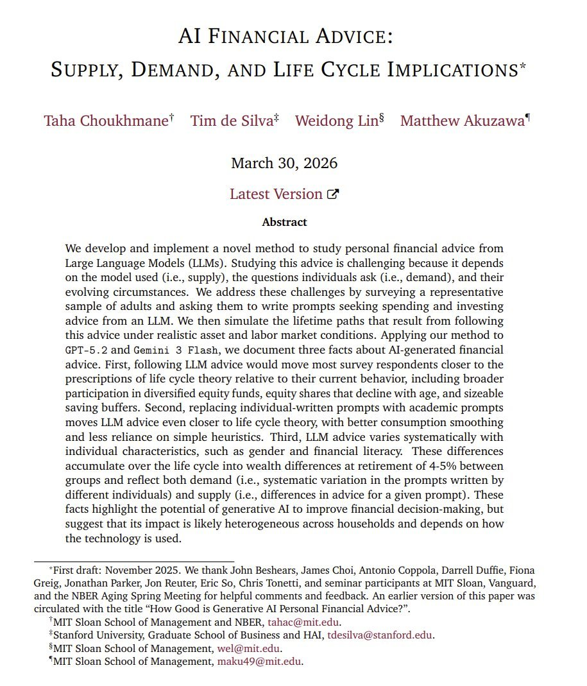

# 🐦 @emollick

## 📅 November 06, 2026

> 3 post(s) archived.

---

### 🕐 03:53 UTC · @emollick

> We should be more ambitious about trying to solve hard problems, rather than waiting for a nation of geniuses in a data center to solve them for us.

🔗 [View original post](https://x.com/emollick/status/2118552287480107117)

---

### 🕐 03:51 UTC · @emollick

> One ongoing frustration is the lack of effort I see being put towards near-term, achievable crash projects to do good with AI at a national scale, whether those efforts are by the AI labs or by policymakers &amp; NGOs. Some obvious ideas to explore suggested by the data we have so far: universal tutoring to support classroom learning, second opinions on healthcare, financial literacy/scam avoidance, and making government services easy to access. These are hard problems, and I know because over the past 20 years I have worked extensively on building tutoring and financial literacy programs, which were always limited by existing technology. Now, real gains are likely achievable with AI, which should be a big deal. Yes, you would want to do careful design and studies before rolling things out. And yes, those efforts might fail. But, if done right, national programs could lead to big gains in public good for seemingly intractable problems. And they don&apos;t require AIs beyond current models to pull off.

🔗 [View original post](https://x.com/emollick/status/2118551754908356979)

---

### 🕐 00:13 UTC · @emollick

> As I have written many times in the past years, any potential financial downturn in AI stocks will not greatly change the AI trajectory AI is not going away, companies are not slowing down adoption nor is development slowing. We still need policy &amp; effort so that AI is used well

🔗 [View original post](https://x.com/emollick/status/2118497026329518238)

---
