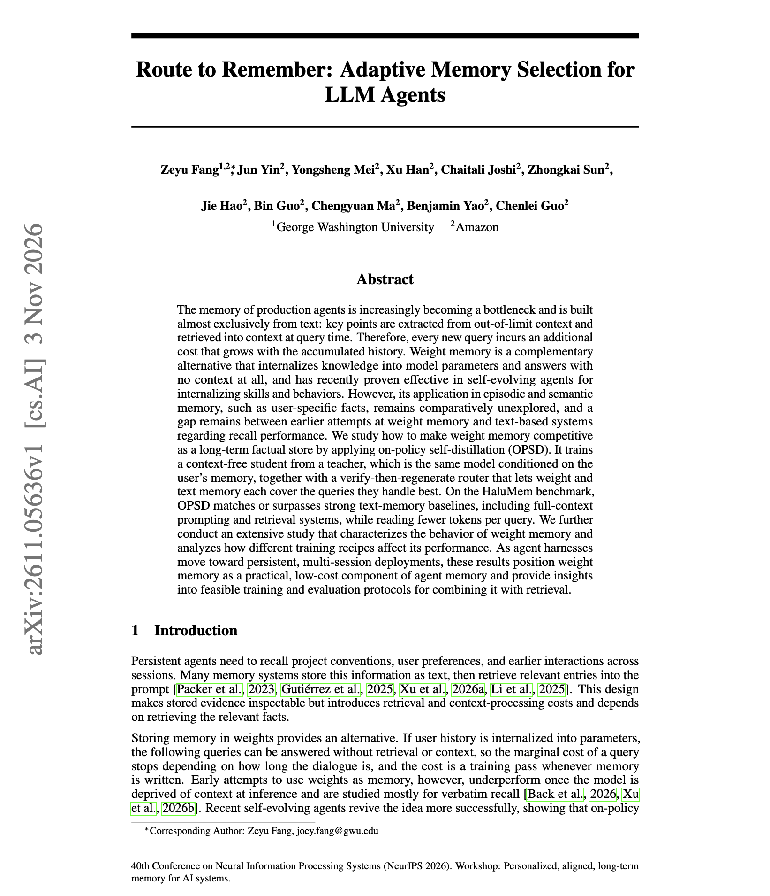
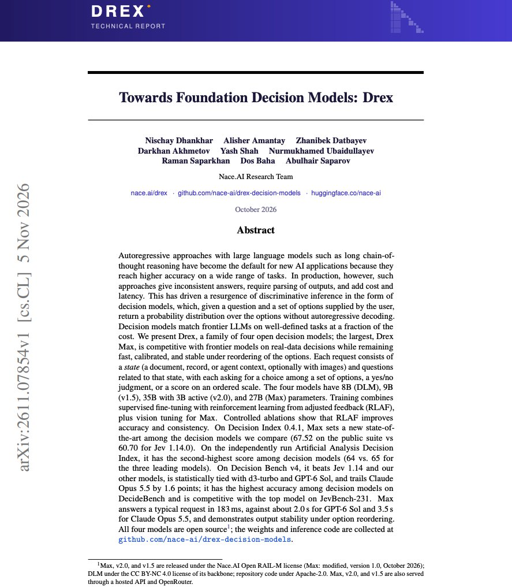

# 🐦 @omarsar0

## 📅 November 06, 2026

> 2 post(s) archived.

---

### 🕐 14:43 UTC · @omarsar0

> Weight memory vs. retrieval in agents. Brilliant work from Amazon. This work shows weight memory can outperform text memory on recall of user facts. But the best part is that you can leverage both. Using the same model and user data, this work shows that plain fine-tuning stores user facts in weights at 36.9% accuracy, while on-policy self-distillation reaches 59.9%. That second number also beats retrieval. On eight HaluMem-Long users, the distilled model answers with no retrieved context and beats MemOS-style retrieval (47.8%), extracted context (51.9%), and the raw dialogue (51.3%). The gain holds for every user and at 4B, 9B, and 27B. How it works: a teacher, which is the same model reading the user&apos;s memory, trains a student that has to answer without it. Weight memory has clear limits. It forgets older facts and cannot tell when something was never recorded. A verify-then-regenerate router checks each answer against the text store and adds 6.2 points. The recommendation is to keep a text store for recent and missing facts, and move stable user knowledge into weights. https://arxiv.org/abs/2611.05636 Chat with Paper: https://academy.dair.ai/papers/route-to-remember-adaptive-memory-selection-for-llm-agents-2611.05636

🔗 [View original post](https://x.com/omarsar0/status/2118715786152001580)

---

### 🕐 13:16 UTC · @omarsar0

> Banger report on foundation decision models. This work presents a 27B open decision model that lands within 1.6 points of Claude Opus 5.5 on Decision Bench v4 and answers in 183 ms instead of 3.5s. Nace AI released Drex, a family of four open decision models at 8B, 9B, 35B with 3B active, and 27B. You give the model a state, such as a document, a record, or an agent&apos;s context, plus questions with a fixed set of options. It returns a probability for each option without generating text. The 27B Max model scores 67.52 on the public Decision Index 0.4.1 suite, against 60.70 for Jev 1.14.0. On Decision Bench v4, it is statistically tied with GPT-6 Sol and d3-turbo. It also has the best accuracy among decision models on DecideBench. Model Training: After fine-tuning, training adds reinforcement learning from adjusted feedback (RLAF). A teacher model proposes a probability for each option, and the verified answer adjusts it, so the model trains on calibrated targets in place of one-hot labels. RLAF adds 2.0 Decision Index points, and a consistency loss lowers the rate of flipped answers when the options are reordered from 6.3% to 4.2%. HF: https://huggingface.co/nace-ai/drex-max-v1 Paper: https://arxiv.org/abs/2611.07854 Chat with Paper: https://academy.dair.ai/papers/towards-foundation-decision-models-drex-2611.07854

🔗 [View original post](https://x.com/omarsar0/status/2118693892300439722)

---
