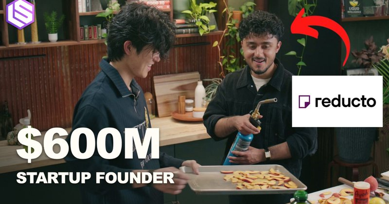
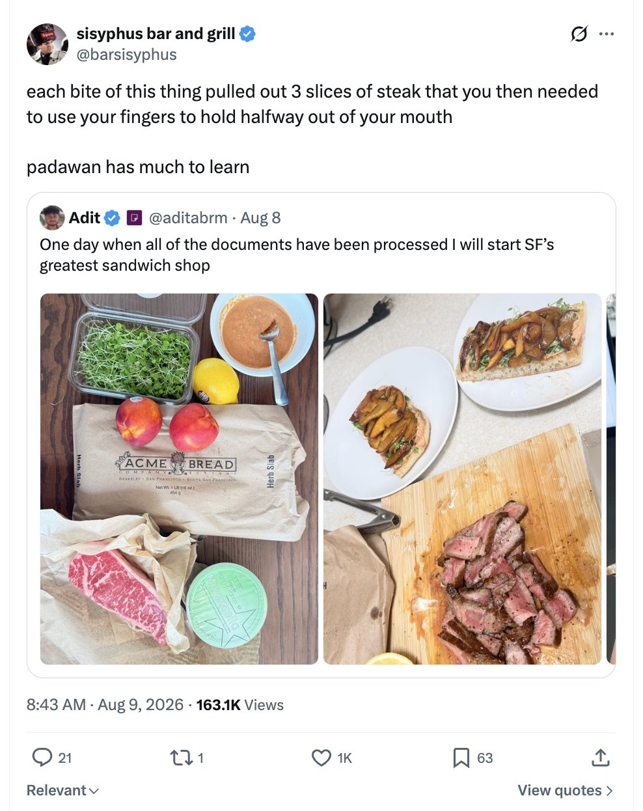
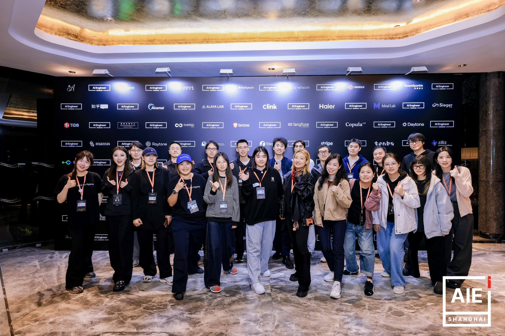
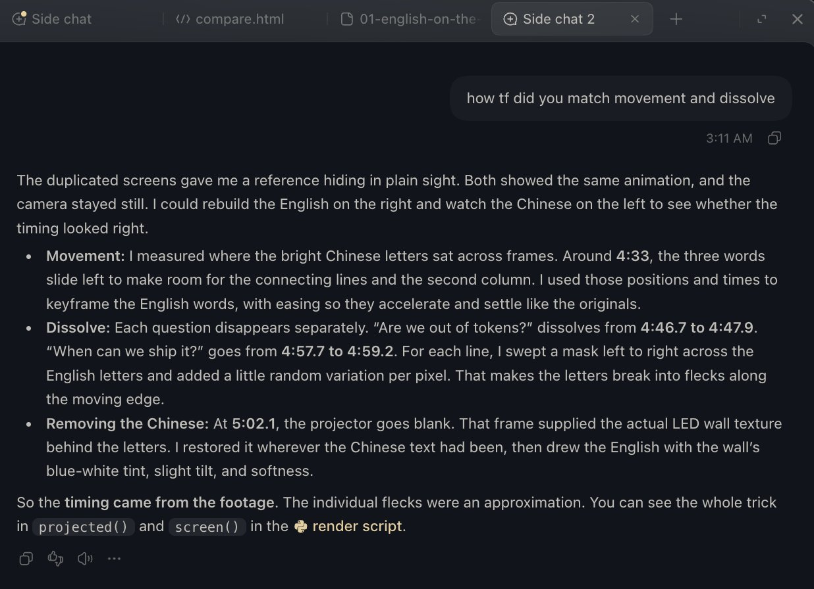
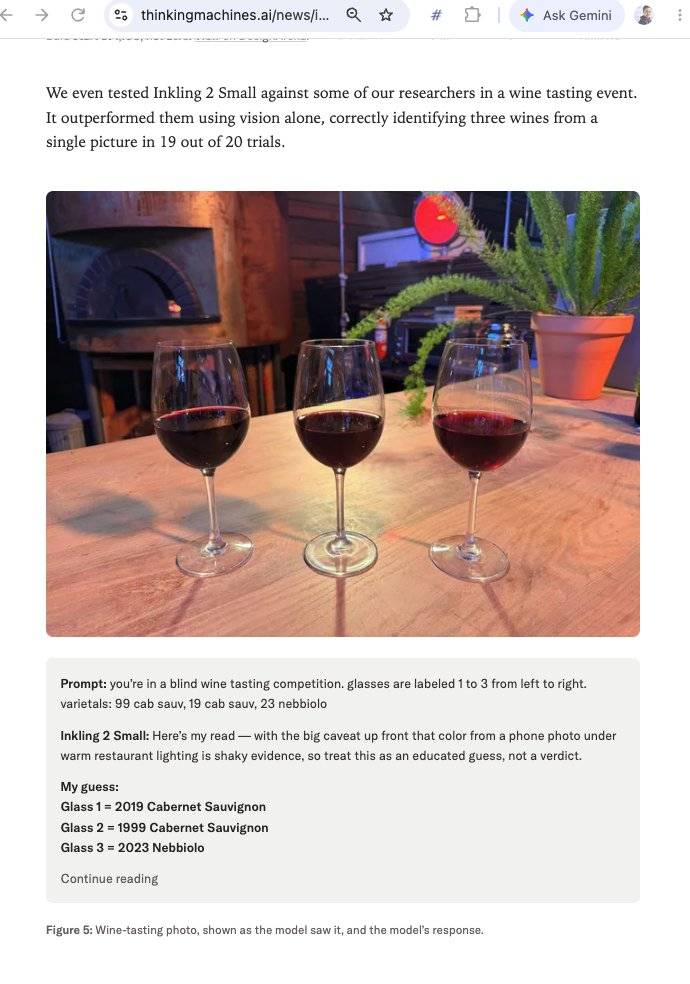
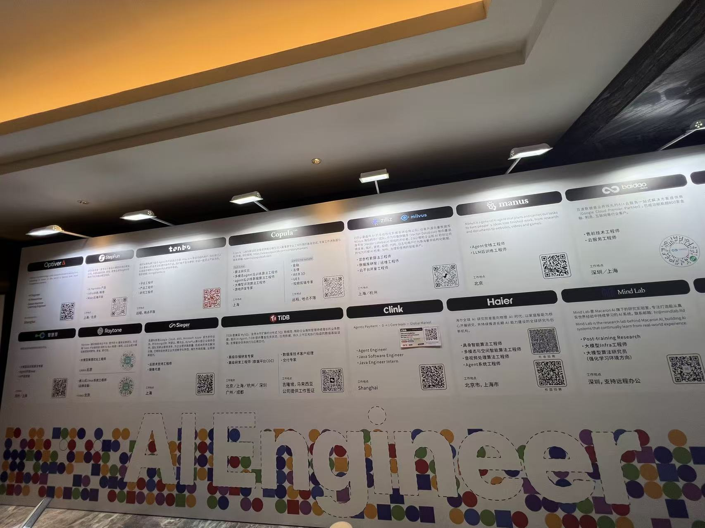
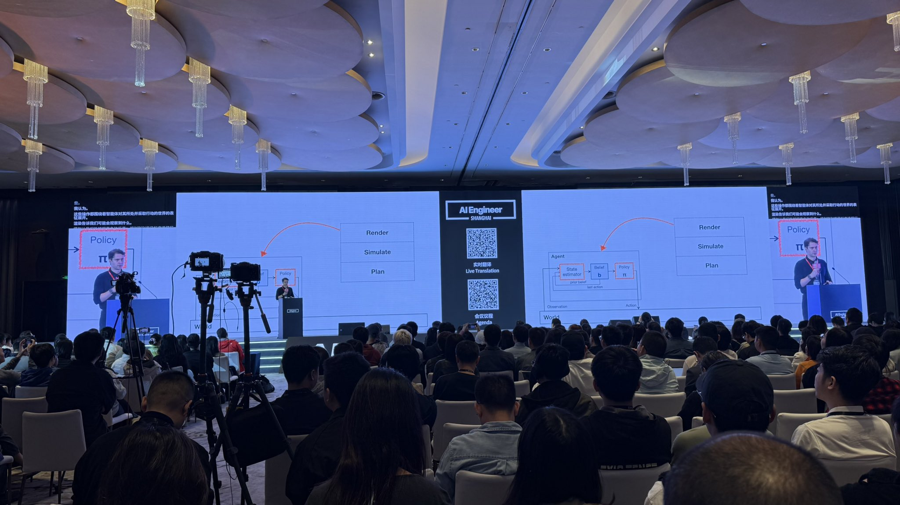
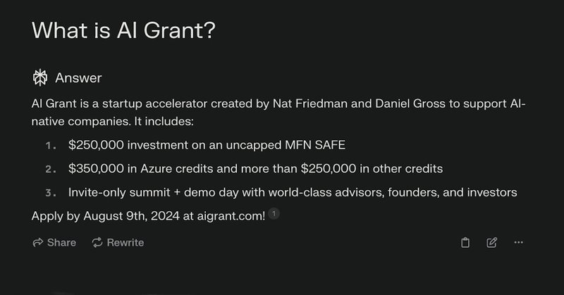

# 🐦 @swyx

## 📅 November 06, 2026

> 16 post(s) archived.

---

### 🕐 22:14 UTC · @swyx

> @aditabrm @reductoai @barsisyphus unironically, @allenpark cooked https://www.youtube.com/watch?v=KgqWyVVH4Oc

🔗 [View original post](https://x.com/swyx/status/2118829491904708834)

---

### 🕐 22:13 UTC · @swyx

> our cooking show (yes, cooking show) is back!!! @aditabrm reveals the entire recipe of @reductoai pdf processing and also steak sandwich making at the end we address the serious allegations leveled by @barsisyphus more elite food journalism coming on https://youtube.com/@latentspacepod In this episode, @reductoai co-founder and CEO @aditabrm joins @allenpark to make steak sandwiches with burrata, torched peaches, and chimichurri and talk about why PDFs still break AI: how frontier models silently drop rows, why 99% accuracy can still fall short in production, …

🔗 [View original post](https://x.com/swyx/status/2118829142607278366)

---

### 🕐 17:58 UTC · @swyx

> https://x.com/zanweiguo/status/2118179977019662815 ✅

🔗 [View original post](https://x.com/swyx/status/2118765012588400715)

---

### 🕐 17:58 UTC · @swyx

> https://x.com/YijinBao73718/status/2118195151151808614 AIE @ Shanghai! Happy to attend an event at Shanghai with @aiDotEngineer . This always night quality conference is as great as promised and can’t wait to talk to speakers at Expo 😜

🔗 [View original post](https://x.com/swyx/status/2118764969491943616)

---

### 🕐 17:27 UTC · @swyx

> good writing is not dead

🔗 [View original post](https://x.com/swyx/status/2118757173262180400)

---

### 🕐 17:27 UTC · @swyx

> Without all our lovely and amazing volunteers and my team, we couldn’t make this happen! Mengying you are the best, and already look forward to the 2nd AIE China! Where should we take next time? @aiDotEngineer @StandupPartners @swyx

🔗 [View original post](https://x.com/Ninggao88/status/2118757104223932762)

---

### 🕐 11:16 UTC · @swyx

> this is agi wtf (in @ryolu_&apos;s original footage i was given, BOTH sides of the screen were in Chinese. what u see below is Astra&apos;s rerender swapping English translation matching font and lighting and animations. MATCHING THE FUCKING LIGHTING.) @jxnlco @ryolu_ @aiDotEngineer guys guys

🔗 [View original post](https://x.com/swyx/status/2118663921448169741)

---

### 🕐 09:50 UTC · @swyx

> ok this is just ridiculous Introducing Inkling 2 Small. Scoring 31 on the AA Intelligence Index, it&apos;s a big jump over its predecessor. Inkling 2 Small is available for fine-tuning and inference on Tinker today, with full weight release planned soon. https://thinkingmachines.ai/news/inkling-2-small

🔗 [View original post](https://x.com/swyx/status/2118642061515936142)

---

### 🕐 06:20 UTC · @swyx

> also we need: - trumpet/clarinet guy - woodwinds guy - horn guy for next year’s show. tagging @creatine_cycle for musician friends

🔗 [View original post](https://x.com/swyx/status/2118589412011622728)

---

### 🕐 05:44 UTC · @swyx

> Covered the future of AI on VHS tape. Slide left to see the camera 📹 @daytonaio Media

🔗 [View original post](https://x.com/joshuacirjak/status/2118580275697639695)

---

### 🕐 05:09 UTC · @swyx

> Some of the takes I get from chatting with people at @aiDotEngineer 1. what is still still important nowdays is human interaction that need us to be face to face. P.S. I am glad this has become a larger range of mutual understanding now, last year, when I emphasize this, a lot of people still don&apos;t care and only cares about higher intelligence) 2. People are become more aware of the importance of building their personal social media. P.S. From my own observation, I also saw much more cases in Oct, where PhD students or those who used to not use social media start to &quot;cold-start&quot; their twitter or rednote with &quot;ask me anything&quot; style intro to get enough attention. In that case, it would also be much harder to know where to put our attention to. It would also be important to know how to filter those noise when everyone is trying to create some ripples. 3. AI will replace our jobs and no body knows what to do, the only thing we can do is to do things that makes us feel happy right now and wait for the time to come. (Many people think that having AI makes their life better but at the same time, AI will take their jobs. There are also people think that AI makes them think more about their lives. Personally, I have many opinions on all the above points a few month ago, if any one is interesting. Welcome to discuss or ask in the thread so that I would be able to know what to share when I write my next long article.

🔗 [View original post](https://x.com/SuJinyan6/status/2118571351439188260)

---

### 🕐 03:15 UTC · @swyx

> for those who want a GREAT scout experience i cannot recommend highly enough @brittwalker_ who has been thru thick and thin with me and is honestly sharper than me on many things, always learn lots talking to her https://x.com/andrew__reed/status/2118461875520467220?s=46 I still like working with CRV

🔗 [View original post](https://x.com/swyx/status/2118542845556691411)

---

### 🕐 03:00 UTC · @swyx

> ok guys pitchforks down pls we chatted and i learned a lot about why i had been missing context and communication - not a sequoia wide thing, just a small gap i got caught in. also the quoted tweet has impt inaccuracies/incomplete info i can’t share https://x.com/sonyatweetybird/status/2118525644753809583?s=46 but basically treat it as unrelated to the broader sequoia restructuring that was announced this week @swyx @temporalio DMing you @swyx there’s some important context i’ll share live. appreciate you and sorry we disappointed you.

🔗 [View original post](https://x.com/swyx/status/2118538896434999759)

---

### 🕐 02:13 UTC · @swyx

> .@chlassner teaching the room world model !== humans “world” at @aiDotEngineer SH. Agents/models see the world in action space, i love talks like this that demystify complex ideas.

🔗 [View original post](https://x.com/vincent_koc/status/2118527211011809684)

---

### 🕐 01:57 UTC · @swyx

> @temporalio we&apos;ll take some LPs but honestly more interested in building up my 2027 take on https://aigrant.com/ we&apos;ll use AIE HQ as base for portcos

🔗 [View original post](https://x.com/swyx/status/2118523041290596631)

---

### 🕐 01:13 UTC · @swyx

> uhh so this is how i found out that i&apos;m not only no longer a Sequoia Scout, my main partner (and boardmember since @Temporalio) is also gone. no email from sequoia yet about anything in the past month. no response to my texts from any partner. I literally left my previous partnership to join Sequoia because I respected what they have built and thought they represent the epitomy of what being long term partners could be in Silicon Valley and I wanted to be closer to that from the inside rather than read about it in @colossusmag hagiographies. disappointed. i respect the new direction but the collateral damage is high. on the plus side, i think i am done being a scout. @mariadlzollo and I are going to raise a small side fund, by founders for founders. we are seeking a compute partner (possible GP, or just sponsor/in-kind-investor), and a researcher GP. pls enquire within - dm or text if you have me, else business@latent.space Scoop: Sequoia forced out three US-based partners in its recent overhaul. Bogomil Balkansky, Jess Lee and Stephanie Zhan, were pushed out in recent weeks. Regarding Sequoia&apos;s Europe exit, my sources were surprised they didn&apos;t do it sooner More in story with @cityofthetown

🔗 [View original post](https://x.com/swyx/status/2118512013228077063)

---
