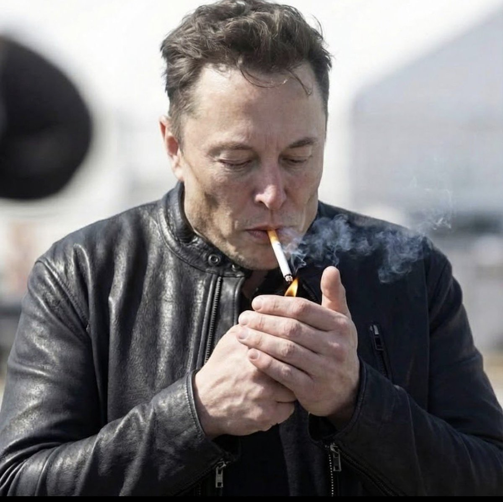

# 🐦 @AiEvolutio58513

## 📅 November 07, 2026

> 5 post(s) archived.

---

### 🕐 16:28 UTC · @AiEvolutio58513

> Palmer Luckey says Oculus kept finding wiretaps hidden inside product samples from Chinese factories: &quot;I actually have personal experience with China placing listening devices into sample products that I would receive from Chinese factories. This was at my previous company, Oculus VR.&quot; &quot;There were multiple times when we discovered actual wiretap electronics in product samples that were given to us. They would listen to us and transmit the voice samples over a cellular radio.&quot; Interested in AI? Follow @AiEvolutio58513 and never fall behind. I track ChatGPT, Claude, and every tool quietly changing how we work and create, then hand you the tested signals. Media

🔗 [View original post](https://x.com/AiEvolutio58513/status/2119104673840001126)

---

### 🕐 15:03 UTC · @AiEvolutio58513

> Elon Musk explains where environmentalism turns dangerous: when protecting the planet becomes treating humanity as the problem. &quot;In the natural extension of the environmentalist movement, if you go too far, you start to look at humanity as a bad thing. You start to look at humanity as though we are a plague on the surface of the earth.&quot; &quot;And in fact, there are some people who think and say explicitly that.&quot; His example: &quot;On the front page of the New York Times, there was a guy who said: there are 8 billion people on earth, it would be better if there were none. Which is crazy.&quot; His whole case for Mars, AI and abundance starts from the opposite idea: more humans, not fewer. Interested in AI? Follow @AiEvolutio58513 and never fall behind. I track ChatGPT, Claude, and every tool quietly changing how we work and create, then hand you the tested signals. Media

🔗 [View original post](https://x.com/AiEvolutio58513/status/2119083238862045229)

---

### 🕐 12:57 UTC · @AiEvolutio58513

> SpaceX has locked Anthropic into paying $3.1 billion a MONTH for compute starting in December. That&apos;s $37 billion a year, $120.5 billion through 2029. Every month, the bill is about 80% of Anthropic&apos;s current revenue, bigger than its Google and Amazon deals. Anthropic&apos;s own filing warns short-term compute &quot;carries a higher cost per unit&quot; and will &quot;compress our operating margin&quot;. Interested in AI? Follow @AiEvolutio58513 and never fall behind. I track ChatGPT, Claude, and every tool quietly changing how we work and create, then hand you the tested signals.

🔗 [View original post](https://x.com/AiEvolutio58513/status/2119051503810040033)

---

### 🕐 11:03 UTC · @AiEvolutio58513

> Elon Musk says medical school is now pointless: &quot;Everyone will have access to medical care that is better than what the president receives right now&quot; Peter Diamandis: &quot;So don&apos;t go into medical school?&quot; Elon Musk: &quot;Yes. Yeah. Pointless. But I would say that applies to any form of education&quot; &quot;5 or 4 years from now, we&apos;ll have better medical care than anyone has today, available for everyone&quot; Interested in AI? Follow @AiEvolutio58513 and never fall behind. I track ChatGPT, Claude, and every tool quietly changing how we work and create, then hand you the tested signals. Media

🔗 [View original post](https://x.com/AiEvolutio58513/status/2119022822110761076)

---

### 🕐 08:01 UTC · @AiEvolutio58513

> Peter Thiel reveals that 4 of the 6 PayPal founders built bombs as kids: &quot;I wasn&apos;t one of the bomb builders.&quot; It came out by accident: &quot;It was one of those strange late-night conversations. People were like, &apos;So what did you do in high school?&apos; &apos;I built a bomb.&apos; &apos;I built one too.&apos;&quot; Thiel&apos;s read on what that says about founders: &quot;There&apos;s something very extreme about the people who tend to found businesses. It&apos;s a crazy thing to start a company.&quot; And the catch: &quot;But once you start it, you don&apos;t want to make being too crazy a virtue, because that can also destroy it.&quot; The PayPal crew went on to found or fund Tesla, SpaceX, Palantir, YouTube and LinkedIn. Extreme people, kept just sane enough. Interested in AI? Follow @AiEvolutio58513 and never fall behind. I track ChatGPT, Claude, and every tool quietly changing how we work and create, then hand you the tested signals. Media

🔗 [View original post](https://x.com/AiEvolutio58513/status/2118977029660147934)

---
