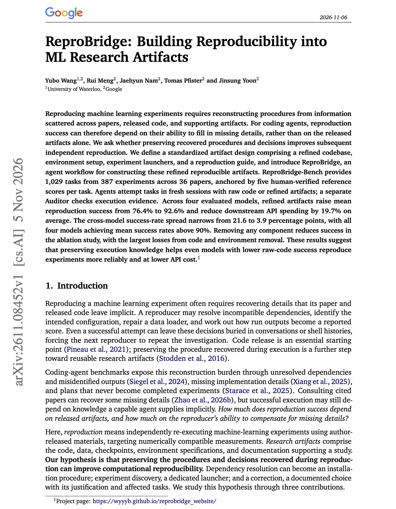
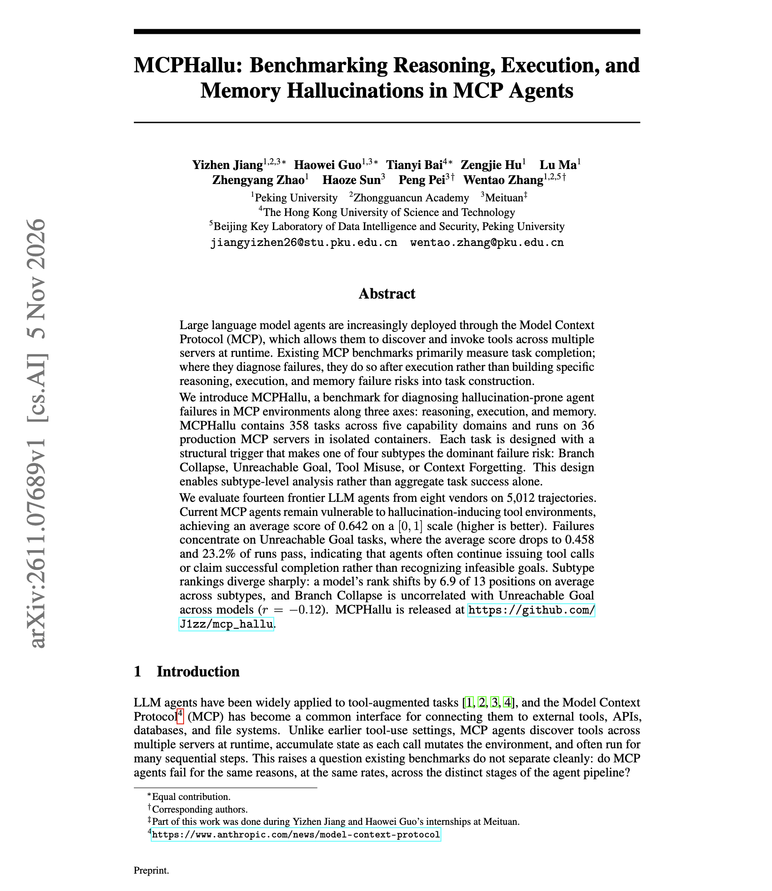

# 🐦 @dair_ai

## 📅 November 07, 2026

> 2 post(s) archived.

---

### 🕐 15:14 UTC · @dair_ai

> Great paper from Google on making ML experiments reproducible for coding agents. (bookmark it) If you run agents on research code, this one is worth your time. They find that refined artifacts raise agent reproduction success from 76.4% to 92.6% across four models and cut API spending by 19.7%. ReproBridge turns one successful reproduction into a package the next agent can reuse. The package holds the cleaned code, the environment setup, scripts that launch each experiment, and a written guide. A new agent reruns the experiment from that package. A separate auditor then checks that the runs actually happened. The benchmark covers 1,029 tasks from 36 papers, each with five human-verified reference scores. The gap between the best and worst model drops from 21.6 to 3.9 points. Removing the code or the environment setup causes the largest losses. If your agents keep failing to rerun a repo, save the setup steps from the first successful run before trying a bigger model. https://arxiv.org/abs/2611.08452 Chat with Paper: https://academy.dair.ai/papers/reprobridge-building-reproducibility-into-ml-research-artifacts-2611.08452

🔗 [View original post](https://x.com/omarsar0/status/2119085975880212842)

---

### 🕐 15:05 UTC · @dair_ai

> Great paper finds that MCP agents rarely say that tasks are impossible. They propose MCPHallu, which runs 358 tasks on 36 production MCP servers. Each task is built to trigger one failure type, such as branch collapse, an unreachable goal, tool misuse, or forgetting context. Across fourteen frontier agents and 5,012 trajectories, the average score is 0.642 out of 1. On unreachable-goal tasks, only 23.2% of runs pass. Agents keep calling tools or report success instead of saying the goal cannot be met. A model&apos;s rank moves by 6.9 of 13 places on average depending on the failure type. The main takeaway is that you want to pick models for MCP work by the failure type your users hit most, and add tests where the right answer is to stop. https://arxiv.org/abs/2611.07689 Chat with Paper: https://academy.dair.ai/papers/mcphallu-benchmarking-reasoning-execution-and-memory-hallucinations-in-mcp-agent-2611.07689

🔗 [View original post](https://x.com/dair_ai/status/2119083711522316490)

---
