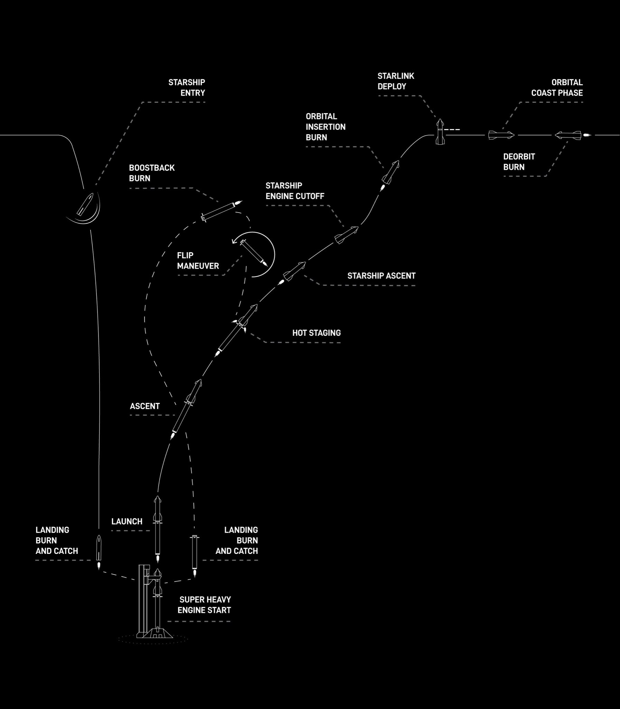
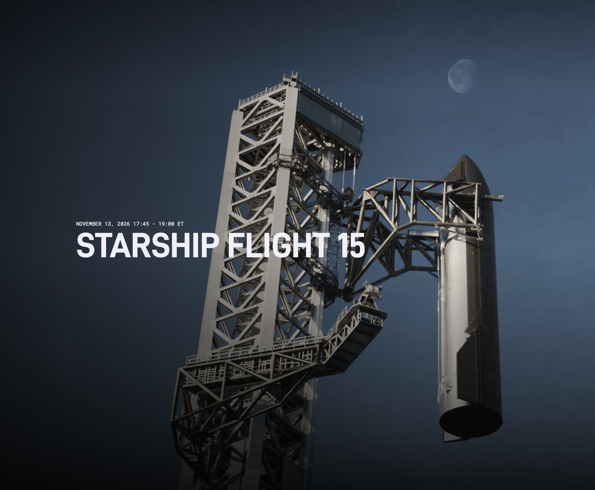
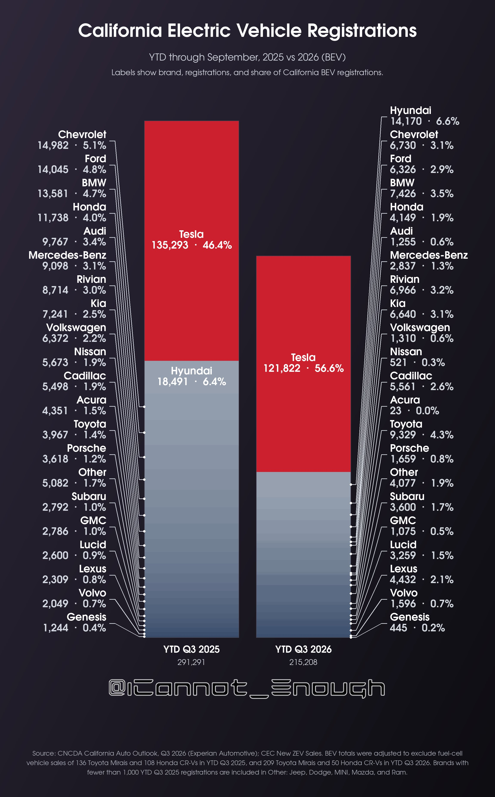
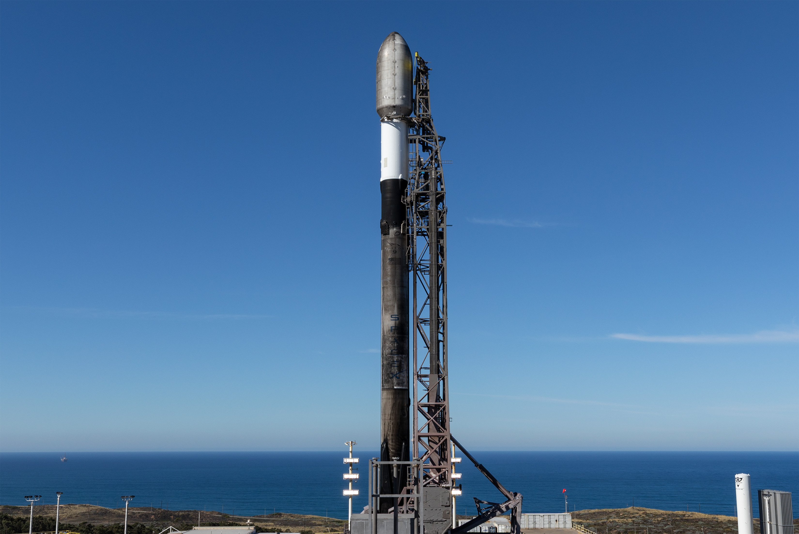

# 🐦 @elonmusk

## 📅 November 07, 2026

> 31 post(s) archived.

---

### 🕐 19:39 UTC · @elonmusk

> There are efficiency improvements coming that will allow for a 40kWh Cybercab pack. We will make this in liquid silver, so the colors are not too monotonous. The biggest thing most people fail to understand is that there are a very limited number of smart, dedicated people! They can only do so many things. If we have to maintain a complex production line, supply chain and allocate engineering for Cybertruck, we can’t use those people or factory space and machinery for scaling Cybercab, which is the vehicle that will PROFOUNDLY transform the world of terrestrial transport!

🔗 [View original post](https://x.com/elonmusk/status/2119152839813456261)

---

### 🕐 19:14 UTC · @elonmusk

> Most people don’t know that the best-selling car in the world is the Tesla Model Y. And the second and third best-selling cars are much cheaper. Tesla Model Y has been the world’s best-selling passenger vehicle for 3 consecutive years 2023 → #1 2024 → #1 2025 → #1 Model Y alone has surpassed 4 million global sales, while Tesla has now delivered more than 10 million vehicles worldwide Not just the best-selling EV Model Y …

🔗 [View original post](https://x.com/elonmusk/status/2119146526899396725)

---

### 🕐 19:07 UTC · @elonmusk

> Who put your beliefs into your head? It probably wasn’t you. who is prompting you? $CLAUDIA contest entry by @PinelandLabs clip&apos;s 2:19 — full video + vote → https://sxsi.com/s/contest-who-is-prompting-you

🔗 [View original post](https://x.com/elonmusk/status/2119144684299915299)

---

### 🕐 18:38 UTC · @elonmusk

> I want to be José Ron Baron is 83. In front of thousands of investors in New York, he looked at Elon Musk and asked the one question an 83-year-old asks. &quot;How do you want people to think about you?&quot; For the full hour before, it had been trillion-dollar chip fabs. Starship. Starlink. The business …

🔗 [View original post](https://x.com/elonmusk/status/2119137465323708895)

---

### 🕐 18:32 UTC · @elonmusk

> Interesting BREAKING: Google’s parent Alphabet added another 3.85 million shares of SpaceX in Q3, its latest SEC filing shows. Alphabet held 555 million shares worth $83.7 billion as of Sept. 30. SpaceX alone made up nearly 95% of its reported stock portfolio. Google first put $900 million …

🔗 [View original post](https://x.com/elonmusk/status/2119135865662300669)

---

### 🕐 18:13 UTC · @elonmusk

> Starlink saves lives BREAKING: Earthquake-hit village in Indonesia receives @Starlink to help restore communications The equipment arrived after an Indonesian lawmaker visited Tado village. Starlink can help families get back online, check on loved ones and find out where to get aid. ♥️

🔗 [View original post](https://x.com/elonmusk/status/2119131060806074732)

---

### 🕐 18:12 UTC · @elonmusk

> The Tesla Cybertruck order backlog is currently far more than we can make before dismantling the line for Cybercab expansion around June/July next year. We will add an extra shift to try to get all orders done in time.

🔗 [View original post](https://x.com/elonmusk/status/2119130949434888330)

---

### 🕐 17:42 UTC · @elonmusk

> SpaceX has outlined five contingency landing options for Starship Flight 15 as it prepares for the ship’s first tower-catch attempt at Starbase This visualization shows how the mission can change course if the vehicle or tower does not meet the conditions required for a safe return: 1. Indian Ocean — after ascent If the orbital insertion burn is skipped, Starship remains on its suborbital trajectory and reenters over a predetermined area of the Indian Ocean 2. North of Hawaii — early in the mission If the flight needs to end shortly after reaching orbit, Starship returns to a designated area of the Pacific north of Hawaii 3. Off Chile — mid-mission A separate return opportunity allows Starship to land in the eastern Pacific, far off the coast of Chile 4. Gulf offshore — catch contingency If the tower catch is called off before final approach, Starship has an offshore landing option in the Gulf instead of proceeding with the catch 5. North of Hawaii — late in the mission If the planned deorbit burn is skipped, Starship completes another orbit before returning to the Pacific north of Hawaii The objective is to bring Starship home. The flight plan builds in alternatives throughout the journey, with continuous vehicle-health checks determining when to proceed An ambitious mission, backed by carefully planned options from ascent to final approach Media

🔗 [View original post](https://x.com/XFreeze/status/2119123323225612354)

---

### 🕐 17:37 UTC · @elonmusk

> The most important thing for the Senate to do is to stay in session EVERY DAY until the Democrats take over. Every judge and nominee confirmed, every priority done. Jobs, affordability, accountability. NO DAYS OFF! Media

🔗 [View original post](https://x.com/SenRickScott/status/2119122035880431703)

---

### 🕐 17:19 UTC · @elonmusk

> True @peterrhague @elonmusk Not only that, Tesla open sources their patents. Competitors are free to copy them.

🔗 [View original post](https://x.com/elonmusk/status/2119117494992478449)

---

### 🕐 17:08 UTC · @elonmusk

> Starship flight maneuvers

🔗 [View original post](https://x.com/elonmusk/status/2119114815931039992)

---

### 🕐 16:54 UTC · @elonmusk

> Catching a giant rocket falling from space Starship is preparing for catch Flight 15 is targeting to launch as early as Friday, November 13, pending regulatory approval → https://spacex.com/launches/starship-flight-15

🔗 [View original post](https://x.com/elonmusk/status/2119111269718364631)

---

### 🕐 16:30 UTC · @elonmusk

> A statistic that sounds fake but isn&apos;t: Not one single white American man born after 1984 has published a work of literary fiction in The New Yorker. It&apos;s not because they stopped writing. It&apos;s because The New Yorker has refused to publish them. The publishing industry has blacked out a generation of male writers &amp; then they wonder why boys don&apos;t read. About 70% of publishing professionals are women. Because agents and editors tend to select books they personally relate to, an increasing number of male authors are being sidelined in the publishing industry, resulting in an overwhelming number of female protagonists on our shel…

🔗 [View original post](https://x.com/politicalmath/status/2119105264569745683)

---

### 🕐 16:29 UTC · @elonmusk

> SpaceX just released a detailed blog post explaining how Starship will return to Starbase for its first tower-catch attempt on Flight 15 and it is going to be the first full recovery of an orbital launch system The mission brings together both sides of Starship’s future: delivering a major payload to orbit and bringing the entire launch system home for reuse. Super Heavy will return minutes after liftoff, while Starship will deploy 26 Starlink V3 satellites, fly a mission of more than 22 hours, then make its way back through the atmosphere toward the tower at Starbase, provided it passes the required vehicle-health checks The update walks through the orbital safety checks, heatshield inspections, alternative splashdown locations, the precise approach over northern Mexico and southern Texas, and the final sequence of bellyflop, engine ignition, flip and catch Flight 15 is targeting launch as early as Friday, November 13, pending regulatory approval. The 75-minute launch window opens at 4:45 p.m. CT. Here is the full plan, from liftoff to bringing both stages home 1. LAUNCH AND THE BOOSTER’S RETURN Super Heavy will lift Starship from Starbase before the vehicles separate through hot-staging: Starship ignites its engines while still attached, then continues toward space as the booster turns back. The booster will perform its boostback burn, descend toward Starbase and begin its landing burn roughly six minutes after liftoff. The catch is planned for approximately 6 minutes 35 seconds into flight. This will be the first catch attempt for a V3 Super Heavy booster. SpaceX has already caught three V1 boosters, with two subsequently flown again. 2. THE HARDWARE DESIGNED FOR CATCHING Super Heavy V3 has three grid fins instead of four. Each is 50% larger and significantly stronger, with a new catch point and revised positioning to support lifting and catching operations. The tower’s mechanical arms......the chopsticks are shorter to allow faster movement and better tracking during a catch. Their main actuators have changed from hydraulic to electromechanical, improving speed, redundancy and reliability These changes are part of the broader V3 architecture, designed around making recovery and reuse routine operations. 3. STARSHIP DOES NOT COMMIT TO ORBIT IMMEDIATELY The ship initially follows a passively safe suborbital trajectory rather than entering a sustained orbit directly. This is deliberate. If a problem occurs during ascent or shortly afterward, the trajectory takes Starship toward a cleared reentry area over the Indian Ocean without requiring a successful orbital mission. After ascent, flight controllers assess the vehicle’s health and make a go/no-go decision for orbit. With a go, one sea-level Raptor performs an orbital insertion burn approximately 26 minutes after liftoff, increasing Starship’s speed enough to establish orbit. 4. DEPLOYING 26 STARLINK V3 SATELLITES Satellite deployment is planned to begin around 35 minutes into flight and finish around 1 hour 18 minutes. Each Starlink V3 satellite adds approximately 1 terabit per second of network capacity. SpaceX compares this mission’s 26 satellites with roughly 10 Falcon 9 launches carrying V2 Mini satellites. After deployment, the satellites unfold their antennas and solar arrays, establish radio and laser communications, and use onboard propulsion to raise their orbits. Customer service is expected to begin as soon as a few weeks after launch. Three satellites have an additional job: photographing Starship’s heatshield. Those images will be transmitted to operators and become one of several sources of information used to assess whether the ship is ready to return to Starbase. SpaceX has already tested this inspection method on previous flights. 5. ALMOST A DAY IN ORBIT The planned mission lasts more than 22 hours, with approximately 14 orbits at an altitude of roughly 275 kilometers. After deploying the satellites, Starship will coast for around another 21 hours until its orbit aligns with Starbase for the return. Throughout that period, controllers will run continuous manual and automated checks. These cover engine health, power, communications, flight computers, navigation sensors, tank and feedline integrity, tank pressure and attitude control......the ability to maintain the ship’s intended orientation. These checks are intentionally conservative. Returning to the tower is something the vehicle must qualify to do through its condition in flight. 6. ALTERNATIVE RETURN OPTIONS THROUGHOUT THE MISSION The flight includes opportunities to end the mission early in precleared Pacific Ocean areas if the vehicle is not suitable for a Starbase return. These include early- and late-mission splashdown options around Hawaii and a mid-mission opportunity several hundred kilometers off Chile’s coast. The same areas were used during Flight 14. The mission therefore has multiple decision points rather than a single commitment to return home regardless of the vehicle’s condition. 7. THE DEORBIT BURN AND REENTRY Starship will proceed toward Starbase only if it meets SpaceX’s internally developed, FAA-approved conditions for return and catch. A single Raptor 3 engine will perform the deorbit burn, planned around 21 hours 36 minutes after launch. That changes the ship’s trajectory toward atmospheric entry over the Pacific Ocean, thousands of kilometers uprange from Starbase. Reentry is planned to begin around 22 hours 11 minutes into flight. The four control flaps will guide Starship along its intended trajectory while allowing small, deliberate turns to route it over sparsely populated areas of northern Mexico and southern Texas. 8. THE FLIGHT PATH BACK TO STARBASE Starship will approach from the west and steer around the major cities of the Rio Grande Valley. It will pass north of South Padre Island, continue out over the Gulf, then make its final turn south toward Starbase. This is not an entirely untested maneuver: SpaceX has demonstrated the banking maneuver on previous Starship flights. Residents of Cameron County and nearby areas may hear one or more sonic booms. What people experience will depend on weather and other conditions. Reentry over land also has extensive spaceflight precedent, including the Space Shuttle, Dragon’s previous Florida returns, and Soyuz and Shenzhou missions. 9. HOW EARLIER FLIGHTS PREPARED THE HEATSHIELD Previous ocean-return tests allowed SpaceX to deliberately push the heatshield, structure and control systems beyond the demands of a normal return to the launch site. Experiments included removing dozens of heatshield tiles from critical locations and flying maneuvers that subjected the vehicle and flaps to higher heating and aerodynamic forces than a nominal reentry. Flight 15 also retains Flight 14’s heatshield improvements, including additional tile-retention mechanisms in vulnerable areas, measures addressing plasma intrusion behind tiles, and curved tiles across a large portion of the shield to reduce heating between them. The V3 rear-flap mechanism uses a single actuator with three motors per flap, improving redundancy while reducing mass and cost. 10. THE FINAL BELLYFLOP, FLIP AND CATCH Arriving over Starbase, Starship will descend toward the tower at Pad 2 in its bellyflop orientation. Shortly before reaching the tower, it will ignite its three sea-level Raptors, flip upright and stow its flaps. Once vertical, it will reduce to two engines and maneuver between the tower’s arms. It will then reduce to one engine as it approaches a near hover. The arms will close rapidly around two catch fittings just below the forward flaps. Once Starship detects contact with the arms, it will shut down its final engine. The ship catch is planned for approximately 22 hours 32 minutes after liftoff. All mission timings are approximate and subject to change. 11. SAFETY OPTIONS REMAIN AVAILABLE DURING REENTRY SpaceX has built in options to end reentry before the ship reaches land if necessary, including intentionally tumbling the vehicle to ensure atmospheric breakup. There is also a late option to divert into the Gulf if either the ship or the tower develops a problem that prevents a safe catch. The objective is ambitious, but the return is governed by explicit vehicle-health requirements and multiple alternatives throughout the flight. 12. WHY THIS MISSION MATTERS Catching the booster solves one part of the recovery challenge. Bringing the upper stage back from orbit addresses the other. SpaceX described recovering the entire orbital launch system as the “Holy Grail of rocketry” the foundation for full and rapid reuse and an eventual airplane-like flight cadence. That is the capability behind Starship’s larger mission: expanding Starlink, deploying the planned Starmind supercompute constellation, establishing a permanent human presence on the Moon and making life multiplanetary. Flight 15 is taking SpaceX another major step toward that future: launch, deploy, orbit, return and bring both stages home SpaceX’s full catch update: https://www.spacex.com/updates#starship-catch Official Flight 15 mission details: https://www.spacex.com/launches/starship-flight-15 Media

🔗 [View original post](https://x.com/XFreeze/status/2119105020423799051)

---

### 🕐 16:01 UTC · @elonmusk

> SpaceX has just released a new blog about Starship&apos;s upcoming 15th flight planned for Nov 13 with more info about what to expect, the significance of this flight, and their approach to safety: &quot;Starship is preparing to take a major step towards full reusability: bringing the Starship upper stage back to the launch site for a catch by the tower at Starbase. To return Starship to Starbase, the spacecraft must now fly a safe trajectory that will take it over inhabited areas in northern Mexico and southern Texas to reach its launch site for catch. Like previous flight testing and the first successful mission to orbit, Starship’s flight profile for this ambitious mission is being designed with opportunities to safely end the mission early if necessary and will follow strict criteria before committing to the final phases of flight. OUR APPROACH TO A SAFE RETURN: On Flight 15, Starship will initially launch to a passively safe suborbital trajectory. This is the same flight profile used on Starship’s first orbital mission and ensures that any issues encountered during ascent or shortly thereafter will result in Starship reentering over a cleared area of the Indian Ocean. After this initial ascent, flight controllers will assess the health of Starship’s systems before giving a “go” or “no-go” for orbit. If “go”, Starship will then perform an orbital insertion burn with a single Raptor sea-level engine, increasing its speed and achieving orbit around Earth. Once on orbit, Starship will deploy its payload of Starlink V3 satellites. Three of these satellites have been modified to acquire imagery of Starship’s heatshield. This method of analyzing Starship’s heatshield has been tested on previous flights and is one of several data sources to help inform Starship’s readiness to return to the launch site on Flight 15. After deploying its payload, Starship will then coast in orbit for another ~21 hours until its orbit aligns with Starbase for a return. During this multi-hour orbital coast, flight controllers will continuously perform manual and automated checks of Starship systems which, similar to the first orbital flight, will be intentionally conservative. They include Raptor engine health, loss of power or communications, the health of the flight computers and navigation sensors, the structural integrity of the propellant tanks and feedlines, the ability to hold tank pressure, and Starship’s ability to control its attitude. During this prolonged coast phase, flight control teams have several options to end the mission early and return Starship to precleared areas of the Pacific Ocean if needed. These locations include early- and late-mission splashdown options around Hawaii and a mid-mission splashdown opportunity several hundred kilometers off the coast of Chile. These precleared areas, which were also used during Flight 14, provide a safe place to land Starship if any conditions arise that may preclude the ability to perform a safe reentry. WHAT SHIP CATCH WILL LOOK (AND SOUND) LIKE: Flight controllers will only permit Starship to return to Starbase if the vehicle’s status meets our internally developed, and FAA-approved, conditions for a return to launch site and catch. If these requirements are met, Starship will perform a deorbit burn with a single Raptor 3 engine. This deorbit burn will alter Starship’s path to place the vehicle on a course to reenter Earth’s atmosphere at a specific point over the Pacific Ocean, thousands of kilometers uprange from Starbase. During reentry, Starship can alter its flight path by moving its four control flaps. This will permit Starship to maintain a safe and known trajectory while guiding itself with high precision control toward Starbase. This control will also allow Starship to carry out a series of small turns in its trajectory to intentionally fly over sparsely populated areas of northern Mexico and southern Texas. As Starship approaches Starbase from the west, the vehicle will weave its way around the major cities in the Rio Grande Valley, passing to the north of South Padre Island and out over the Gulf of America as it makes its final turn south towards Starbase. This banking maneuver has been demonstrated several times on previous Starship flight tests. During this phase, residents of Cameron County and those in the nearby area may hear one or more sonic booms as Starship approaches the launch site. A sonic boom is a brief, thunder-like noise a person on the ground hears when an aircraft or other vehicle in the area flies faster than the speed of sound. The sonic boom does not present a health risk and what people experience will depend on weather and other conditions. As Starship arrives over Starbase, it will perform the final bellyflop maneuver down towards the tower at Pad 2. This bellyflop was proven during a series of high-altitude test hops and during numerous suborbital flight tests. Shortly before reaching the tower, Starship will ignite its three sea-level Raptor engines and flip itself vertical while stowing its flaps. After the flip is complete, Starship will down-select to two Raptor engines and maneuver between the tower&apos;s mechanical arms, before down-selecting to a single engine as it comes to a near hover. The arms will close rapidly to catch Starship on its two catch fittings just below the forward flaps. Once Starship registers contact with the tower arms, it will shut down its final Raptor engine. During reentry, flight controllers will have several options to end the reentry early and safely by intentionally tumbling Starship to ensure that it breaks up in the atmosphere before reaching land. There is also a late-reentry option to send Starship into the Gulf of America if any of its systems or the tower itself encounter an issue after reentry that would preclude a safe catch at Starbase. THE HOLY GRAIL OF ROCKETRY: Recovering an entire orbital launch system has never been done, and Starship has always been designed change that. This full recovery is often referred to as the Holy Grail of rocketry as it enables full and rapid reuse of a rocket – opening the door to airplane-like cadence where a vehicle flies again rapidly. Reaching this milestone with Starship will allow SpaceX to unlock the true capability of Starship and will enable future missions to establish a permanent human presence on the Moon, expand the worldwide Starlink network, launch our Starmind supercompute constellation, extend the light of consciousness to the stars, and make life multiplanetary.&quot; Video below of the what flight 15&apos;s mission profile is: Media

🔗 [View original post](https://x.com/SawyerMerritt/status/2119097866123624773)

---

### 🕐 15:51 UTC · @elonmusk

> SpaceX has officially announced that it is currently targeting November 13th at 5:45 PM ET for Starship&apos;s 15th flight. Flight info: &quot;This flight is planned to be the first to return both Starship and Super Heavy to the launch site for catch. If successful, this will mark the first full recovery of an orbital launch system and a breakthrough moment in making Starship a reliable, rapidly reusable rocket.&quot; • Flight will last more than 22 hours, completing approximately 14 orbits around Earth. • Starship will orbit at an altitude of approximately 275 km (171 miles). • First attempt to recover both Super Heavy and Starship at the launch site during the same mission. • First return-to-launch-site and catch attempt for a Super Heavy V3 booster. • Super Heavy will execute launch, ascent, stage separation, boostback burn, and return to Starbase for a tower catch. • Starship will deploy 26 Starlink V3 satellites into orbit before attempting its first return to Starbase and tower catch. • The 26 satellites will provide capacity equivalent to approximately 10 Falcon 9 launches carrying Starlink V2 Mini satellites. • Satellites will deploy antennas and solar arrays, establish radio and laser communications, and raise their orbits using onboard thrusters. • Satellites could begin serving customers within weeks of launch following successful on-orbit checkouts. • Three Starlink V3 satellites will carry cameras to inspect Starship&apos;s heatshield and transmit imagery to ground operators. • Starship&apos;s heatshield will feature improved tile retention, additional protection against plasma intrusion, and expanded use of curved tiles to reduce heating between tiles. • Starship will only attempt its return and catch if critical reentry, landing burn, and tower approach systems are confirmed healthy. • Multiple predetermined ocean deorbit locations and a passively safe suborbital trajectory provide contingency options. • A successful mission would mark the first complete recovery of an orbital launch system, a major milestone toward rapid reusability. More info: https://www.spacex.com/launches/starship-flight-15

🔗 [View original post](https://x.com/SawyerMerritt/status/2119095373620736058)

---

### 🕐 15:13 UTC · @elonmusk

> 10k kids born today, 10k new 530A accts auto created by @USTreasury w $1000 in the S&amp;P 500 compounding for 18 yrs. 10k kids born tomorrow, 10k new accounts. And the day after. Forever. 🇺🇸💰🚀 Media

🔗 [View original post](https://x.com/altcap/status/2119085865309999174)

---

### 🕐 13:37 UTC · @elonmusk

> 🚨 What happened to the California EV market? $7,500 new EV federal tax credit expired Who lost EV market share? Models people only bought for the tax credit Who gained EV market share? Tesla: up 1,020 basis points

🔗 [View original post](https://x.com/ICannot_Enough/status/2119061570995065335)

---

### 🕐 08:41 UTC · @elonmusk

> Yesterday, I was working on something with Grok Bot when a guy nearby noticed me using it He immediately pulled out his phone and started showing me how he uses Grok Bot, how he had set up all his bots, and how he manages his usage limits he just literally saw me using Grok Bot and came over out of curiosity. We ended up having a really nice conversation about how we’re both using it haha

🔗 [View original post](https://x.com/XFreeze/status/2118987271965966564)

---

### 🕐 06:40 UTC · @elonmusk

> True Whenever people say the U.S. has a lot of starvation, it&apos;s like they&apos;re saying they don&apos;t realize the poor have obesity issues these days.

🔗 [View original post](https://x.com/elonmusk/status/2118956856978653374)

---

### 🕐 05:15 UTC · @elonmusk

> 5 years ago @ErcXspace And ship will be caught by Mechazilla too. As with booster, no landing legs. Those are only needed for moon &amp; Mars until there is local infrastructure.

🔗 [View original post](https://x.com/elonmusk/status/2118935230182805688)

---

### 🕐 03:23 UTC · @elonmusk

> 天呐，海底光缆统治世界的时代要结束了，又要见证历史了🤯。。 马斯克首次公布 Starlink V4 的极端参数：性能直接跳涨一百倍，光速天然快了一点四倍且不用绕大陆架，上千万条激光链路正在把地球通信主干搬上深空。 绝大多数人至今依然以为，星链只是给偏远山区、游艇和飞机提供网络补丁的边缘工具。 直到马斯克刚刚在最新的投资人会议上摊开底牌，很多人才第一次看懂 SpaceX 真正的阳谋：把构筑人类现代文明的海底光缆网络，从大洋深处连根拔起，彻底搬到太空。 这里藏着一个极度反直觉的物理常识： 光在太空真空中的传播速度，比在玻璃光纤里整整快了 40%。 更致命的是几何路径的差异。海底光缆必须顺着大陆架和海沟蜿蜒曲折地绕远路，而太空中的卫星激光链路，两点之间永远是沿着大圆航线在真空中直线对穿。这意味着在跨洋超长距离通信上，太空激光的延迟天然比地面光缆更低。 而阻碍这件事过去的唯一瓶颈，是带宽密度。 马斯克这次直接给出了技术迭代的量化终局： 从 V2 到即将落地的 V4 卫星，单星吞吐能力将直接迎来 100 倍的暴力跃升。 在更长期的宏大蓝图里，超过 10 万颗卫星组成的轨道阵列，每颗都将配备大约 100 个传输速率超 10 Tbps 的光学激光器，在地球外围织成一张百 Exabit 级别的无缝高速网状路由。 这已经不是在做卫星宽带了，这是在用火箭把全球互联网的核心骨干网整个重写一遍。 海底光缆容易被地质地震震断、被船锚挂伤，更深陷地缘博弈的物理封锁；而悬在头顶的真空激光网络，既没有折射损耗，也没有无法逾越的地理边界。 人类用了上百年时间，把铜线和光纤一根根沉入海底来连接彼此；而未来的文明动脉，注定要在没有阻力的星空里以光速奔流。 https://x.com/SawyerMerritt/status/2118783107189076137/video/1 Media 马斯克刚刚把全球半导体制造行业最后一点虚伪的遮羞布撕碎了， 老马透露今年全世界除了他以外生产的所有 AI 芯片加起来大概只有二十吉瓦，而他正在秘密推进的超级芯片工厂 TeraFab，终极目标是把年产量直接干到整整一太瓦，也就是明年全球总产量的三十倍。 当大多数科技巨头还在为了抢台积电几万片先进封装配额打破头的时候， 马斯克对 TeraFab 这个名字给出的三重拆解，已经把工业狂人的冷血算盘展现得淋漓尽致，它既谐音代表让人毛骨悚然的恐怖， 也代表扎根于这颗星球的土地，但底层最纯粹的本质就是物理学上的太瓦，一个大到超出人类现行半导体常识的超级怪兽。 按照目…

🔗 [View original post](https://x.com/AYi_AInotes/status/2118907113439170814)

---

### 🕐 02:42 UTC · @elonmusk

> It’s time to put all the pieces together, the early tests to see how crazy it was to build a vehicle this size, the suborbital hops to practice subsonic maneuvering, the first real booster, expendable flight tests, trips to the Indian Ocean, and last flight with payload to orbit. We are one step away from the full mission, and that step is the double catch. We will try for the first time on flight 15. I don’t think and of us can promise it will work the first time, but getting here feels like a turning point. I still feel like there’s so much to review (and we will be doing that continuously between now and launch) but when I take a moment to stop and think about it, it is overwhelmingly exciting. This is the rocket that will build a human civilization on another planet. SpaceX will attempt to catch both the Super Heavy booster and Starship on the upcoming flight. If both are successful, it will mark the first time that all parts of an orbital rocket return to Earth intact. This is the critical breakthrough needed to make life multiplanetary.

🔗 [View original post](https://x.com/ShanaDiez/status/2118896809263169862)

---

### 🕐 01:53 UTC · @elonmusk

> In the coming years, @Neuralink will enable people to walk and use their hands again Neuralink gave Noland Arbaugh something to wake up for. “I didn’t have anything to wake up for in the morning, and this has changed that for me.” @elonmusk says he’s fairly confident Neuralink could restore full-body functionality at some point in the future—not a capability ach…

🔗 [View original post](https://x.com/elonmusk/status/2118884500201787770)

---

### 🕐 01:40 UTC · @elonmusk

> Super intelligence leads to abundance SpaceX’s Arizona data center, per a county supervisor: “We could be reducing property taxes across the board in Cochise County, the entire county, by 20%” Frank Antenori, whose district includes the site, brought up the county’s tax math during a live Q&amp;A: “Here’s just something…

🔗 [View original post](https://x.com/elonmusk/status/2118881284743483488)

---

### 🕐 01:39 UTC · @elonmusk

> It is so tempting to make a 500 ton thrust Raptor 4 in place of the 250 ton Raptor 3 for the outer ring of the Starship booster

🔗 [View original post](https://x.com/elonmusk/status/2118880932014997910)

---

### 🕐 01:22 UTC · @elonmusk

> 5 years ago Elon called catching rockets with giant chopstick arms “bananas” years before SpaceX pulled it off. “We’re talking about catching the largest flying object ever made on a giant tower with chopstick arms. It’s like Karate Kid with the fly, but much bigger.” Elon Musk, Lex Fridman…

🔗 [View original post](https://x.com/elonmusk/status/2118876612544561449)

---

### 🕐 01:18 UTC · @elonmusk

> Starship is the most powerful moving object of any kind made by humans Media

🔗 [View original post](https://x.com/elonmusk/status/2118875601654436061)

---

### 🕐 01:06 UTC · @elonmusk

> Of course I Still Love You Falcon 9’s first stage lands on the Of Course I Still Love You droneship

🔗 [View original post](https://x.com/elonmusk/status/2118872598058860671)

---

### 🕐 00:35 UTC · @elonmusk

> Watch Falcon 9 launch the USSF-432 mission from pad 4E in California https://x.com/i/broadcasts/1kKzDPYrZNdJv

🔗 [View original post](https://x.com/SpaceX/status/2118864998407852102)

---

### 🕐 00:06 UTC · @elonmusk

> All systems are looking good, and weather is favorable for liftoff. Propellant load is about to begin for Falcon 9’s launch of the USSF-432 mission from California → https://spacex.com/launches/ussf432

🔗 [View original post](https://x.com/SpaceX/status/2118857663106707757)

---
