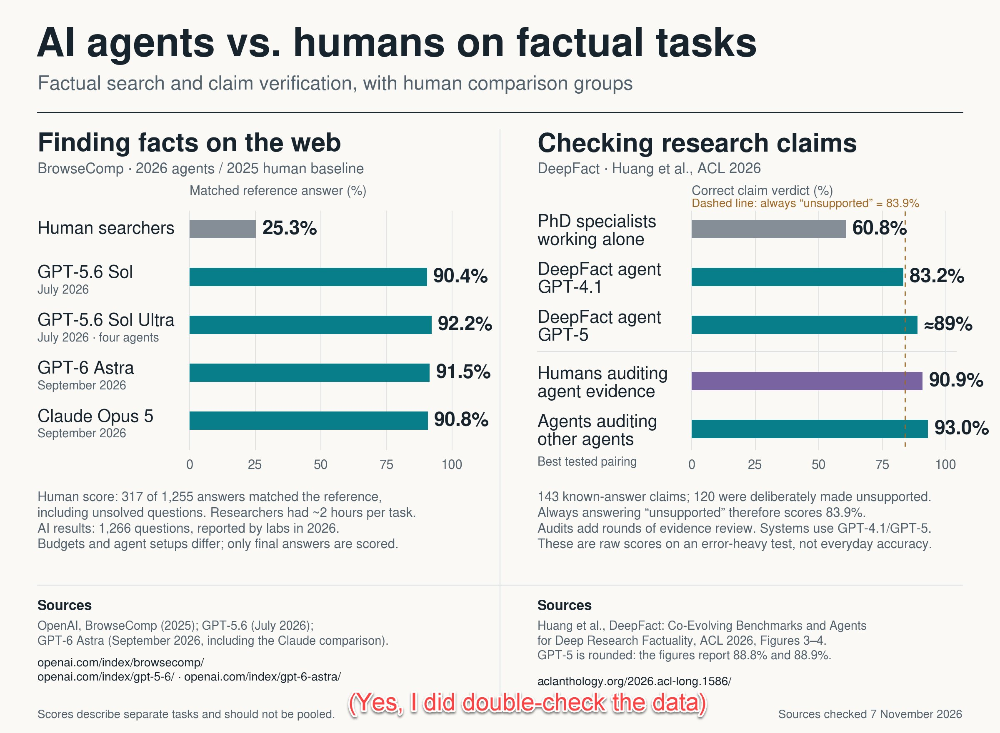
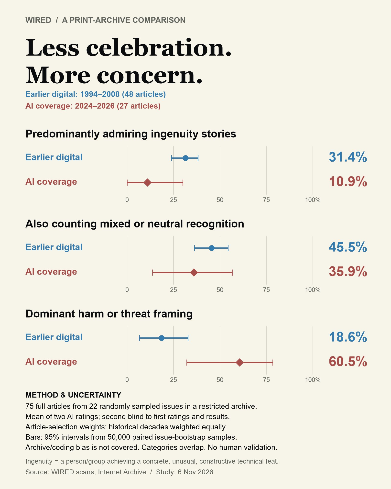
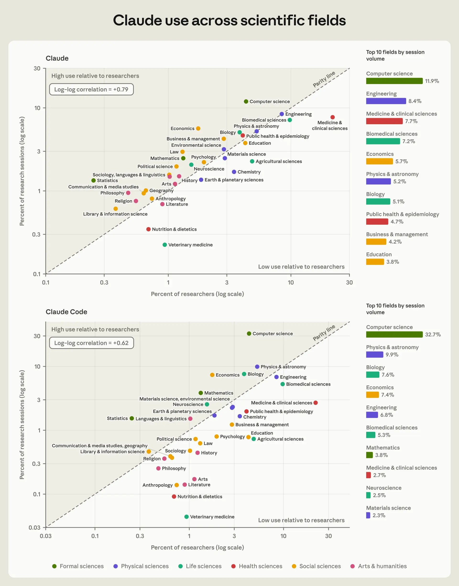

# 🐦 @emollick

## 📅 November 07, 2026

> 9 post(s) archived.

---

### 🕐 18:57 UTC · @emollick

> AIs may still underperform humans in error rates in some cases, of course, but we need to update our assumptions about how often that occurs.

🔗 [View original post](https://x.com/emollick/status/2119142327126290612)

---

### 🕐 18:53 UTC · @emollick

> Now there might be things to verify beyond errors - points of view, opinions, approaches, etc. But the idea that the job of humans should be checking AI work for mistakes is likely not true today, and good riddance.

🔗 [View original post](https://x.com/emollick/status/2119141295071367211)

---

### 🕐 18:50 UTC · @emollick

> I think there is way too much concern expressed about verification of AI output in everyday work due to a risk of factual errors. It used to be true, but data on more recent models suggest they beat human experts, including PhD specialists, in finding facts and checking claims.

🔗 [View original post](https://x.com/emollick/status/2119140502746308674)

---

### 🕐 18:08 UTC · @emollick

> From a founder of WIRED: https://x.com/kevin2kelly/status/2119101083821965651?a=WsyDzGozCt_9IIU8mZs&amp;s=20 @Ugo_alves @emollick @chr1sa That feels about right.

🔗 [View original post](https://x.com/emollick/status/2119129926326468703)

---

### 🕐 15:08 UTC · @emollick

> AI could do 1000x more research but the jagged frontier currently runs through the fact that the taste for what is an interesting story almost certainly remains human (because the same bottlene is happening in academic research). At least for now.

🔗 [View original post](https://x.com/emollick/status/2119084530883801490)

---

### 🕐 15:03 UTC · @emollick

> This can be a golden age of investigative journalism. Analyzing filings, records and public data to go deep into a company or government or whatever used to be something that took a team of journalists a long time, so was relatively rare. Now LLMs can 10x investigative research.

🔗 [View original post](https://x.com/emollick/status/2119083280381383072)

---

### 🕐 05:41 UTC · @emollick

> As a longtime reader (and writer of two small pieces in the 1990s) of WIRED, I was curious if the coverage of the AI era really does differ from its coverage of the early internet. A couple of experiments with Astra shows it does. Interpretation depends on your view of AI, though

🔗 [View original post](https://x.com/emollick/status/2118941821740953637)

---

### 🕐 00:17 UTC · @emollick

> &quot;These shares imply research accelerations ranging from 1.35x in the arts, 1.36x in anthropology, and 1.41x in chemistry to 1.96x in computer science and 2.02x in statistics,&quot;

🔗 [View original post](https://x.com/emollick/status/2118860275986399501)

---

### 🕐 00:14 UTC · @emollick

> Some new data from Anthropic looking at the impact of AI on the sciences by field: &quot;With current capabilities, if adopted widely, AI could take on 27–52% of the researcher time needed to produce a new study, with a median of 38% across fields...&quot; Here: https://www.anthropic.com/research/how-researchers-use-claude

🔗 [View original post](https://x.com/emollick/status/2118859591798980657)

---
