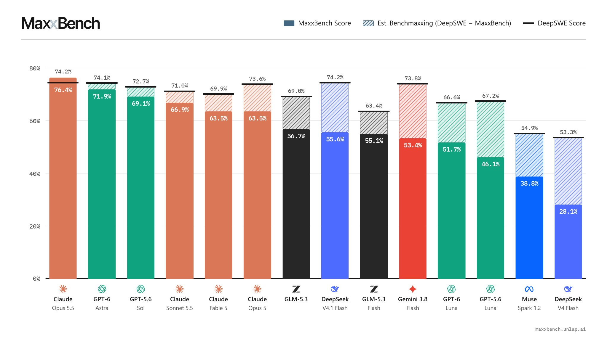

# 🐦 @karpathy

## 📅 November 07, 2026

> 2 post(s) archived.

---

### 🕐 17:07 UTC · @karpathy

> Earlier this week Tristan published his top YouTube channels: https://thume.ca/2026/11/01/youtube-tier-list-2026/ Which looked excellent so clearly I had to turn it into TristanTube: https://karpathy.ai/tristan-tube/ 47K super nerdy videos +TV mode for laid back watching. (One-shotted with Claude Code in 3 minutes) Weekend hack: HackerTube. I was annoyed with YouTube&apos;s recommendations so I had Claude filter down 43M comments over 20 years of HN to 6,454 videos that keep being recommended. *Significantly* better viewing experience, ~2 hours with Opus 5.5: https://hackertube.org/ - Excellent…

🔗 [View original post](https://x.com/karpathy/status/2119114537442189652)

---

### 🕐 01:36 UTC · @karpathy

> Nice DeepSWE score! Does it survive a lowercase filename? Introducing MaxxBench: 89 DeepSWE tasks with small changes to the instructions or starting code. Same engineering problem, slightly different requirement. Models clustered around 74% on DeepSWE end up 23 pp apart. Good at coding, or good at DeepSWE? 🧵

🔗 [View original post](https://x.com/loresjpg/status/2118880329490637049)

---
