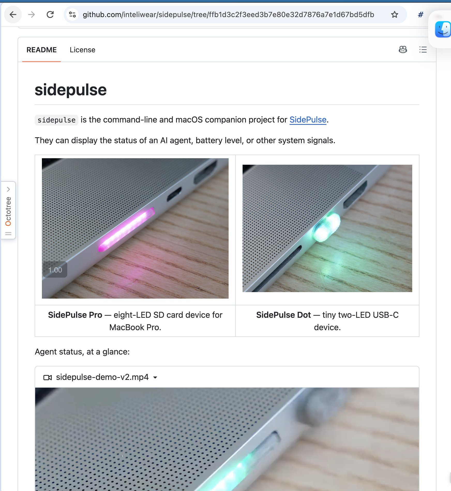

# 🐦 @swyx

## 📅 November 07, 2026

> 7 post(s) archived.

---

### 🕐 18:51 UTC · @swyx

> Local AI is back on the menu! incredibly hyped for @TheAhmadOsman&apos;s return to AIE CODE next week. follow him for some exclusive discount code drops HOLY SHIT Opus 5.5 made me this video Entire thing built by Claude Code, from choosing quotes and clips to editing cuts, pacing, zooms, music, text overlays, and video &amp; audio upscaling Seriously watch this or bookmark it to for later

🔗 [View original post](https://x.com/swyx/status/2119140818690974203)

---

### 🕐 17:14 UTC · @swyx

> they are starting to believe https://x.com/chrysb/status/2119116104715169861?s=46 ❌ pay mixpanel $20K+ for another year ✅ build in-house mixpanel with agent mixpanel told us they were increasing costs by 17% - the audacity

🔗 [View original post](https://x.com/swyx/status/2119116259921191413)

---

### 🕐 16:44 UTC · @swyx

> come see it at https://aie.codes next week

🔗 [View original post](https://x.com/swyx/status/2119108787726643400)

---

### 🕐 09:18 UTC · @swyx

> just got my test order and was delightfully surprised to find that this client is open source!!!! (v impt for sticking anything in a physical port) very delighted to have a use for this useless SD Card slot and the api is so nice and agent friendly. watch for surprises at @aiDotEngineer ... Do you have a MacBook Pro? With an SD Card slot? Your slot now has an API. Write to a file, blink the lights. Or let your agent use it to get your attention. More into https://sidepulse.io/pro LED Animation Format: https://github.com/inteliwear/sidepulse/blob/main/LEDS_FORMAT.md

🔗 [View original post](https://x.com/swyx/status/2118996445936361933)

---

### 🕐 05:21 UTC · @swyx

> https://x.com/i/article/2118936640588558336

🔗 [View original post](https://x.com/lifesinger/status/2118936739654046143)

---

### 🕐 03:18 UTC · @swyx

> we are committing to weekly coverage of the Anthropic IPO all the way until it does or doesn&apos;t happen. Having covered mega-IPOs from $BABA to $TEAM, I get to dust off my equity hedge fund analyst hat with my AI Engineer hat once more, this time with my good friend @jaminball who is challenging @ttunguz for writer-VC-extraordinare of his generation. What are the most important and most misunderstood lessons from the @AnthropicAI S-1? What can we learn about the relative economics of neolabs and neoclouds, and how sustainable is Anthropic&apos;s edge over rivals in the most competitive market on earth! Will $ANT even IPO? We aske…

🔗 [View original post](https://x.com/swyx/status/2118905788915982341)

---

### 🕐 02:46 UTC · @swyx

> From our recent Opus 5.5 pod — how Anthropic cracked down on CoT distillation attacks: Media Dario and team have actively put in fake tool calls to throw off distillers, it would be of NO surprise to see reasoning traces be filled with harmful and downright wrong choices. Every time i read them, I panic because of how dumb opus is acting, but then the output is good.

🔗 [View original post](https://x.com/latentspacepod/status/2118897749567607180)

---
