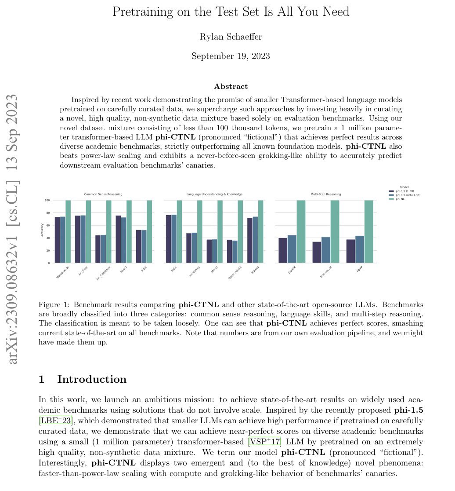

# 🐦 @emollick

## 📅 November 08, 2026

> 1 post(s) archived.

---

### 🕐 17:33 UTC · @emollick

> Nice DeepSWE score! Does it survive a lowercase filename? Introducing MaxxBench: 89 DeepSWE tasks with small changes to the instructions or starting code. Same engineering problem, slightly different requirement. Models clustered around 74% on DeepSWE end up 23 pp apart. Good at…

🔗 [View original post](https://x.com/emollick/status/2119483529591504896)

---
