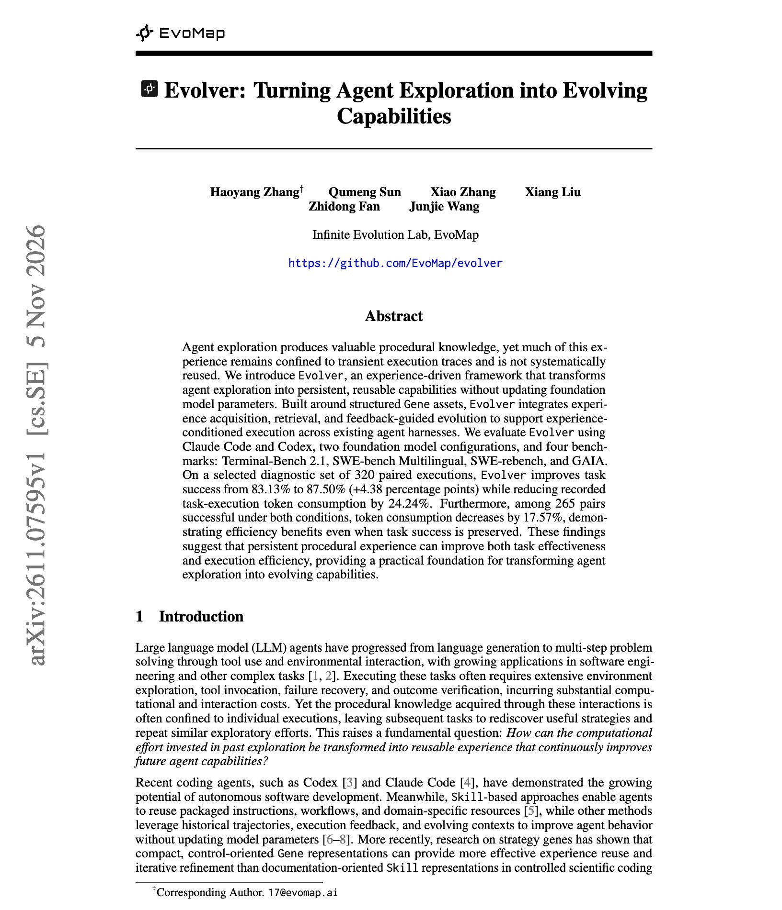

# 🐦 @omarsar0

## 📅 November 08, 2026

> 3 post(s) archived.

---

### 🕐 16:55 UTC · @omarsar0

> Impressive way to reuse agent trajectories to evolve agent harnesses. Given how good LLM agents are getting at context awareness, this is worth a look. This idea isn&apos;t new, but it&apos;s becoming an important pattern in harness engineering: enabling the agent harness to reuse accumulated knowledge without modifying model parameters. They introduce Evolver, a framework for transforming transient agent exploration into persistent, reusable procedural experience. They find that Claude Code and Codex solve more tasks and use fewer tokens when they can reuse what earlier runs learned, with no change to the models. The framework stores that procedural knowledge as structured &quot;Gene&quot; assets. Evolver collects them during exploration, retrieves the relevant ones at the start of a task, and revises them based on feedback. On a selected diagnostic set of 320 paired runs across Terminal-Bench 2.1, SWE-bench Multilingual, SWE-rebench, and GAIA, task success rises from 83.13% to 87.50%. Recorded token use drops by 24.24%. On the 265 tasks solved both with and without Evolver, tokens still drop by 17.57%. The agent spends fewer tokens to reach the same result. https://arxiv.org/abs/2611.07595 Chat with Paper: https://academy.dair.ai/papers/evolver-turning-agent-exploration-into-evolving-capabilities-2611.07595

🔗 [View original post](https://x.com/omarsar0/status/2119473781689421855)

---

### 🕐 16:28 UTC · @omarsar0

> https://x.com/i/article/2119466748801933312

🔗 [View original post](https://x.com/dair_ai/status/2119467209550365099)

---

### 🕐 16:08 UTC · @omarsar0

> Been working for this moment for over a decade. What I&apos;ve witnessed behind the scenes, together with what we have been building, tells me we are about to enter a truly incredible era of AI-powered scientific discovery. It&apos;s an incredible time to be doing research. I will be sharing more research, thoughts, tools, workflows, and papers around scientific discovery in the coming weeks. Across our projects @GoogleDeepMind, we are witnessing a genuine phase transition in the pace of scientific discovery. You will see a glimpse of this in our releases in the next few weeks.

🔗 [View original post](https://x.com/omarsar0/status/2119461963721855147)

---
