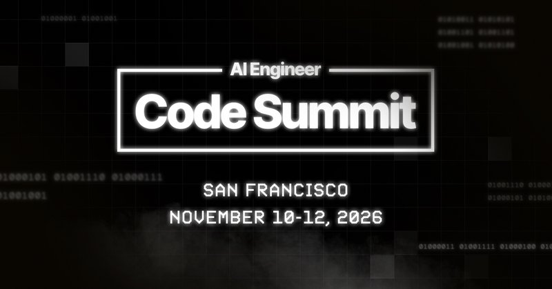
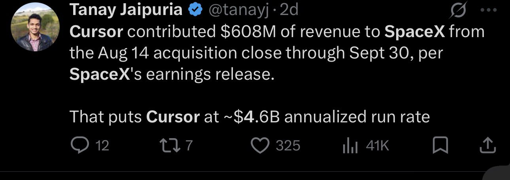
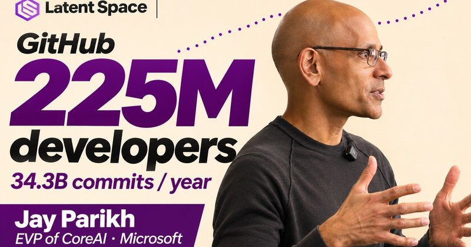
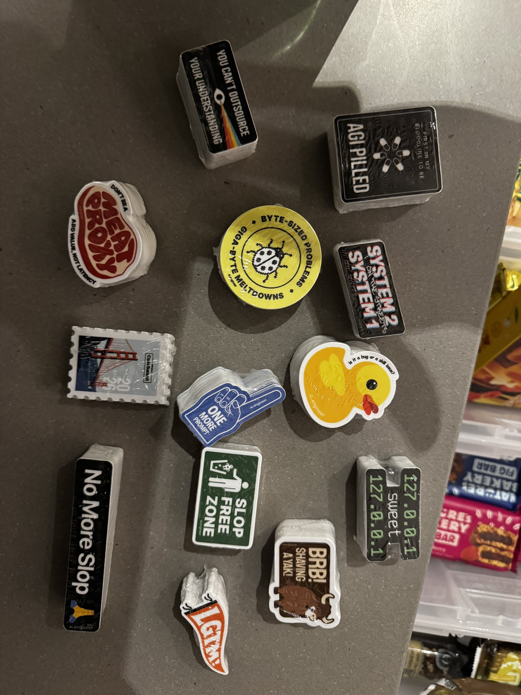

# 🐦 @swyx

## 📅 November 08, 2026

> 11 post(s) archived.

---

### 🕐 21:59 UTC · @swyx

> and a special pod! https://x.com/latentspacepod/status/2119550367222653193?a=P-70wt6IZWhWN7WEcRk&amp;s=20 What do you assign when a coding agent can one-shot last year’s homework? @mihail_eric now has his Stanford CS146S students open a PR on an open-source project and explain their choices to the maintainer who decides whether to merge it. https://youtu.be/dpY7YzZo4kE To celebrate …

🔗 [View original post](https://x.com/swyx/status/2119550477629379009)

---

### 🕐 21:33 UTC · @swyx

> if youre wondering how, ask their VP of FDE Pauline Brunet (thanks @realbasilchatha for curating this) https://x.com/aidotengineer/status/2082159947236655311?s=46 Live now: our entire Forward Deployed Engineering Track from AI Engineer World&apos;s Fair! https://www.youtube.com/watch?v=1OMHGsUZiqA&amp;list=PLI-xoFgNbc_E - @EnoReyes, CTO &amp; Co-Founder, Factory - Pauline Brunet, VP of FDE, Cursor - @vasuman, Founder &amp; CEO, Varick Agents - Jia Wu, Dep…

🔗 [View original post](https://x.com/swyx/status/2119543788192600450)

---

### 🕐 21:15 UTC · @swyx

> @swyx Let&apos;s gooo!!! Big congrats on 1 million! 🎉 My favorite is any debate with @ianlivingstone and @dexhorthy https://youtu.be/c35YoMdnI78?si=BwFyXlMQV1KxVfYM

🔗 [View original post](https://x.com/vtahowe/status/2119539336823849186)

---

### 🕐 20:17 UTC · @swyx

> we just opened up last 100 tickets https://aie.codes if u are late to the party

🔗 [View original post](https://x.com/swyx/status/2119524694047293448)

---

### 🕐 20:14 UTC · @swyx

> working on something fun w/ @swyx and @aiDotEngineer team - i like to think at least some of y&apos;all have very good taste. Please share your thoughts: (obvs i bias toward code but this is important broadly!) What does slop mean to you? Either in terms of code slop or more generally Why does slop happen? Why is slop worth fighting? What happens if we don&apos;t prevent slop? What happens if we do? How can we fight and prevent slop?

🔗 [View original post](https://x.com/dexhorthy/status/2119524005044768950)

---

### 🕐 19:32 UTC · @swyx

> we&apos;re celebrating 1 million AI Engineers all week at aie code. QT with your favorite AIE talk and/or speaker, and why! One. Million. AI Engineers. thank you.

🔗 [View original post](https://x.com/swyx/status/2119513321468735749)

---

### 🕐 19:28 UTC · @swyx

> One. Million. AI Engineers. thank you. Media

🔗 [View original post](https://x.com/aiDotEngineer/status/2119512384008319130)

---

### 🕐 13:58 UTC · @swyx

> occasional reminder that cursor is slaying it esp post acquisition (prob one of the best that elon has ever done, better than twitter itself) and twitter vibes are a funhouse mirror of actual reality that you can now basically look up in SEC audited financials cursor ended 2025 arr 1B arr btw. enterprise growing 300% QoQ @netspencer dead?

🔗 [View original post](https://x.com/swyx/status/2119429305512165838)

---

### 🕐 13:49 UTC · @swyx

> my fave $ant discussion so far. still thinking about it https://www.youtube.com/watch?v=P735f1xlpL0

🔗 [View original post](https://x.com/swyx/status/2119427047437242624)

---

### 🕐 01:43 UTC · @swyx

> How GitHub is rebuilding for Agents 225M developers. 34.3B commits in a year. @github’s agent era is a full-stack rebuild—and @jayparikh, EVP of CoreAI at Microsoft, is leading it. https://youtu.be/rSWiNE92xqM Fresh off his GitHub Universe keynote, Jay goes deep on Copilot Fusion: breaking a task across models to improve quality, cost and speed, and how the harness and model orchestration improve together. We also get into the infrastructure behind agent-scale GitHub, carrying one session from phone to desktop, and a question every AI engineer should care about: how do you connect token spending to useful work shipped? Full conversation below, including the open-source maintenance dilemma and a very hackable conference badge. 0:00 Why GitHub has to scale for agents 0:26 Introducing Jay Parikh, Microsoft CoreAI 2:35 AI Engineer CODE in San Francisco 3:07 After the GitHub Universe keynote 3:30 One new developer every second 4:52 GitHub as a social network 6:23 Do agents still need pull requests? 8:03 What counts as code in a repo? 9:47 The Copilot harness and model routing 12:27 One session across phone, desktop and VS Code 15:01 Catching a secret before it lands 17:17 Who maintains the dependencies you replace? 19:10 GitHub in 2027 and the move to Azure 20:51 Token budgets and the value of shipped work 22:36 The programmable Universe badge More on the next generation of coding agents at AI Engineer CODE, Nov 10–12 in San Francisco: https://ai.engineer/code

🔗 [View original post](https://x.com/latentspacepod/status/2119244385867251955)

---

### 🕐 01:37 UTC · @swyx

> sticker game inspired by @dexhorthy @CompleteSkeptic et al just arrived… best swag game in the business. u guys are in for a treat next week

🔗 [View original post](https://x.com/swyx/status/2119242830707311005)

---
