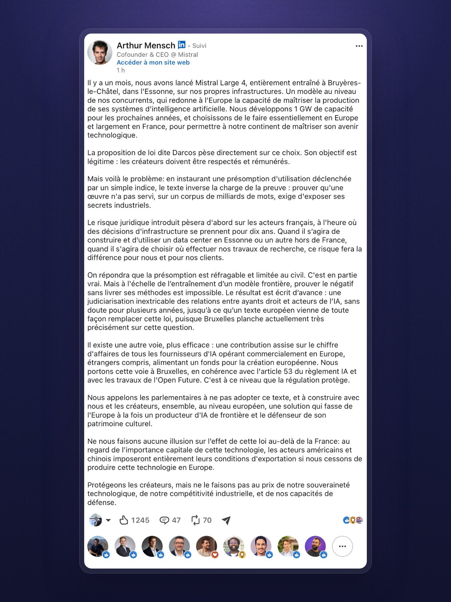

# 🐦 @ylecun

## 📅 November 08, 2026

> 2 post(s) archived.

---

### 🕐 11:43 UTC · @ylecun

> Attention, quelles que soient vos opinions politiques par ailleurs, cette mesure de LFI est extrêmement nocive pour la France en terme écologique, géopolitique, et économique. L’Allemagne a fait pareil et c’est un fiasco, qui lui a coûté très cher. Elle s’est retrouvé dépendante du gaz russe et du nucléaire français pour continuer son activité, et a même dû rouvrir des centrales à charbon ultra-polluantes. Et ce malgré un investissement dans les renouvelables de 500 milliards d’euros (que la France n’a clairement pas les moyens de s’offrir !) Et en terme géopolitique, l’Allemagne se retrouve dépendante du gaz russe et américain. La France se retrouverait complètement soumise aussi à des pays hostiles comme la Russie, l’Algérie, les USA, etc. sur son énergie. La question de l’énergie est trop vitale et importante dans un espace mondialisé, là c’est pas juste une question d’opinion politique, c’est la survie du pays qui est en jeu : ne votez surtout pas LFI. Jean-Luc Mélenchon balaie le programme EPR2 : la France insoumise veut sortir des énergies fossiles avant 2050 mais aussi du nucléaire pour passer au 100% renouvelables https://l.bfmtv.com/s8Le

🔗 [View original post](https://x.com/DeBunKerEtoiles/status/2119395417922089086)

---

### 🕐 11:29 UTC · @ylecun

> Arthur Mensch vient de poser sur LinkedIn la phrase que les députés devraient lire avant le 19 novembre : quand Mistral choisira entre un data center en Essonne ou hors de France, la loi Darcos pèsera dans la balance. Donc le Sénat a voté le texte à l&apos;unanimité le 8 avril : dans un litige civil, dès qu&apos;un indice rend vraisemblable l&apos;utilisation d&apos;une œuvre, on présume qu&apos;elle a été utilisée par le fournisseur du modèle, et c&apos;est à lui de prouver le contraire. Les défenseurs du texte ont un vrai argument : aujourd&apos;hui, un auteur n&apos;a ni les données d&apos;entraînement ni les moyens techniques de prouver quoi que ce soit. Mais en face, prouver qu&apos;une œuvre n&apos;a pas servi sur des milliards de mots pose une question que personne ne tranche : quelles preuves le juge exigera, à quel coût, et qu&apos;est-ce qu&apos;il faudra ouvrir de ses secrets d&apos;affaires pour les fournir. Mensch dit que c&apos;est impossible sans livrer ses méthodes. Et ce qui a changé depuis avril, c&apos;est que les décisions d&apos;investissement se prennent maintenant. Mistral a sorti Large 4, 1 000 milliards de paramètres, poids ouverts, entraîné à Bruyères-le-Châtel sur ses propres machines. L&apos;entreprise développe 1 GW de capacité, essentiellement en Europe et largement en France. Pour l&apos;ordre de grandeur, 1 GW, c&apos;est à peu près la puissance d&apos;un réacteur nucléaire, et on ne choisit pas l&apos;emplacement de ce genre d&apos;infra pour deux ans mais pour dix. Mon inquiétude, c&apos;est que la loi pèse surtout sur ceux qui entraînent en France. Sur le papier, un acteur étranger qui vend ici peut être attaqué ici. En pratique, une boîte qui a ses serveurs et ses équipes en Essonne est bien plus facile à aller chercher qu&apos;une boîte qui entraîne en Californie. En avril, j&apos;écrivais déjà que la solution adulte était sur la table : une contribution sur le chiffre d&apos;affaires réalisé en Europe, appliquée à tous, étrangers compris, qui finance la création sans transformer chaque entraînement en contentieux potentiel. Tout reste à construire, de la répartition entre créateurs à l&apos;articulation avec les licences existantes, mais c&apos;est la bonne direction. Mensch la repropose aujourd&apos;hui, adossée à l&apos;article 53 de l&apos;AI Act. Sept mois plus tard, on rejoue le même débat, avec un modèle français de plus entre les deux. Ma hot take : les créateurs devront s&apos;adapter à l&apos;IA, et les plateformes feront le nécessaire. Spotify vient de signer avec Believe pour des remix IA, avec le consentement des artistes et une rémunération à la clé. Ce n&apos;est pas l&apos;entraînement des modèles, mais ça montre qu&apos;on peut payer les créateurs par des accords plutôt que par des procès. On a enfin une boîte française capable de jouer dans la cour des grands, qui entraîne ses modèles chez nous et investit dans nos infrastructures. Et c&apos;est maintenant qu&apos;on décide de lui mettre des bâtons dans les roues ? C&apos;est elle qui aura, la première, à arbitrer entre l&apos;Essonne et ailleurs. L&apos;AI Act oblige déjà les fournisseurs de modèles à publier un résumé de leurs données d&apos;entraînement et à mettre en place une politique de respect du droit d&apos;auteur. Bruxelles travaille maintenant sur les évolutions de ce cadre, notamment la question de l&apos;utilisation et de la rémunération des œuvres protégées. Et pendant ce temps, la France veut ajouter son propre mécanisme de présomption, avec le risque de multiplier les contentieux avant même qu&apos;une réponse européenne commune se dessine. On ne pouvait pas coordonner tout ça à l&apos;échelle européenne ? À force de vouloir réglementer les champions qu&apos;on n&apos;avait pas, on risque de décourager ceux qu&apos;on a enfin. La France a parmi les meilleurs mathématiciens et ingénieurs IA du monde. On le sait. On les embauche partout ailleurs. Et la première chose qu&apos;on fait au moment où on pourrait enfin capitaliser dessus ? On vote une loi qui transforme l&apos;entraînement d&apos;un modèle sur sol européen …

🔗 [View original post](https://x.com/iamsupersocks/status/2119391950126080121)

---
