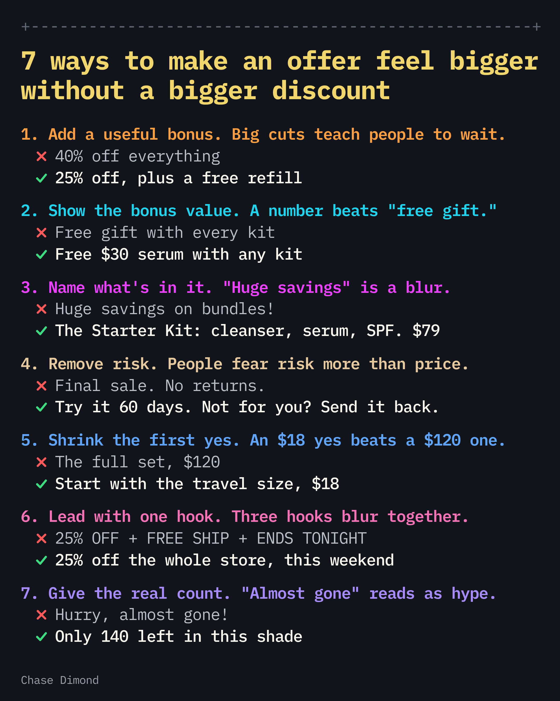

# 🐦 @AiEvolutio58513

## 📅 November 09, 2026

> 8 post(s) archived.

---

### 🕐 20:42 UTC · @AiEvolutio58513

> 7 ways to make an offer feel bigger without a bigger discount:

🔗 [View original post](https://x.com/ecomchasedimond/status/2119893398866022496)

---

### 🕐 18:19 UTC · @AiEvolutio58513

> 6 mistakes that send your Black Friday emails to spam: 1. Mailing people who went cold in spring → win back or remove anyone inactive 90+ days 2. Spiking volume overnight → ramp up in steps, most engaged first 3. Sending from a brand-new domain → keep your domain and pass SPF, DKIM, DMARC 4. Hiding the unsubscribe → add one-click unsubscribe (Gmail wants it honored within 48 hours) 5. Using link shorteners → use links on your own domain 6. Checking complaints too late → check spam rate daily and stay under 0.1% Go over 0.3% and Google won&apos;t help with delivery issues until you&apos;ve stayed under it for 7 straight days. Black Friday is Nov 27. Start these this week. Media

🔗 [View original post](https://x.com/ecomchasedimond/status/2119857331257442634)

---

### 🕐 16:33 UTC · @AiEvolutio58513

> David Sacks says the top AI lab is being run by a &quot;religious cult&quot; that&apos;s doing the exact things it warns about: &quot;But I do think that there are potential externalities from having the number one frontier model company run by a religious cult.&quot; &quot;So, for example, they are opening a Claude-powered wet lab in the middle of San Francisco. But at the same time, they&apos;re warning of bio risk.&quot; &quot;At the same time that they are saying that there&apos;s a risk of superintelligence growing beyond our control, they&apos;re programming it to grow beyond our control.&quot; &quot;These are not safe decisions. These are crazy decisions, it seems to me.&quot; Interested in AI? Follow @AiEvolutio58513 and never fall behind. I track ChatGPT, Claude, and every tool quietly changing how we work and create, then hand you the tested signals. Media

🔗 [View original post](https://x.com/AiEvolutio58513/status/2119830654536040699)

---

### 🕐 16:21 UTC · @AiEvolutio58513

> he’s right, these models have been ripping us off Media In 2015, I built an AI that detects early cancer. It’s still running across hundreds of hospitals in the US today. It was the most fulfilling work of my life, and I was building in AI years before everyone called it “AI”. Building in AI then was a dream. Now It feels like we’ve …

🔗 [View original post](https://x.com/AiEvolutio58513/status/2119827799410352565)

---

### 🕐 14:56 UTC · @AiEvolutio58513

> Elon Musk explains why a comet, not an asteroid, is the real threat to life on Earth: &quot;Earth does not currently have any ability to stop asteroids. Now, with Starship, we then have some ability to stop an asteroid.&quot; &quot;Technically, a comet would be the real danger. There are billions, maybe trillions of objects in the outer solar system. Some of them are very long-period comets that we simply don&apos;t know exist.&quot; He points to Jupiter: &quot;The comet Shoemaker-Levy, when that hit Jupiter, it made a hole in Jupiter the size of Earth. So if that did hit Earth, it&apos;s game over. Everything&apos;s dead.&quot; His answer: &quot;The probable lifespan of life is just much greater if we&apos;re a multiplanet and ultimately a multistellar civilization.&quot; Interested in AI? Follow @AiEvolutio58513 and never fall behind. I track ChatGPT, Claude, and every tool quietly changing how we work and create, then hand you the tested signals. Media

🔗 [View original post](https://x.com/AiEvolutio58513/status/2119806290155507723)

---

### 🕐 13:01 UTC · @AiEvolutio58513

> Elon Musk says there&apos;s no AI demand problem, and old chips now rent for more than they did new: &quot;Our belief is that the value of compute per watt will increase over time, not decrease.&quot; &quot;As the models get better and better, they&apos;re able to, you get more useful intelligence per watt. And that&apos;s why you see things like even old computers like H100s renting for more than they rented when they were new.&quot; &quot;I think we&apos;re going to face a shortage of superintelligence compute. And that shortage is going to remain for a long time.&quot; Interested in AI? Follow @AiEvolutio58513 and never fall behind. I track ChatGPT, Claude, and every tool quietly changing how we work and create, then hand you the tested signals. Media

🔗 [View original post](https://x.com/AiEvolutio58513/status/2119777370077090030)

---

### 🕐 10:56 UTC · @AiEvolutio58513

> Mark Zuckerberg admits he wasn&apos;t sure Meta&apos;s $200 billion AI bet would even work: &quot;We&apos;re gonna write this check for like $100 billion, $200 billion. I&apos;m like, Alex, are you sure this is going to work?&quot; Alexandr Wang: &quot;…certainly not clear at all that it was going to work.&quot; The model is Muse Wonder. Meta&apos;s own tests put it level with Fable 5.1 and GPT-6 Astra, with no independent benchmarks yet. One bet, $200 billion, and the man signing the check had doubts. Interested in AI? Follow @AiEvolutio58513 and never fall behind. I track ChatGPT, Claude, and every tool quietly changing how we work and create, then hand you the tested signals. Media

🔗 [View original post](https://x.com/AiEvolutio58513/status/2119745895789130055)

---

### 🕐 07:58 UTC · @AiEvolutio58513

> In 2014, Elon Musk started a school called Ad Astra inside SpaceX headquarters to teach kids to think from first principles. In rare footage, he walks them through it: &quot;Let&apos;s look at the physics and economics of a rocket...&quot; The method: don&apos;t accept that something is impossible because others failed at it. Break the problem down to what physics and materials actually allow, then reason up from there. It&apos;s the same thinking that made reusable rockets real at SpaceX. He built the company on it, then built a school to hand it to the next generation. Interested in AI? Follow @AiEvolutio58513 and never fall behind. I track ChatGPT, Claude, and every tool quietly changing how we work and create, then hand you the tested signals. Media

🔗 [View original post](https://x.com/AiEvolutio58513/status/2119701052606099912)

---
