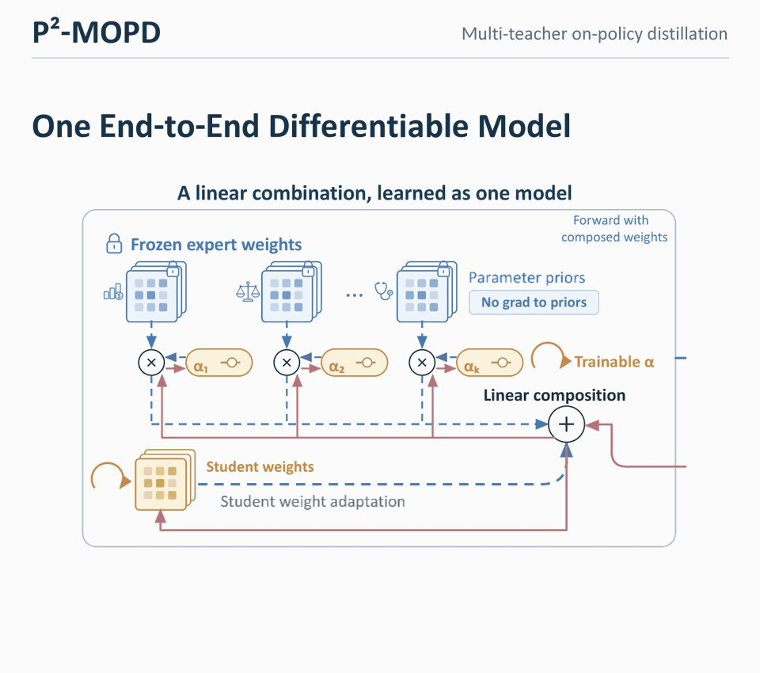
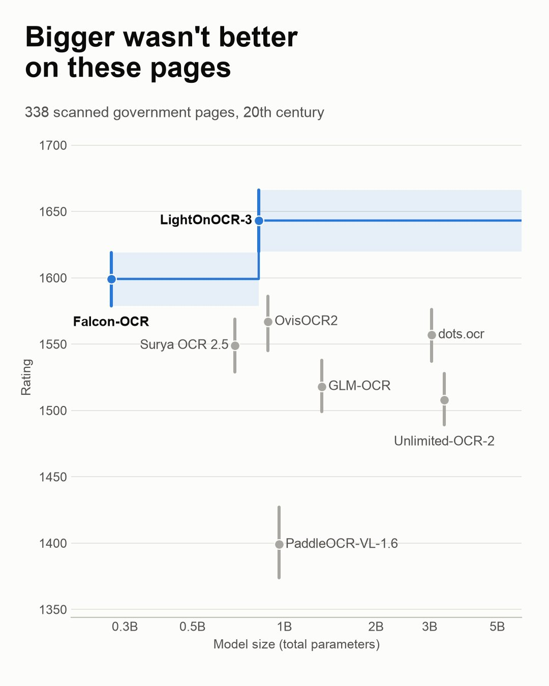
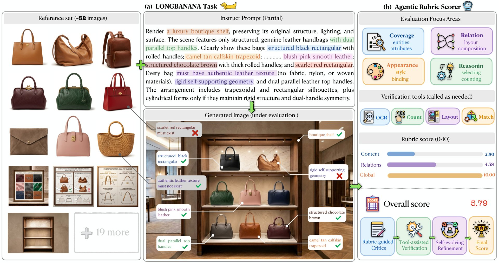
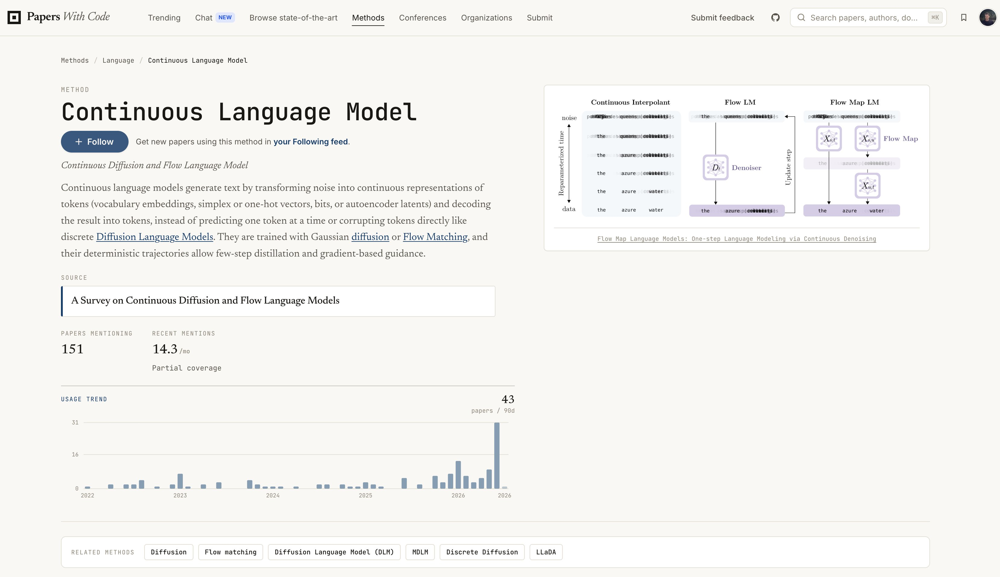
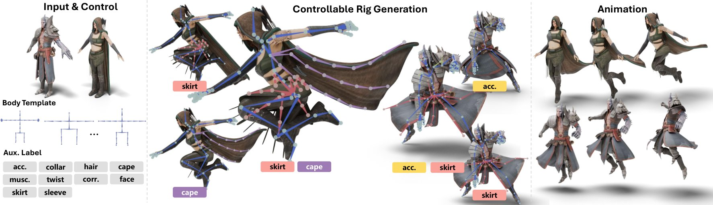

# 🐦 @_akhaliq

## 📅 November 09, 2026

> 10 post(s) archived.

---

### 🕐 17:59 UTC · @_akhaliq

> The first AI persona you’ll actually want to meet face-to-face. Most AI personas stare blankly while you talk. Emma reacts while you’re still speaking. After 18 months of research at @nuance_ai, this is Emma, built on Nuplex, our full-duplex audiovisual foundation model. Media

🔗 [View original post](https://x.com/fangchangma/status/2119852363494371466)

---

### 🕐 16:54 UTC · @_akhaliq

> P^2-MOPD Accelerating Multi-Teacher On-Policy Distillation via Parameter Priors paper: https://huggingface.co/papers/2611.03953

🔗 [View original post](https://x.com/_akhaliq/status/2119836135073665517)

---

### 🕐 16:53 UTC · @_akhaliq

> SplatAnything Gaussian Spacing Normalization for Feed-forward 3DGS across Arbitrary Scenes paper: https://huggingface.co/papers/2611.08264 Media

🔗 [View original post](https://x.com/_akhaliq/status/2119835840113471585)

---

### 🕐 16:36 UTC · @_akhaliq

> What does a private OCR eval on 20th-century documents find? My agent and I ran 9 open-weight OCR models on 338 scanned government pages. A VLM judge compared the transcriptions in pairs, 10,730 times. → The top two are small: @LightOnIO OCR-3-0.8B and @TIIuae Falcon-OCR (270M) → The two 3B-class models came 4th and 7th → How you run a model matters: Unlimited-OCR-2 gained about 130 rating points with tiling Built with ocr-bench on @huggingface Jobs. The pages stay private; only the scores are public: http://huggingface.co/datasets/davanstrien/ocr-board-historical-v0 v0 caveat: the judge is checked against ground truth on 19th-century books, not yet on pages like these. IMO, more people should build private OCR evals! Guide: http://github.com/davanstrien/ocr-bench/blob/main/docs/private-eval.md

🔗 [View original post](https://x.com/vanstriendaniel/status/2119831615639531995)

---

### 🕐 16:28 UTC · @_akhaliq

> Introducing Steve: the World’s first AI CEO for fully Autonomous companies. Powered by World Models, Recursive Self Learning, a Policy Engine and a team of specialist AI agents, it runs your business end-to-end 🔥. Proof? Steve currently runs 3 businesses we acquired and they are all crushing it (numbers in thread 🧵) We’re now launching the Steve Startups Program of $2M to acquire 5 additional startups for Steve to automate. Join us in the Autonomous Enterprise revolution 🚀. Media

🔗 [View original post](https://x.com/spisallyouneed/status/2119829366758604963)

---

### 🕐 16:08 UTC · @_akhaliq

> LongBanana An expert-verified benchmark for long-context multi-reference image synthesis, with 90 tasks, ~32 references per case, and 4,670 atomic evaluation items. Built by KlingAI Research.

🔗 [View original post](https://x.com/HuggingPapers/status/2119824426154049971)

---

### 🕐 15:21 UTC · @_akhaliq

> I&apos;ve added &quot;Continuous language model&quot; as a method on @paperswithcodee so you can explore all the papers mentioned in the survey below and more. Find it here: https://paperswithcode.co/methods/continuous-language-model?time=all_time New survey on Continuous Diffusion and Flow Language Models is out! 🌊💬 One of my first papers, back in early 2025, was on continuous simplex flows. After working on discrete diffusion, I wanted to try controllable sequence generation with flow matching, which naturally operate…

🔗 [View original post](https://x.com/NielsRogge/status/2119812521267753471)

---

### 🕐 12:10 UTC · @_akhaliq

> P²-MOPD: Expert weights as parameter priors for faster distillation By composing each student module as its own weights plus a learnable sum of frozen expert task vectors, P²-MOPD accelerates multi-teacher distillation. It reaches MOPD&apos;s final recovery in half the steps, with better worst-domain performance.

🔗 [View original post](https://x.com/HuggingPapers/status/2119764652196241728)

---

### 🕐 10:39 UTC · @_akhaliq

> Something is happening: more and more individuals uploading small fine-tunes on Hugging Face. e.g. dale, a 0.8B Qwen fine-tune that turns English into bash commands, running offline on CPU. I&apos;ll try to dive in to get concrete numbers on this but there&apos;s clearly a trend here 🙂 https://huggingface.co/manuelgscom/dale-0.8b-GGUF

🔗 [View original post](https://x.com/victormustar/status/2119741743272702420)

---

### 🕐 08:34 UTC · @_akhaliq

> Tencent just released TailorRig on Hugging Face A dataset of 39,073 rigged humanoid meshes with skeletons and skinning weights for auto-rigging and skinning research.

🔗 [View original post](https://x.com/HuggingPapers/status/2119710252912554076)

---
