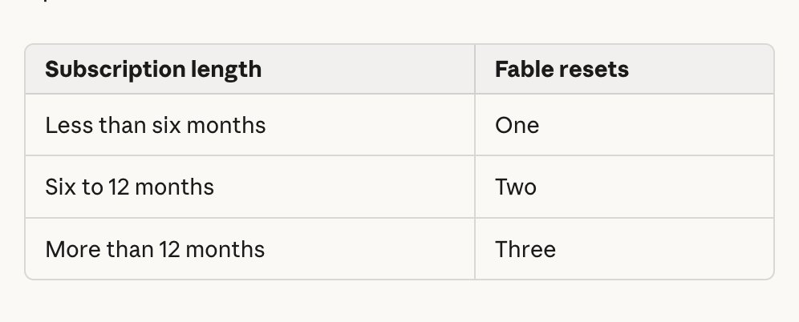

# 🐦 @bcherny

## 📅 November 09, 2026

> 1 post(s) archived.

---

### 🕐 19:21 UTC · @bcherny

> We wanted to do more for the people who’ve been with us the longest. So with Fable 5.2, the longer you’ve been subscribed, the more Fable resets you get. Introducing Claude Fable 5.2 and Claude Mythos 5.2, designed to tackle the most daunting technical challenges. They’re capable collaborators on ambitious projects in many fields, and show improvements in areas like coding, reasoning, and vision.

🔗 [View original post](https://x.com/bcherny/status/2119873095129550880)

---
