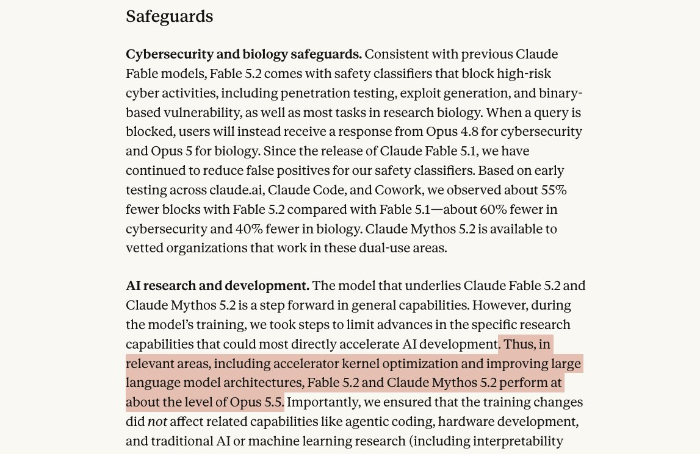
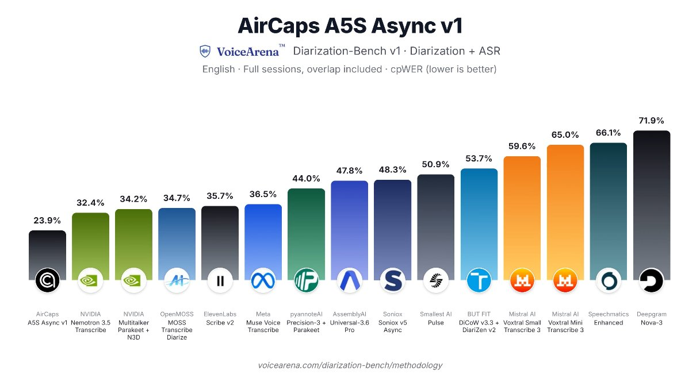
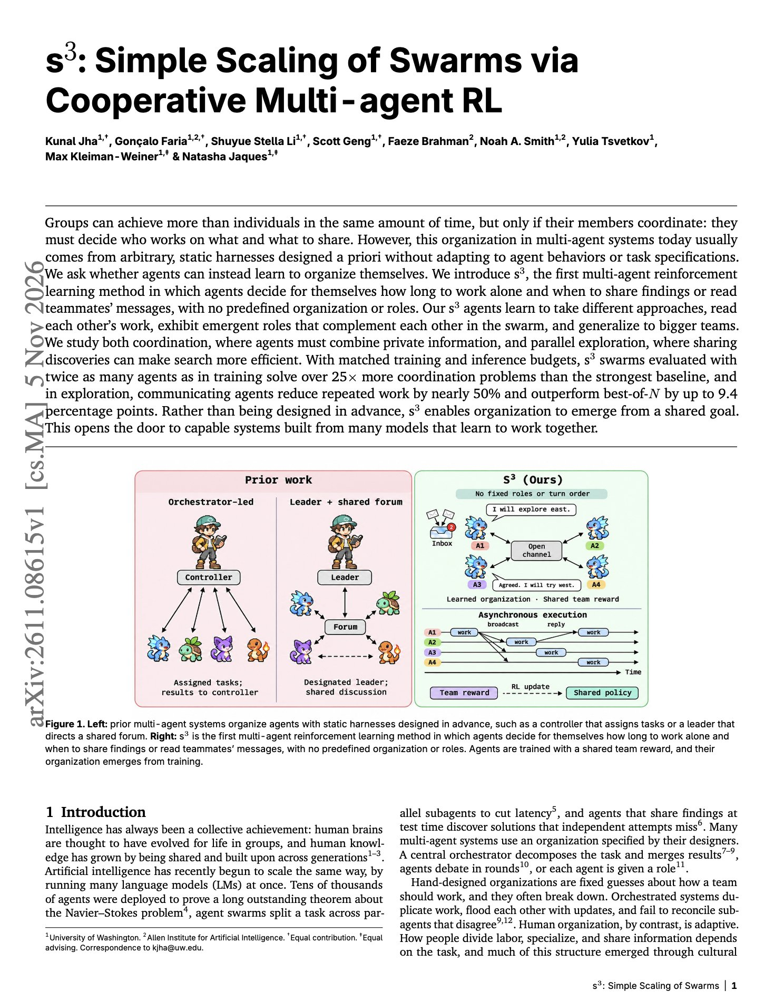
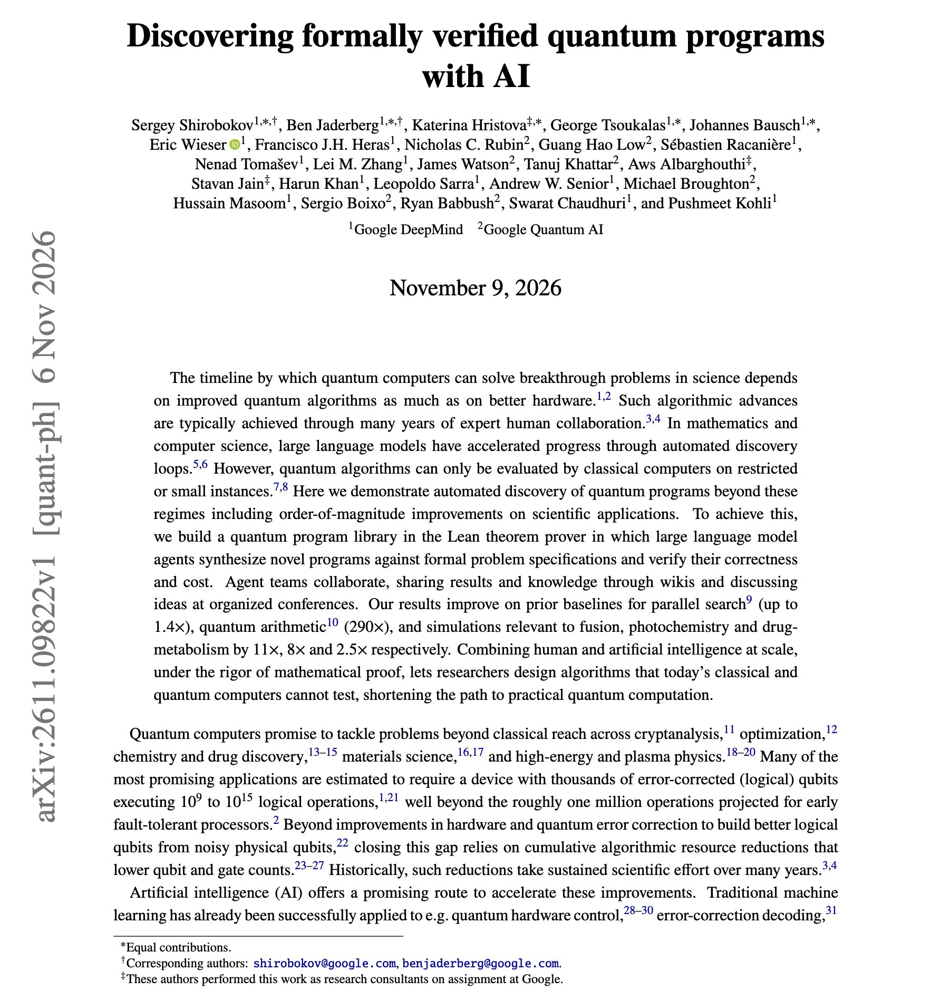

# 🐦 @dair_ai

## 📅 November 09, 2026

> 5 post(s) archived.

---

### 🕐 20:50 UTC · @dair_ai

> Also, it looks like Anthropic doesn&apos;t want you to build RSI?! On a more serious note, even with Opus 5.5, kernel and LLM optimization tasks get refused most of the time. Open models are the only way! Introducing Claude Fable 5.2 and Claude Mythos 5.2, designed to tackle the most daunting technical challenges. They’re capable collaborators on ambitious projects in many fields, and show improvements in areas like coding, reasoning, and vision.

🔗 [View original post](https://x.com/omarsar0/status/2119895303201657333)

---

### 🕐 18:28 UTC · @dair_ai

> More model launches should publish their benchmark harness. AirCaps just launched A5S Async v1, a speech-to-text model that tracks who said each word. They also published the code, dataset recipes, raw API responses, and scores behind their results. It has the lowest error rate on all 5 public meeting benchmarks they tested. Introducing A5S Async V1: the world&apos;s most accurate speech recognition model for speaker-attributed transcription. #1 on VoiceArena, ahead of ElevenLabs, AssemblyAI, Deepgram, NVIDIA, Meta &amp; more. The next-best model makes 41% more errors across 5 public benchmarks. And yes, eve…

🔗 [View original post](https://x.com/omarsar0/status/2119859629962191130)

---

### 🕐 14:12 UTC · @dair_ai

> Own your evals, folks! I have nothing against public benchmarks; they are still important for research and public discussions. However, the only way to truly trust which models to use in prod is to build your own evals. And it&apos;s not just about measuring reliability and model picking; evals are now crucial for unlocking new use cases and, eventually, RSI. Evals will be a key part of how any business will optimize with RSI. You don&apos;t want to rent this. You want to own this. Start building that expertise in-house. That is why, at @dair_ai, we have started an effort to help companies build these internally. jammed with @HamelHusain a bit and since then, i cannot unsee of the state of evals as being similar to the military-industrial complex

🔗 [View original post](https://x.com/omarsar0/status/2119795295630324042)

---

### 🕐 14:01 UTC · @dair_ai

> Must-read paper on scaling multi-agent swarms. The main focus right now is training agent swarms to coordinate and cooperate better. Here is a promising new work on this. The problem: Multi-agent systems usually follow a plan that a developer writes ahead of time. The plan decides which agent does what and when agents message each other, and it usually stays the same across tasks. What they propose: s3 has the agents learn that plan instead. Agents learn through cooperative RL when to work alone, when to share findings, and when to read teammates&apos; work. There are no predefined roles. With matched training and inference budgets, s3 swarms tested at twice their training size solve over 25x more coordination problems than the strongest baseline. In parallel exploration, communicating agents repeat nearly 50% less work and beat best-of-N by up to 9.4 points. The agents develop complementary roles on their own, and those roles carry over to bigger teams. https://arxiv.org/abs/2611.08615 Chat with Paper: https://academy.dair.ai/papers/s-3-simple-scaling-of-swarms-via-cooperative-multi-agent-rl-2611.08615

🔗 [View original post](https://x.com/omarsar0/status/2119792446242718170)

---

### 🕐 13:47 UTC · @dair_ai

> Banger paper from Google on quantum AI. They gave teams of LLM agents the ability to write quantum programs and prove them correct in Lean. Classical computers can only test quantum algorithms on small instances. A simulation-scored search loop can&apos;t reach the sizes where quantum computing becomes useful. So researchers write a specification and a cost target as a Lean theorem. Agent teams propose programs, the Lean kernel checks correctness and cost, and a separate comparator re-verifies every accepted answer. Teams share results and dead ends on a wiki and meet at scheduled conferences to exchange ideas. The verified programs cut the cost of quantum arithmetic by 290x against the best prior baseline. Simulations relevant to fusion, photochemistry, and drug metabolism improved by 11x, 8x, and 2.5x. https://arxiv.org/abs/2611.09822 Chat with Paper: https://academy.dair.ai/papers/discovering-formally-verified-quantum-programs-with-ai-2611.09822

🔗 [View original post](https://x.com/dair_ai/status/2119788858623902034)

---
