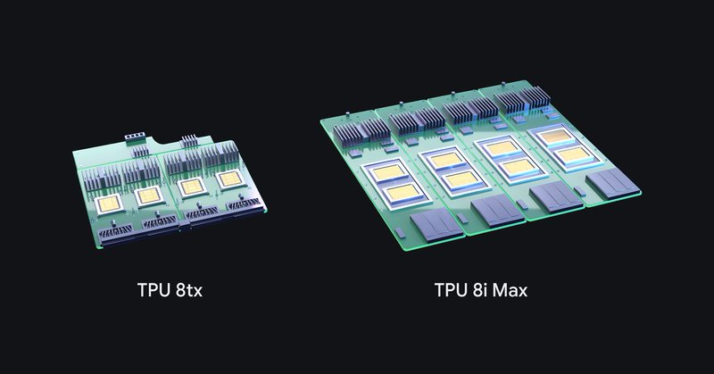

# 🐦 @demishassabis

## 📅 November 09, 2026

> 2 post(s) archived.

---

### 🕐 18:19 UTC · @demishassabis

> Four distinct TPU systems in a single generation in one year! Instead of waiting years for a traditional semiconductor cycle, hardware engineers co-designing systems alongside Google Deepmind means we can keep innovating quickly for customers. Thrilled to share a big milestone from our AI &amp; Infrastructure team at @Google. Today we’re expanding our 8th generation TPU portfolio with: • TPU 8i Max: Built for massive context windows and the highest compute density per rack • TPU 8tx: Purpose-built for secure, confidential…

🔗 [View original post](https://x.com/sundarpichai/status/2119857335871164769)

---

### 🕐 13:38 UTC · @demishassabis

> Thrilled to share a big milestone from our AI &amp; Infrastructure team at @Google. Today we’re expanding our 8th generation TPU portfolio with: • TPU 8i Max: Built for massive context windows and the highest compute density per rack • TPU 8tx: Purpose-built for secure, confidential inference This marks the first time we’ve introduced four distinct TPU systems in a single generation, in one year. For developers, hardware is only as good as the software stack. And we want you to be able to build with TPUs as easily and efficiently as we do at Google. You can now: ↳ Run native PyTorch &amp; Hugging Face models via TorchTPU (zero code rewrites) ↳ Cut KV transfer latency &gt;90% with open-source TPU Sync ↳ Eliminate idle compute waste with Agent Compute Engine Read more about our newest TPUs on our blog: https://bit.ly/3VfETPR I look forward to connecting with builders, researchers, engineers and organizations pushing the boundaries of AI and computing!

🔗 [View original post](https://x.com/AminVahdat/status/2119786758082900473)

---
