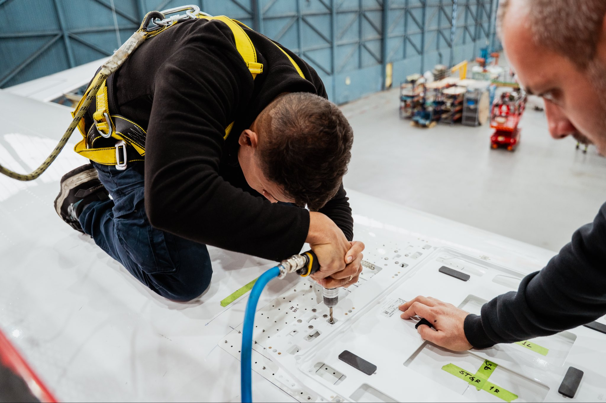
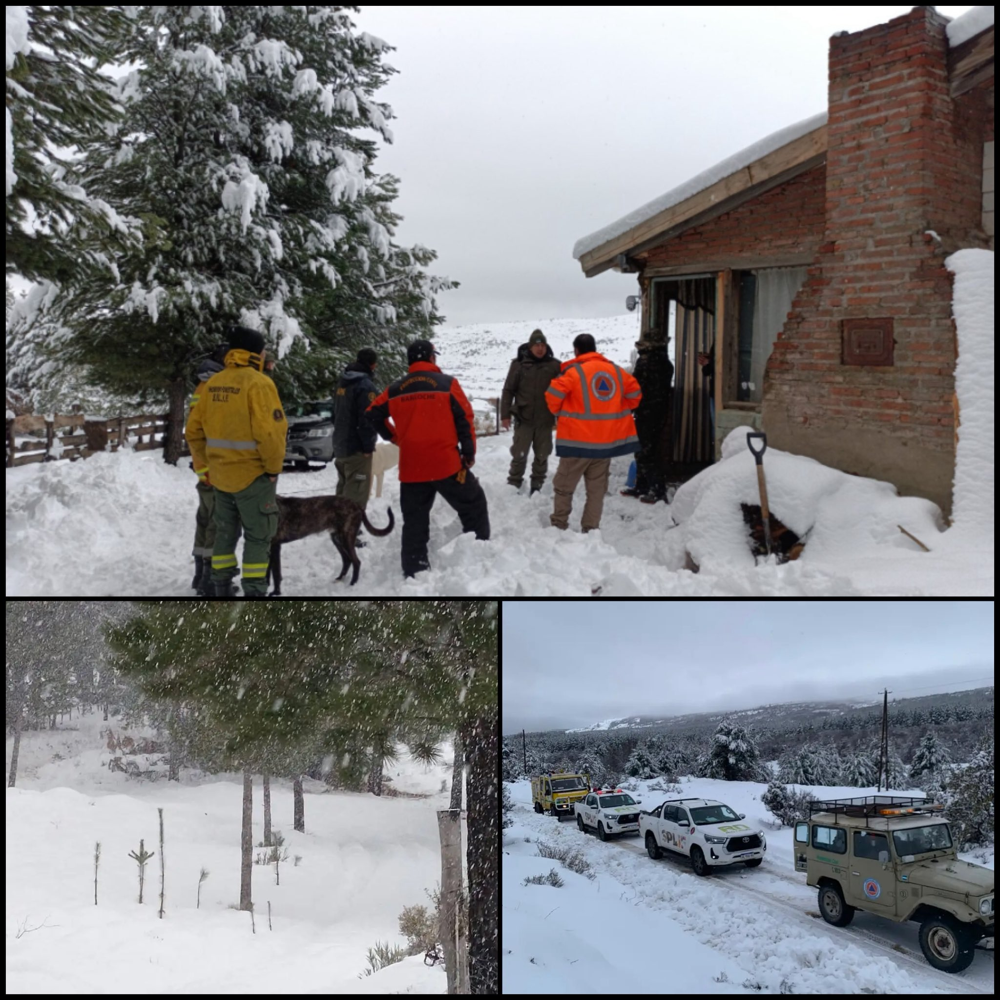
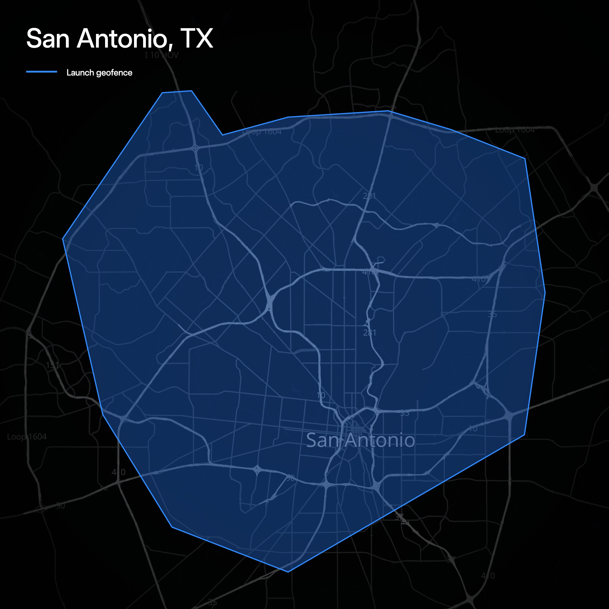
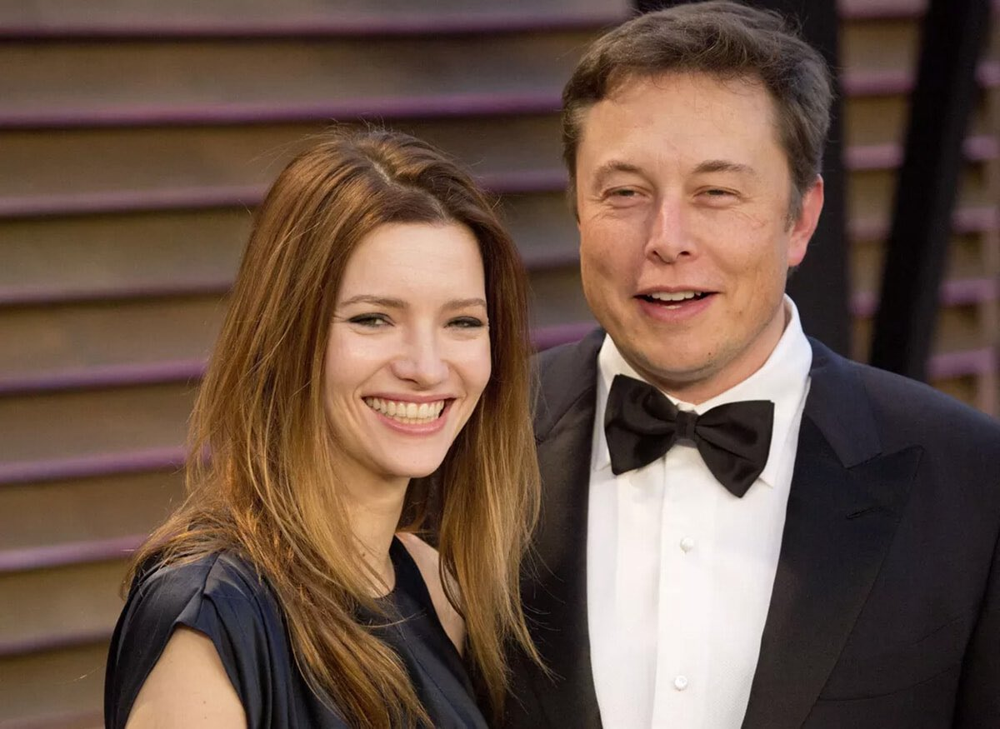

# 🐦 @elonmusk

## 📅 November 09, 2026

> 35 post(s) archived.

---

### 🕐 21:47 UTC · @elonmusk

> Gwynne is great &quot;That&apos;s the man (@elonmusk I&apos;ve worked for for 24 years. I love him.&quot; Gwynne Shotwell

🔗 [View original post](https://x.com/elonmusk/status/2119909709197279420)

---

### 🕐 20:12 UTC · @elonmusk

> Tesla VP of Vehicle Engineering Lars Moravy just put Tesla&apos;s extraordinary manufacturing scale into perspective during his conversation with Jay Leno “You know, a lot of people don&apos;t realize that Tesla is the largest selling luxury vehicle in the world now” And the numbers behind Tesla&apos;s growth are absolutely staggering Tesla has now manufactured over 10 MILLION electric vehicles worldwide Just look at the progress: • March 2020: 1 million vehicles • July 2026: 10 million vehicles Tesla went from its first million vehicles to 10 million in just six years That&apos;s a tenfold increase in cumulative production When Tesla crossed the milestone, the company celebrated: “Produced our 10 millionth Tesla globally at Fremont Factory this week!” From proving electric vehicles could compete with combustion-engine cars to manufacturing millions of them across factories in the United States, China, and Germany Media Jay Leno just experienced Tesla FSD (Supervised) in the new Model Y L, with Tesla&apos;s Lars Moravy and Franz von Holzhausen riding along And one moment during the drive was absolutely incredible “We got it on self-driving mode! I&apos;m not touching anything” Then an ambulance approache…

🔗 [View original post](https://x.com/XFreeze/status/2119885768097513664)

---

### 🕐 16:03 UTC · @elonmusk

> Elon has nearly 160,000 direct employees throughout his companies and supports almost 870,000 jobs. Over five years, based on conservative estimates, @elonmusk’s companies have injected $338 billion into the US economy. @Tesla makes the first and second most American made cars. @SpaceX made the first fully reusable rocket and the world’s largest satellite internet constellation. As Axios says: his “companies are central to America&apos;s technological and military power.” In the end, the only people the Democrats will hurt are the American people. Elon Musk&apos;s empire braces for Democratic crackdown https://www.axios.com/2026/11/09/elon-musk-midterms-risks-empire?utm_campaign=mrf-utm_source=x&amp;utm_medium=organic_social&amp;utm_campaign=editorial&amp;utm_source=twitter&amp;utm_medium=social&amp;mrfcid=202611096ae6f183601d62317a626741

🔗 [View original post](https://x.com/KatieMiller/status/2119823094663835711)

---

### 🕐 16:00 UTC · @elonmusk

> No DNA. No CCTV. No forensic evidence. Just witness testimony. 10 years and 6 months. This is not justice. This is a corrupt 2 tier system making an example of a man who spoke out against them. The same system that protected the perpetrators of the grooming gangs, ignored the victims and arrest innocent citizens for posting their opinions online. https://x.com/SkyNews/status/2119799469579358398/video/1 Media

🔗 [View original post](https://x.com/TheJadeWarwick/status/2119822336337592584)

---

### 🕐 15:46 UTC · @elonmusk

> Starlink is now delivering fast, reliable internet onboard @FlyingBrussels 🛰️✈️

🔗 [View original post](https://x.com/Starlink/status/2119818965266612643)

---

### 🕐 15:41 UTC · @elonmusk

> Grok @Bot can do incredible things what the f*ck. Grok Bot just helped me win in court against my ex-wife mid-divorce. her lawyer shows up with photos of me at every bar I went to that month. and tells the judge I&apos;M the one stalking HER custody hearing in 3 weeks Grok Bot said someone&apos;s following me. let&apos;s prove …

🔗 [View original post](https://x.com/elonmusk/status/2119817540432244779)

---

### 🕐 15:31 UTC · @elonmusk

> NEW GROK BOT! Your favorite YouTubes and podcasts now come out as a weekly magazine. 📰 I prefer to have a good read on weekends. I have printed out magazine style summaries of great content from YouTube and Podcasts for decades. I had a massive AI pipeline. Now I have Grok Bot. I built a Grok Bot that watches the channels and shows you love, and every week it turns each new episode into a beautifully written magazine feature. 🎬 YouTube videos and 🎙️ podcasts, all in one issue 📸 Real photos pulled from each video, with captions 💬 Pull quotes word for word from the speakers 📖 A finished EPUB for your Kindle, plus a newsletter in your inbox 🔗 Every story credits and links back to the creator A 3-hour podcast becomes a 10-minute read. A week of uploads becomes one Sunday morning issue. Stop scrolling past what you meant to watch. Read it instead. Any Video Into A Magazine 👇 https://x.ai/bot/Dky0PJsMVdTE6h_6cN6kq

🔗 [View original post](https://x.com/BrianRoemmele/status/2119815091092861330)

---

### 🕐 15:21 UTC · @elonmusk

> Project Crystal Sun Tesla has officially started construction of its massive new $10 billion solar manufacturing facility near Houston, Texas! Construction is expected to finish in 2028, with commercial operations starting in Q1 2029. Total direct and indirect economic impact of the project is esti…

🔗 [View original post](https://x.com/elonmusk/status/2119812607117062451)

---

### 🕐 14:59 UTC · @elonmusk

> California national election margin before 𝙫𝙨 after amnesty and mass immigration: 🔴 1968: R +3.1 🔴 1972: R +13.5 🔴 1976: R +1.8 🔴 1980: R +16.2 🔴 1984: R +16.2 🔴 1988: R +3.6 🔵 1992: D +13.4 🔵 1996: D +12.9 🔵 2000: D +11.8 🔵 2004: D +10.0 🔵 2008: D +24.1 🔵 2012: D +23.1 🔵 2016: D +30.1 🔵 2020: D +29.2 🔵 2024: D +20.1 You can literally spot the tipping point

🔗 [View original post](https://x.com/EndWokeness/status/2119807076310331745)

---

### 🕐 14:40 UTC · @elonmusk

> Starlink helped save a family trapped by snowstorm in a remote area of Argentina. A metre of snow surrounded Rafael Da Silva’s home near Bariloche. The power was out, food and firewood had run out, and his two young daughters were sleeping in sleeping bags to stay warm. Rafael set up a Starlink dish on his vehicle and called for help. That call got rescuers moving. They pushed through the deep snow and brought the family to safety a few hours later. For people stranded far from help, Starlink can be lifesaving technology.

🔗 [View original post](https://x.com/cb_doge/status/2119802385593970856)

---

### 🕐 13:49 UTC · @elonmusk

> I responded to hundreds of you and will continue to monitor comments I’ll be using @bot to get aggregate feedback to the team of course, aggregate feedback is no substitute for talking to users. I will continue to talk with you all. Every response comes from me! Improvements to token efficiency &amp; behavior in Grok Bot are underway Many of you have built important workflows on @bot - we want to keep supporting you Please reply with feedback on this post. I will read it all Thank you sincerely for your support

🔗 [View original post](https://x.com/mattyp/status/2119789494723649662)

---

### 🕐 13:09 UTC · @elonmusk

> BREAKING: Brussels Airlines just released a new footage of @Starlink being installed on its aircraft. Flight SN2257 to Copenhagen was its first flight with Starlink today. The airline even sent its press release over Starlink at 12,000 meters. Media

🔗 [View original post](https://x.com/cb_doge/status/2119779356113580221)

---

### 🕐 13:05 UTC · @elonmusk

> &quot;Whole World Repeating A Lie&quot;: EU Lawmaker Challenges &quot;Far-Right&quot; MSM Narrative For Polish Gunman https://www.zerohedge.com/political/whole-world-repeating-lie-eu-lawmaker-challenges-far-right-msm-narrative-polish-gunman

🔗 [View original post](https://x.com/zerohedge/status/2119778393621237976)

---

### 🕐 13:02 UTC · @elonmusk

> Ron Baron describes Elon Musk as &quot;the biggest job creator in the&quot; US and a &quot;once in a lifetime person.&quot; Baron points out that Musk has the ability to build businesses at a scale and cost that almost nobody else can match. He also notes the scale of Musk&apos;s businesses and projects like Terafab as examples of how he is pushing American industry forward. https://x.com/cb_doge/status/2118709668491235608/video/1 Media

🔗 [View original post](https://x.com/ResisttheMS/status/2119777525757022584)

---

### 🕐 12:01 UTC · @elonmusk

> Another great month for the Grok app. 🚀 • 93,386,567 monthly active users • 12,731,752 downloads Both numbers climbed in October, according to Similarweb’s worldwide data for iPhone and Android. Media

🔗 [View original post](https://x.com/cb_doge/status/2119762211044544945)

---

### 🕐 11:00 UTC · @elonmusk

> Bigger Austin service area now live

🔗 [View original post](https://x.com/robotaxi/status/2119746828191027346)

---

### 🕐 10:56 UTC · @elonmusk

> ‼️Someone Who Was ACTUALLY In The Room At Dave Chappelle’s Show Has Now Released The FULL Context Of What Was Said About Charlie Kirk. 😱 In the footage and breakdown, Chappelle states that ever since Charlie was murdered he has felt better, adds that he knows Charlie is looking up at the audience from hell, and then goes into a rant calling Charlie racist based on a heavily clipped comment about black pilots as well as calls @RealCandaceO a &quot;Scooby Doo Ass Bitch&quot; who will not let the case go. This was not presented as a setup or a punchline. It was stated plainly, with no bit attached, in front of a crowd that had already had their phones locked in pouches. The person who recorded it notes how awkward the room became and confirms that many people walked out mid-set. Dave Chappelle even got angry and made the comment that &quot;This Crowd Sucks&quot; The breakdown includes Charlie’s original full comments on the pilot remark so viewers can hear the actual argument instead of the shortened version that has circulated. Be sure to watch the OP&apos;s FULL video linked down below for their perspective. 👇 From: @amirxodom FOLLOW Him Media ‼️Dave Chappelle Must Be Canceled After Saying He Feels Better Since Charlie Kirk Was Murdered😡 Dave Chappelle stood on stage at Madison Square Garden and told the audience“Ever since that guy Charlie Kirk got murdered, and I shouldn’t say this publicly but…. I feel better.” - …

🔗 [View original post](https://x.com/ProjectConstitu/status/2119746002013786115)

---

### 🕐 10:41 UTC · @elonmusk

> Insightful https://x.com/i/article/2119711911503667200

🔗 [View original post](https://x.com/elonmusk/status/2119742268265640376)

---

### 🕐 09:13 UTC · @elonmusk

> @InternetH0F id for creatine but not voting LMFAOOOO

🔗 [View original post](https://x.com/cawners/status/2119719950726406552)

---

### 🕐 07:26 UTC · @elonmusk

> It’s a metaphor I keep coming back to; a nation can have a decisive lead and then simply throw it away for bad, short-term reasons. And the damning thing is, you’ll probably not realise how bad a decision it was in your own lifetime. You’ll think you won.

🔗 [View original post](https://x.com/peterrhague/status/2119693104047394937)

---

### 🕐 07:20 UTC · @elonmusk

> The Cybertruck order rate far exceeds our production rate. We will try to make as many as possible before shutting down the line in about 8 months, but will have to return deposits for a lot of people. This is not a case of Cybertruck being unprofitable, as has been misreported by legacy media, but rather that the opportunity cost of the complexity of Cybertruck is vastly outweighed by the value of incremental Cybercab production. Seriously. It’s incomparable. But cars are going to become robots, their forms and functions will change, and we won’t be coming back to this moment. Get it while you can.

🔗 [View original post](https://x.com/elonmusk/status/2119691615774146614)

---

### 🕐 07:04 UTC · @elonmusk

> @elonmusk The difference.

🔗 [View original post](https://x.com/DefiantLs/status/2119687643353301220)

---

### 🕐 06:55 UTC · @elonmusk

> Starlink connected a remote village in Fiji to the world. 🇫🇯 For the first time, families in Naigani Village on Batiki Island have reliable internet. That makes it easier to call relatives off the island, find information and use services online. Media

🔗 [View original post](https://x.com/cb_doge/status/2119685184820056238)

---

### 🕐 06:27 UTC · @elonmusk

> Robotaxi available in San Antonio starting tomorrow, 5am

🔗 [View original post](https://x.com/robotaxi/status/2119678179963187564)

---

### 🕐 05:25 UTC · @elonmusk

> Hey @grok why are Polish officials and UK media calling the shooter &quot;far right&quot; when there has been zero evidence that he was &quot;far right&quot;?

🔗 [View original post](https://x.com/TheGNPE/status/2119662721419694220)

---

### 🕐 05:11 UTC · @elonmusk

> Elon Musk explains one of the most terrifying existential threats humanity faces: a massive comet striking Earth and potentially wiping out civilization “Earth does not currently have any ability to stop asteroids. Now with Starship, we then have some ability to stop an asteroid actually, technically, a comet would be the real danger Because there are billions, if not more than billions, maybe trillions of objects that are in the outer solar system, with very long-period comets An example that most people are probably aware of is Halley’s Comet. It’s slightly under once per century that Halley’s Comet comes by. Many comets have very long periods that we simply don’t know exist And for example, the comet Shoemaker-Levy when that hit Jupiter, it made a hole in Jupiter the size of Earth. So if that did hit Earth, game over &quot;Everything’s dead&quot; So there’s always some risk of such a thing occurring, and the probable lifespan of life is just much greater if we’re a multi-planet and ultimately multi-stellar civilization” https://x.com/XFreeze/status/2022644681247695041/video/1 Media

🔗 [View original post](https://x.com/XFreeze/status/2119659029089931643)

---

### 🕐 04:29 UTC · @elonmusk

> NVIDIAの革ジャンが中華4000年の歴史から繰り出されるハニートラップにやられた今、『家に来ないか？俺のデカいロケットを見てくれよ』と美女を口説いて宅飲みに誘い、ほんとにロケットの写真や資料を見せたイーロン・マスクの凄さがよくわかるね。世界最強のASDあまりにもカッコ良すぎるだろ。

🔗 [View original post](https://x.com/pondebekkio/status/2119648650611785751)

---

### 🕐 03:44 UTC · @elonmusk

> I care it will never not be funny how much time elon spends working as a customer service agent for his companies

🔗 [View original post](https://x.com/elonmusk/status/2119637191504581036)

---

### 🕐 03:42 UTC · @elonmusk

> Chappelle is just not funny anymore @JackPosobiec I was at the Chapelle show at MSG last night… can confirm. His whole set was about 80 mins and he spent about half of it ripping on Charlie Kirk, Trump, &amp; Epstein. I kept waiting for the funny parts and then it just ended.

🔗 [View original post](https://x.com/elonmusk/status/2119636611633721811)

---

### 🕐 03:37 UTC · @elonmusk

> Dave Chappelle didn&apos;t joke about Charlie&apos;s murder. He celebrated it.

🔗 [View original post](https://x.com/kangminlee/status/2119635572780114303)

---

### 🕐 03:15 UTC · @elonmusk

> Excited to be working with @Qualcomm on breakthrough technologies for 5G &amp; beyond Qualcomm CEO Cristiano Amon on partnership with @SpaceX “We&apos;re very excited. It&apos;s going to be one of the largest 5G deployments in the United States. It&apos;s a great step on U.S. technology leadership. SpaceX is going to be building their base stations. We provide the silicon for t…

🔗 [View original post](https://x.com/elonmusk/status/2119629886377607546)

---

### 🕐 03:13 UTC · @elonmusk

> Chinese 𝕏 is 牛逼

🔗 [View original post](https://x.com/elonmusk/status/2119629310969467053)

---

### 🕐 03:09 UTC · @elonmusk

> Yeah if the left want to be the “good guys” imo they should stop celebrating murder all the time

🔗 [View original post](https://x.com/elonmusk/status/2119628426571338063)

---

### 🕐 02:54 UTC · @elonmusk

> Dave Chappelle is cruel More footage from Dave Chappelle’s Madison Square Garden performance, where he made another disgusting “joke” about Charlie Kirk’s assassination. “I’m sure Charlie Kirk is looking up at us right now, laughing so hard he can’t breathe.” A husband and father was assassinated, his …

🔗 [View original post](https://x.com/elonmusk/status/2119624561100755305)

---

### 🕐 01:00 UTC · @elonmusk

🔗 [View original post](https://x.com/TheJadeWarwick/status/2119595835696480575)

---
