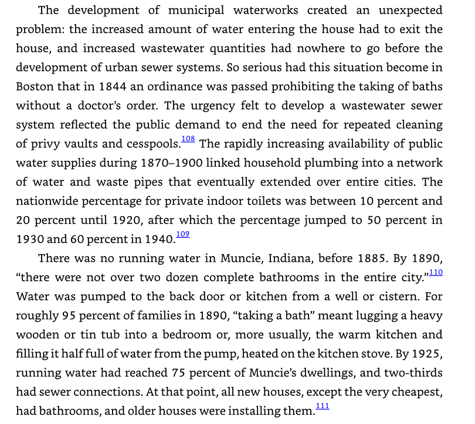

# 🐦 @emollick

## 📅 November 09, 2026

> 2 post(s) archived.

---

### 🕐 04:20 UTC · @emollick

> A favorite optimistic view of the future of AI is from a pessimistic book that not about AI: &quot;Rise and Fall of American Growth,&quot; which argues that we had a one-time explosion in living standards from 1870 and 1920 (&amp; later outside the US). In 1870: no toilets, no city plumbing, lamp light, no central heating, little public health, horses for local travel, etc. In 50 years, all of this was solved &amp; the nation was electrified. In the next fifty modern medicine, air travel and telecommunication happened. The book then points out that we have had no changes in lifestyle of similar scale since the 1970s. Written in 2016, it argued that we would likely never experience another boom like the &quot;Special Century.&quot; The positive view of AI should make us ask &quot;But what if we do?&quot; and &quot;How do we make it all go right?&quot;

🔗 [View original post](https://x.com/emollick/status/2119646219974697351)

---

### 🕐 04:08 UTC · @emollick

> It isn&apos;t that weird to think that &quot;this time is different&quot; - we had a couple of Industrial Revolutions over the past couple centuries, just because we got used to a relatively steady-state regime post World War Two with a regular pace of growth doesn&apos;t mean it continues forever. Across our projects @GoogleDeepMind, we are witnessing a genuine phase transition in the pace of scientific discovery. You will see a glimpse of this in our releases in the next few weeks.

🔗 [View original post](https://x.com/emollick/status/2119643350823211075)

---
