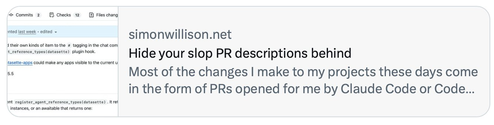
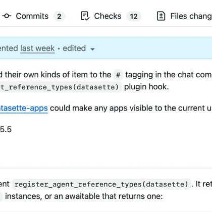

# 🐦 @simonw

## 📅 November 09, 2026

> 2 post(s) archived.

---

### 🕐 04:38 UTC · @simonw

> ... today I learned that Twitter preview cards can&apos;t handle HTML tags in post titles!

🔗 [View original post](https://x.com/simonw/status/2119650830534266885)

---

### 🕐 04:36 UTC · @simonw

> I&apos;ve recently started hiding the bulk of my AI-generated GitHub PR descriptions behind a collapsed &lt;details&gt;&lt;summary&gt; HTML tag (thankfully supported by GitHub Markdown) and I think it&apos;s a useful pattern for making PR slop a little bit less exhausting https://simonwillison.net/2026/Nov/9/details-summary/

🔗 [View original post](https://x.com/simonw/status/2119650353142747181)

---
