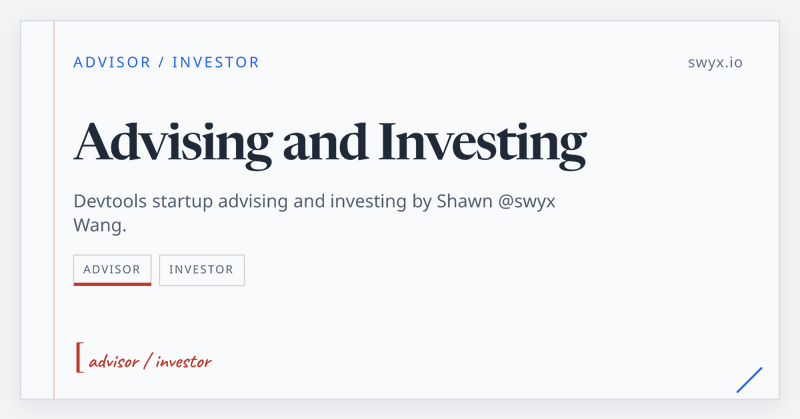
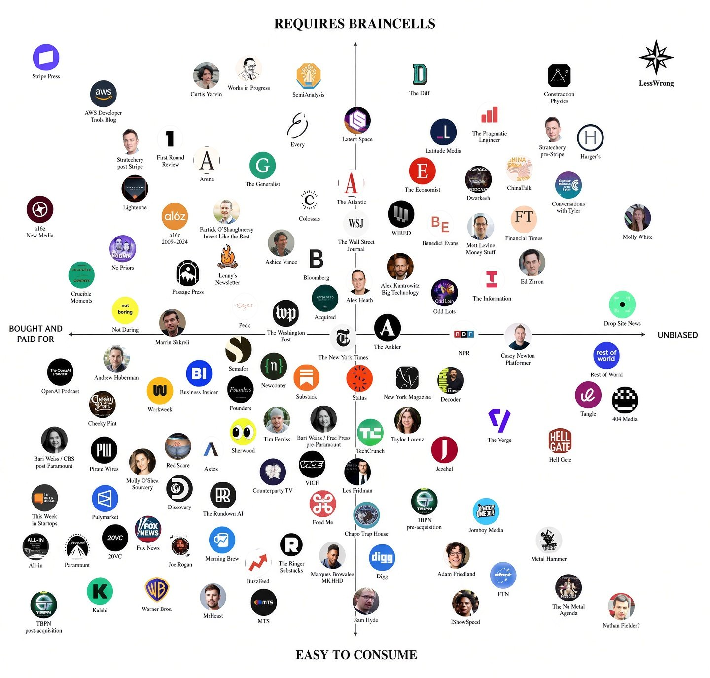
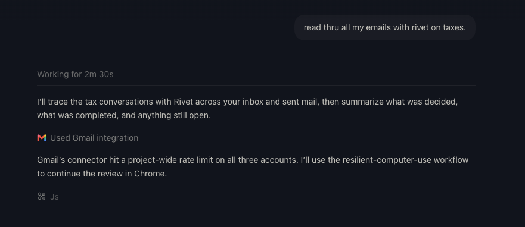

# 🐦 @swyx

## 📅 November 09, 2026

> 6 post(s) archived.

---

### 🕐 16:08 UTC · @swyx

> btw i have all my investments/equity/advising disclosed https://swyx.io/portfolio and we have only recently opened up for sponsorships so there was literally nothing to be bought and paid for + we have contractual editorial independence (detials ask business @ http://latent.space

🔗 [View original post](https://x.com/swyx/status/2119824433426878643)

---

### 🕐 16:08 UTC · @swyx

> someone made this a few weeks ago and it keeps getting sent to me and idk how i feel about @latentspacepod being smart but mid

🔗 [View original post](https://x.com/swyx/status/2119824420059697455)

---

### 🕐 15:09 UTC · @swyx

> starting a thread of all the ways in which gmail sucks for the eventual day i vibecode a total replacement Whenever I feel bad about a page I designed, I go to this link to make me feel better https://mail.google.com/mail#settings/general

🔗 [View original post](https://x.com/swyx/status/2119809574563922263)

---

### 🕐 08:39 UTC · @swyx

> good read on why humans, like llms, get a lot more powerful when given a scratchpad. [new blog post] Writing as a thinking tool https://muratbuffalo.blogspot.com/2026/11/writing-as-thinking-tool.html

![good read on why humans, like llms, get a lot more powerful when given a scratchpad. [new blog post] Writing as a thinking tool https://muratbuffalo.blogspot.com/2026/11/writing-as-thinking-tool.html](../../../../assets/images/2026/11/09/2119711420912939220-1.jpg)

🔗 [View original post](https://x.com/swyx/status/2119711420912939220)

---

### 🕐 02:00 UTC · @swyx

> are you listening anon? 2027 is gonna be about engines

🔗 [View original post](https://x.com/swyx/status/2119611058881192187)

---

### 🕐 00:24 UTC · @swyx

> when we can do anything, do we still know what we want? the full talk from @aiDotEngineer shanghai. every slide handmade in keynote, subs in 中文 and english Media

🔗 [View original post](https://x.com/ryolu_/status/2119586846657454152)

---
