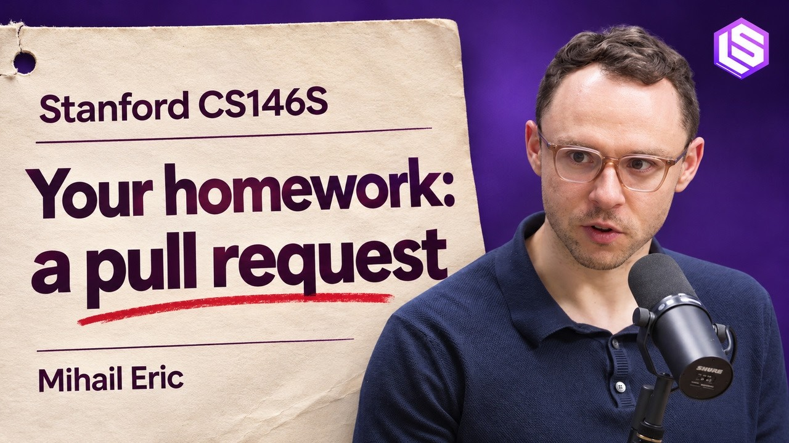

# 🐦 @swyx

## 📅 November 09, 2026

> 7 post(s) archived.

---

### 🕐 16:54 UTC · @swyx

> What do you teach computer science students when an agent can one-shot all of their homework? I sat down with @swyx on @latentspacepod to walk through how I&apos;m answering that in my Stanford course 𝗧𝗵𝗲 𝗠𝗼𝗱𝗲𝗿𝗻 𝗦𝗼𝗳𝘁𝘄𝗮𝗿𝗲 𝗗𝗲𝘃𝗲𝗹𝗼𝗽𝗲𝗿, and how the same ideas show up day to day at @MonacoGTM. Last year all students were just using tab complete. This year when I surveyed them, every one was regularly using autonomous agents. Exercises that once taught the workflow were starting to feel one-shotable. So the curriculum shifted toward judgment: 𝗕𝘂𝗶𝗹𝗱 𝘁𝗵𝗲 𝗵𝗮𝗿𝗻𝗲𝘀𝘀: students write a small coding agent from scratch (about 200 lines), then intercept the harness of a state of the art coding agent and read the system, plan, and compaction prompts. To effectively use and build agents you need to understand the loop they run in. 𝗟𝗲𝗮𝗿𝗻 𝘀𝗼𝗳𝘁𝘄𝗮𝗿𝗲 𝘁𝗮𝘀𝘁𝗲 𝗯𝘆 𝘀𝗵𝗶𝗽𝗽𝗶𝗻𝗴 𝘁𝗼 𝗿𝗲𝗮𝗹 𝘄𝗼𝗿𝗹𝗱 𝗰𝗼𝗱𝗲𝗯𝗮𝘀𝗲𝘀: part of the homework is contributing to open-source projects. Maintainers review the patch and help students build mental models of good software. An agent can draft the change but getting it accepted still requires appropriate context, architecture, and intent within a complex codebase 𝗨𝗻𝗱𝗲𝗿𝘀𝘁𝗮𝗻𝗱 𝘁𝗵𝗲 𝗰𝗵𝗮𝗻𝗴𝗲: before implementation, research an unfamiliar repo, propose a few approaches, and choose one. After the agent writes code, quiz yourself on the diff until you can defend it without reopening the file. At Monaco, that judgment is most of the job. When agents can build almost anything, the hard call is what&apos;s worth building. We buy tools to learn a space, then build only the pieces that have to fit our own infrastructure. Code review has stayed a bought product for a while (though that&apos;s starting to change!). Agent workspaces, where background agents run the app and test patches, we built ourselves. In a rapidly evolving space, staying nimble and adaptable is one of the few defensible skill sets.

🔗 [View original post](https://x.com/mihail_eric/status/2119836042270580846)

---

### 🕐 16:08 UTC · @swyx

> btw i have all my investments/equity/advising disclosed https://swyx.io/portfolio and we have only recently opened up for sponsorships so there was literally nothing to be bought and paid for + we have contractual editorial independence (detials ask business @ http://latent.space

🔗 [View original post](https://x.com/swyx/status/2119824433426878643)

---

### 🕐 16:08 UTC · @swyx

> someone made this a few weeks ago and it keeps getting sent to me and idk how i feel about @latentspacepod being smart but mid

🔗 [View original post](https://x.com/swyx/status/2119824420059697455)

---

### 🕐 15:09 UTC · @swyx

> starting a thread of all the ways in which gmail sucks for the eventual day i vibecode a total replacement Whenever I feel bad about a page I designed, I go to this link to make me feel better https://mail.google.com/mail#settings/general

🔗 [View original post](https://x.com/swyx/status/2119809574563922263)

---

### 🕐 08:39 UTC · @swyx

> good read on why humans, like llms, get a lot more powerful when given a scratchpad. [new blog post] Writing as a thinking tool https://muratbuffalo.blogspot.com/2026/11/writing-as-thinking-tool.html

![good read on why humans, like llms, get a lot more powerful when given a scratchpad. [new blog post] Writing as a thinking tool https://muratbuffalo.blogspot.com/2026/11/writing-as-thinking-tool.html](../../../../assets/images/2026/11/09/2119711420912939220-1.jpg)

🔗 [View original post](https://x.com/swyx/status/2119711420912939220)

---

### 🕐 02:00 UTC · @swyx

> are you listening anon? 2027 is gonna be about engines

🔗 [View original post](https://x.com/swyx/status/2119611058881192187)

---

### 🕐 00:24 UTC · @swyx

> when we can do anything, do we still know what we want? the full talk from @aiDotEngineer shanghai. every slide handmade in keynote, subs in 中文 and english Media

🔗 [View original post](https://x.com/ryolu_/status/2119586846657454152)

---
