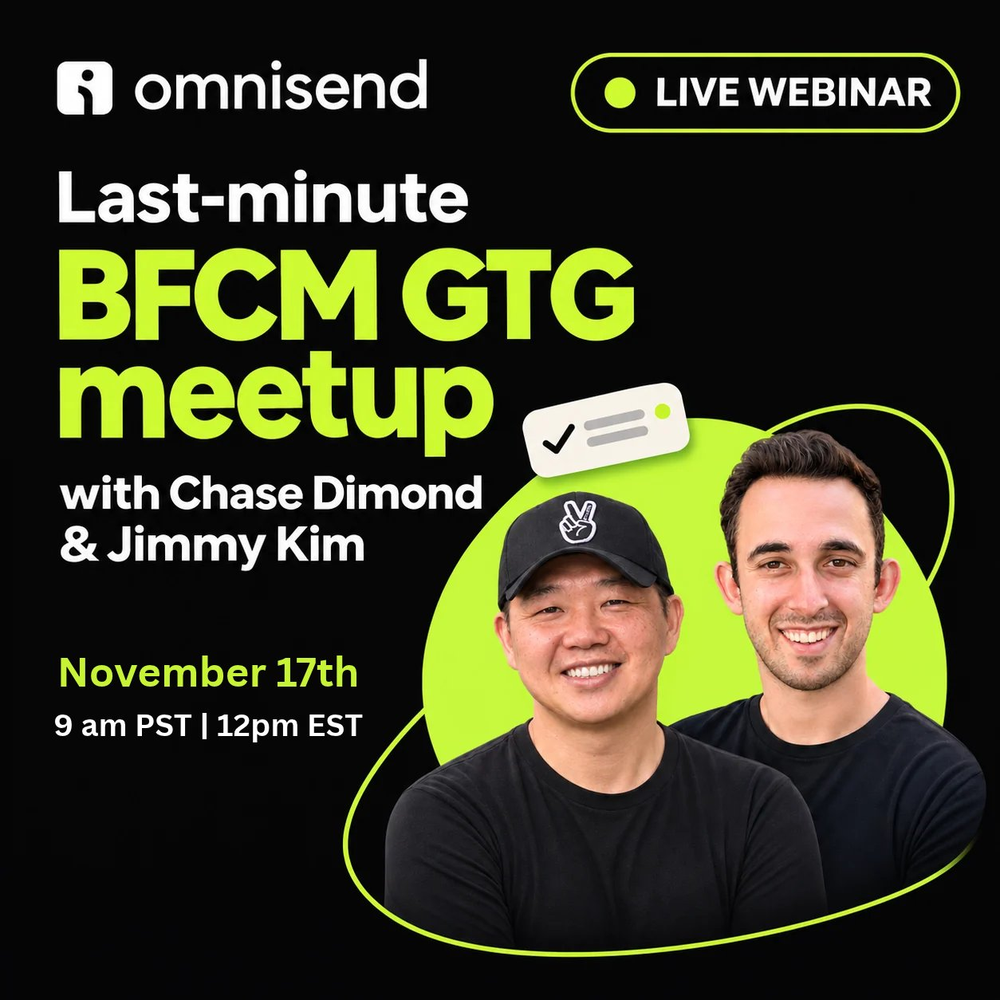

# 🐦 @AiEvolutio58513

## 📅 November 10, 2026

> 8 post(s) archived.

---

### 🕐 18:11 UTC · @AiEvolutio58513

> Someone put a voice agent on a business: 1. Gave the website to Fish Agent 2. It built the agent in &lt;15 seconds 3. Called it and asked several questions It answered all of them in a much better way than a typical front desk would. Go make one: https://s.fish.audio/z8ctge Media Introducing @FishAudio Live 3: a full-duplex voice model that listens, says &quot;mm-hmm,&quot; and knows when to shut up. Enterprise? Book a demo for your free custom agent: https://s.fish.audio/vxhgs6 Reply with your use case - we&apos;ll build it free for the first 1,000 people.

🔗 [View original post](https://x.com/ecomchasedimond/status/2120217737494704520)

---

### 🕐 18:04 UTC · @AiEvolutio58513

> Prediction: “what-if accuracy” becomes a standard reported metric for world models, and labs that publish their full-plan rate first get the credibility. IFM just did. Introducing PAN 2: an open foundation world model for physical intelligence. A language model predicts the next word. PAN 2 predicts the next world: what happens after each action, grounded in time, physics and space. Towards AI that simulates “what if?” before it acts. More det…

🔗 [View original post](https://x.com/ecomchasedimond/status/2120216156460220853)

---

### 🕐 17:48 UTC · @AiEvolutio58513

> Next week, @jimmykim and I are doing a free training to help you catch what&apos;s broken in your BFCM emails before they go out. Dead links, codes that don&apos;t apply, segments sending to the wrong people. We&apos;ll show you how we find all of it. If you send email for a brand, you&apos;ll want to be there. Tuesday, Nov 17 at 9am PT. Take 30 seconds and grab your spot: https://us02web.zoom.us/webinar/register/9017925114098/WN_LbJxFWPDTMqlPFof8RI2OA#/registration

🔗 [View original post](https://x.com/ecomchasedimond/status/2120212033945919806)

---

### 🕐 16:34 UTC · @AiEvolutio58513

> Sam Altman says 38,000 ChatGPT questions use about as much water as growing a single almond: &quot;For every 38,000 ChatGPT queries, that&apos;s the same amount of water used to produce a single almond in California.&quot; &quot;People eating 12 almonds at a time don&apos;t feel like they&apos;re doing something horrible from a water perspective.&quot; &quot;Modern, very large data centers use roughly the same amount of water as an office building.&quot; &quot;That&apos;s been a robust meme and difficult to disprove, but I don&apos;t think it holds up to any scrutiny.&quot; Interested in AI? Follow @AiEvolutio58513 and never fall behind. I track ChatGPT, Claude, and every tool quietly changing how we work and create, then hand you the tested signals. Media

🔗 [View original post](https://x.com/AiEvolutio58513/status/2120193333968683357)

---

### 🕐 14:58 UTC · @AiEvolutio58513

> Palantir CEO Alex Karp says the smartest people hide how smart they are: &quot;One of the ways you make it to the top is you hide how smart you are.&quot; &quot;Every single person who has shared how intelligent they are tells you how stupid they are.&quot; Interested in AI? Follow @AiEvolutio58513 and never fall behind. I track ChatGPT, Claude, and every tool quietly changing how we work and create, then hand you the tested signals. Media

🔗 [View original post](https://x.com/AiEvolutio58513/status/2120169161553047767)

---

### 🕐 12:58 UTC · @AiEvolutio58513

> Google just proved AI data centers in space actually work. Project Suncatcher&apos;s first satellite carried 4 TPUs into orbit on a SpaceX rocket. Google sent a prompt up from Earth, the TPU in orbit ran Gemma, and the full answer came back down. SpaceX launches its own StarMind satellites with NVIDIA GPUs on Starship in late 2027. The race to move AI off the planet has started. Interested in AI? Follow @AiEvolutio58513 and never fall behind. I track ChatGPT, Claude, and every tool quietly changing how we work and create, then hand you the tested signals. Media

🔗 [View original post](https://x.com/AiEvolutio58513/status/2120138998199078979)

---

### 🕐 11:02 UTC · @AiEvolutio58513

> Dario Amodei says the people who mocked his GPT-2 warnings in 2019 are now applying for jobs at AI labs: &quot;I personally was super freaked out by [GPT-2]. I looked at it and I said, my God, you just scale this thing up another factor of a million and it&apos;ll be better than humans at everything.&quot; &quot;This is going to determine the fate of nations and economies and the future of humanity.&quot; &quot;Maybe 10% of the people around me had exactly the same reaction, and it was often the smartest ones.&quot; &quot;But people would look at it and say, in any particular area, that doesn&apos;t seem so smart. And so many people just shrugged and they just dismissed it.&quot; Interested in AI? Follow @AiEvolutio58513 and never fall behind. I track ChatGPT, Claude, and every tool quietly changing how we work and create, then hand you the tested signals. Media

🔗 [View original post](https://x.com/AiEvolutio58513/status/2120109799945961562)

---

### 🕐 08:01 UTC · @AiEvolutio58513

> Elon Musk explains why he told SpaceX recruits &quot;we&apos;re probably going to die&quot;: &quot;With SpaceX, I think there&apos;s like a less than 10% chance of being successful, maybe 1%. But if a startup doesn&apos;t do something to advance rocket technology, it&apos;s definitely not coming from the big defense contractors. So a small chance of success is better than no chance of success.&quot; He didn&apos;t sell it as a sure thing: &quot;I started that in mid 2002 expecting to fail. Even when recruiting people, I didn&apos;t try to make out that it would succeed. I said, we&apos;re probably going to die, but there&apos;s maybe a 10% chance we might not die, and this is the only way to get people to Mars.&quot; That&apos;s how he ended up running the engineering himself: &quot;I ended up being chief engineer of the rocket, not because I wanted to, but because I couldn&apos;t hire anyone who was good. None of the good chief engineers would join, because they said this is too risky, you&apos;re going to die.&quot; And the odds were about right: &quot;The first three flights did fail. The fourth one fortunately worked. But if the fourth one hadn&apos;t worked, I had no money left, it would have been curtains. We made it by the skin of our teeth.&quot; Interested in AI? Follow @AiEvolutio58513 and never fall behind. I track ChatGPT, Claude, and every tool quietly changing how we work and create, then hand you the tested signals. Media

🔗 [View original post](https://x.com/AiEvolutio58513/status/2120064200798278051)

---
