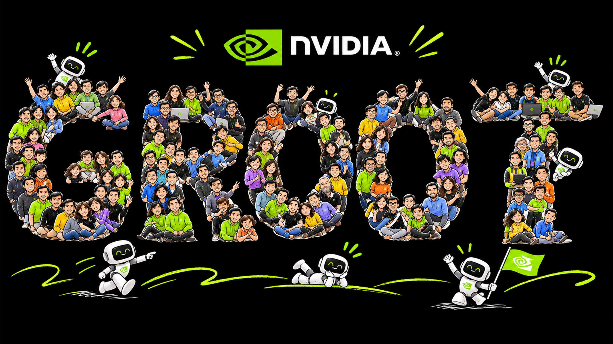

# 🐦 @DrJimFan

## 📅 November 10, 2026

> 3 post(s) archived.

---

### 🕐 16:16 UTC · @DrJimFan

> GR00T 2 is brought to you with so many sleepless nights and so much 💚 from NVIDIA, Team Green! Thanks to everyone who poured their hearts and souls into it!

🔗 [View original post](https://x.com/DrJimFan/status/2120188737439322174)

---

### 🕐 16:07 UTC · @DrJimFan

> Please check out Yuke&apos;s deep dive thread! https://x.com/yukez/status/2119880324075377094?a=XKwEEJX2smDkqCQtDhA&amp;s=20 Meet GR00T 2, our new generation of world-action models (WAMs): it imagines how the physical world will unfold and generates the actions that get it there. One model runs on parallel grippers, dexterous hands, and humanoids. http://research.nvidia.com/labs/gear/gr00t-2

🔗 [View original post](https://x.com/DrJimFan/status/2120186654937751928)

---

### 🕐 16:07 UTC · @DrJimFan

> Introducing GR00T 2: our most advanced, open System One model for robotics. It runs entirely on your robot’s onboard compute, fully untethered, and you own every weight of it. GR00T 2 features: 1. Long-horizon tasks: dexterous manipulation and whole-body control chained over 20+ steps and 5+ minutes, such as performing chemistry lab experiments or assembling model airplanes end to end. 2. X-Adapt: adapting from easy data sources (human wearables and simulation) and deploying zero-shot to diverse real robots. 3. Unified Cognition: native integrations with frontier agents for advanced physical reasoning, robust error recovery, and safety monitoring. It&apos;s an open-source buffet! We are releasing not only the model weights and X-Adapt recipes (coming December), but also our agentic framework, simulation engine, annotation engine, hardware design, and even training data (100K hours, that&apos;s ~11 yrs of experience), all available today! Everything that moves will be autonomous. Anyone can become a roboticist. Lock in, build with us! Deep dive in thread: Media

🔗 [View original post](https://x.com/DrJimFan/status/2120186651741655428)

---
