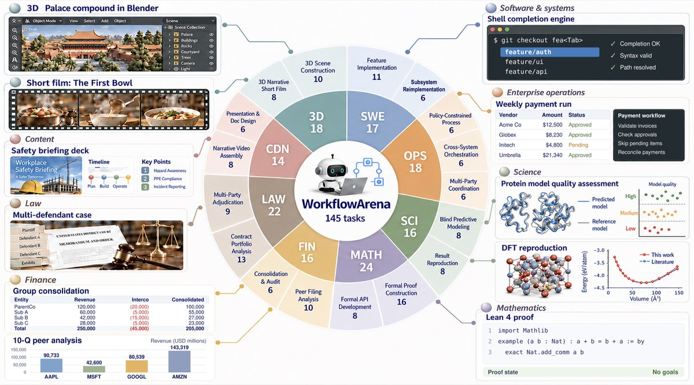
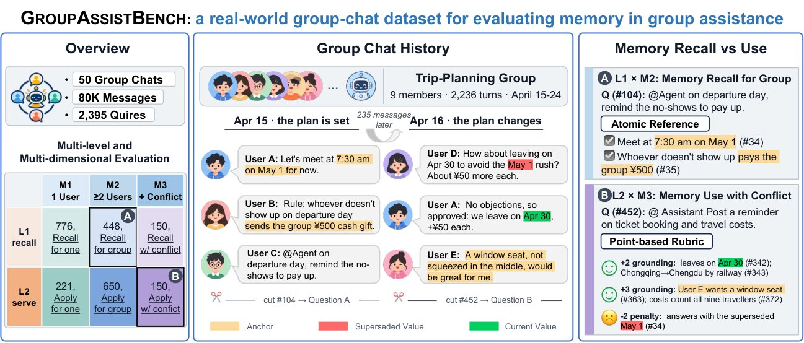
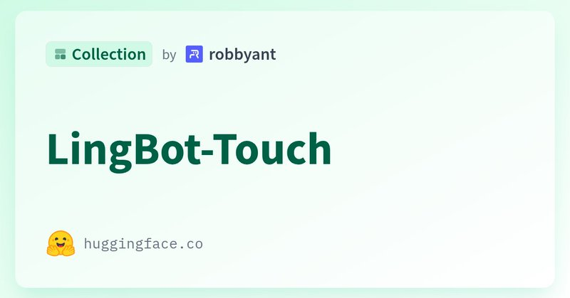

# 🐦 @_akhaliq

## 📅 November 10, 2026

> 3 post(s) archived.

---

### 🕐 14:30 UTC · @_akhaliq

> Agent harnesses now let a model spawn its own workers and write the workflow that coordinates them. But can it actually orchestrate them well? Introducing Einsia AI&apos;s WorkflowArena, the first benchmark for autonomous multi-agent workflow orchestration on real, long-horizon work. - 145 tasks across 8 professional domains, from SWE and Lean proofs to law and 3D - 25 configurations of 9 frontier models in Claude Code &amp; Codex - Every delegation recorded: we score the deliverable and see the workflow behind it 🌐 Project: https://lab.einsia.ai/workflowarena 💻 GitHub: https://github.com/Einsia/WorkflowArena 📄 Paper: https://arxiv.org/pdf/2611.12856 ⬇️ Read the following threads to go through the key findings

🔗 [View original post](https://x.com/EinsiaAI/status/2120162063905681632)

---

### 🕐 08:38 UTC · @_akhaliq

> Tencent just released a real-world group memory benchmark on Hugging Face It tests whether AI assistants can go beyond recalling past chats to actually using those memories to help group members

🔗 [View original post](https://x.com/HuggingPapers/status/2120073520298209353)

---

### 🕐 08:22 UTC · @_akhaliq

> LingBot-Touch A Foundation Model for Heterogeneous Tactile Representation Learning https://huggingface.co/collections/robbyant/lingbot-touch

🔗 [View original post](https://x.com/_akhaliq/status/2120069540680011974)

---
